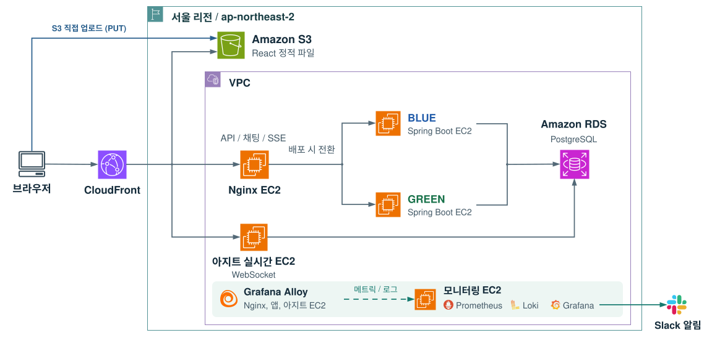
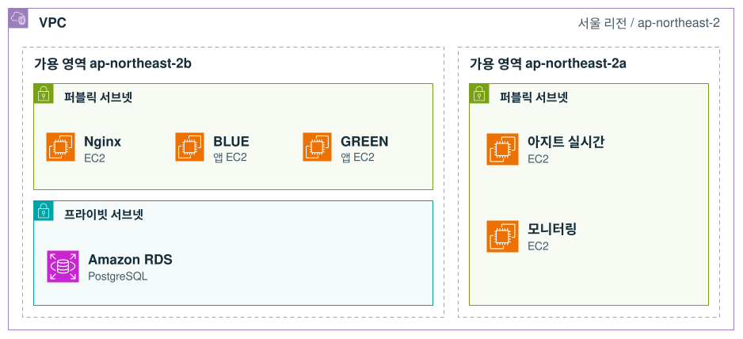

# 자리하나?

## 서비스 소개

**자리하나?** 는 모임을 찾고 직접 만들며 우리 모임만의 3D 공간인 **아지트**를 꾸밀 수 있는 서비스입니다.

함께하고 싶은 사람을 초대해 아지트에서 만나 보세요. 멤버들과 다음 약속을 잡고 함께한 활동은 사진과 글로 남길 수 있습니다.

## 주요 기능

| 기능                     | 할 수 있는 일                                                                                                                                                              |
| ------------------------ | -------------------------------------------------------------------------------------------------------------------------------------------------------------------------- |
| 모임 탐색과 참여         | 이름, 유형, 모집 상태로 모임을 찾습니다. 일정과 남은 자리를 확인한 뒤 참여를 신청하고 마이페이지에서 결과를 확인합니다.                                                    |
| 모임 제안과 모집         | 자유게시판에 아이디어를 올려 함께하고 싶은 사람과 가능한 시간을 알아봅니다. 모임을 열 때는 바로 가입하거나 모임장이 승인하는 방식을 고르고 초대 링크를 공유할 수 있습니다. |
| 모임 꾸미기 (아지트)     | 스터디와 동아리의 모임장은 3D 모임방에 가구를 배치하고 벽과 바닥 테마를 바꿀 수 있습니다. 멤버들은 아바타로 방 안을 걸어 다니거나 의자에 앉을 수 있습니다.                 |
| 채팅과 일정              | 멤버 전용 채팅방에서 대화하고 모임 캘린더에서 정기 일정과 개별 약속을 확인합니다.                                                                                          |
| 활동 기록                | 모임 사진과 후기를 올리고 댓글과 하트로 반응을 주고받습니다.                                                                                                               |
| 토론과 게임              | '토론하나?'에서는 주제에 대한 입장을 고르고 상대의 한마디에 답합니다. '게임하나?'에서는 친구와 오목을 두거나 리듬 작살에 도전할 수 있습니다.                               |

## 프로젝트 아키텍처

가용 영역과 서브넷 보기

[diagrams.net 편집 원본](docs/readme/service-architecture.drawio)

### CI/CD

## 기술 스택

### 프론트엔드

| 구분 | 기술 |
| --- | --- |
| 언어와 UI |    |
| 라우팅 |  |
| 서버 상태 관리 |  |
| 폼과 입력 검증 |   |
| 실시간 통신 |  |
| 3D 렌더링 |  |
| 빌드 |  |
| 테스트 |    |

### 백엔드

| 구분 | 기술 |
| --- | --- |
| 언어와 프레임워크 |   |
| 인증과 세션 |   |
| 실시간 통신 |   |
| 데이터 관리 |    |
| 테스트 |    |

### 인프라

| 구분 | 기술 |
| --- | --- |
| AWS |   |
| 컨테이너와 웹 서버 |   |
| CI/CD |   |
| 모니터링 |     |
| 제품 분석 |  |

## 팀원

|                                                                이삭                                                                |                                                                  요크                                                                  |                                                                 파도                                                                 |                                                                 에덴                                                                 |
| :--------------------------------------------------------------------------------------------------------------------------------: | :------------------------------------------------------------------------------------------------------------------------------------: | :----------------------------------------------------------------------------------------------------------------------------------: | :----------------------------------------------------------------------------------------------------------------------------------: |
|  |  |  |  |
|                                               [@5jonyuk](https://github.com/5jonyuk)                                               |                                               [@Sauter001](https://github.com/Sauter001)                                               |                                               [@choubung](https://github.com/choubung)                                               |                                               [@RealTake](https://github.com/RealTake)                                               |
