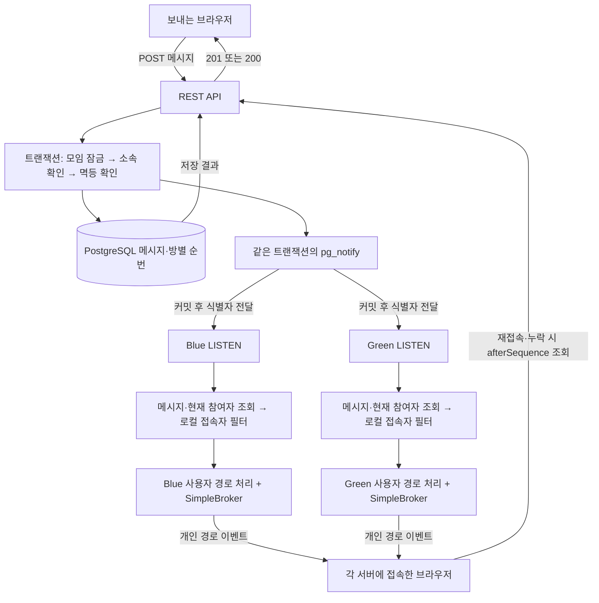

# 백엔드 ADR 0028. 모임 채팅은 DB 순번과 개인 경로로 복구한다

- 상태: 채택, 로컬 구현 / 운영 적용 대기
- 결정일: 2026-10-25
- 보완일: 2026-10-26
- 관련 문서: [공통 채팅 계약](../../../docs/chat-implementation-contract.md), [프론트엔드 ADR 0004](../../../frontend/docs/adr/0004-chat-event-recovery.md), [블루그린 배포 절차](../../../infra/BLUEGREEN.md)

## 배경

자리하나 채팅은 참여한 모임 안에서 약속을 잡고 대화를 이어가는 기능이다. 한 사용자가 여러 모임에
들어갈 수 있고, 여러 창을 열거나 배포 중 다른 서버로 재접속할 수도 있다. 모임이 끝나면 이전
대화는 남겨 두고 새 메시지는 즉시 막기로 했다.

처음에는 UI와 인메모리 저장으로 사용 흐름을 확인했다. 실제 기능에서는 재시작 후에도 대화가
남아야 하고, Blue와 Green에 나뉘어 접속한 사용자끼리도 대화가 오가야 한다.
이 과정에서 REST 전송, 방별·개인별 구독, 강퇴 처리, 참여자 테이블, 서버 간 전달 방식을 비교했다.

## 결정 요약

| 고민 | 선택 | 선택 이유 | 감수하는 비용 |
| --- | --- | --- | --- |
| 메시지 저장·전송 | REST로 저장, WebSocket으로 수신 | 기존 인증·오류 응답·재시도 흐름 재사용 | HTTP 결과와 실시간 이벤트를 합치는 클라이언트 로직 |
| 구독 단위 | 개인 경로 하나 | 여러 모임의 메시지·읽음·종료 이벤트를 한 경로에서 처리 | 서버가 현재 참여자를 조회해 사용자별로 발행 |
| 발행 대상 | 현재 참여자 중 로컬 접속자 | 오프라인 사용자와 다른 서버 접속자에 대한 발행 호출 생략 | 전체 참여자 조회·순회는 남음 |
| 서버 간 전달 | PostgreSQL `LISTEN/NOTIFY` | 기존 DB로 Blue·Green 사이의 변경 소식 전달 | 모든 listener의 DB 조회, 전용 연결, 장애 복구 처리 |
| 누락 복구 | DB의 방별 순번으로 REST 조회 | 재접속 후 놓친 메시지를 범위로 조회 | 클라이언트 커서·병합·주기적 동기화 관리 |
| 참여 권한 | 기존 `GroupMember` | 모임 소속과 채팅 소속을 한곳에서 관리 | 독립 채팅방·채팅만 나가기에는 모델 확장 필요 |
| 읽음 상태 | 별도 `chat_read_state` | 사람마다 다른 읽음 위치 저장 | 읽음 갱신과 미확인 수 집계 비용 |
| 모임 종료 | 즉시 읽기 전용 | 종료 후 새 대화는 막고 기록은 열어 둠 | 종료와 전송의 동시 실행 순서 관리 |
| 강퇴 | 개인 발행 단계에서 현재 소속 확인하는 구조 선택 | 다른 모임 연결을 유지하며 수신 대상 제외 가능 | 강퇴 API·권한 회수 시점·재가입 정책은 후속 구현 |

## 전체 구조

브라우저는 `/api/ws/chat`에 연결하고 `/user/queue/chat-events` 하나를 구독한다.
서버는 `convertAndSendToUser(memberId, "/queue/chat-events", event)`로 발행한다.
`Principal.getName()`과 발행에 쓰는 회원 ID 문자열을 맞춘다.

Spring의 `UserDestinationMessageHandler`가 개인 경로를 세션별 목적지로 바꾸고,
SimpleBroker가 그 목적지의 구독 세션으로 전달한다. 한 회원이 여러 창에서 구독하면 각 창이 받는다.
현재 SimpleBroker 설정에서 `/queue`는 목적지 접두사이고 사용자별 분리는 `/user` 처리에서 이루어진다.
[Spring 사용자 경로 문서](https://docs.spring.io/spring-framework/reference/web/websocket/stomp/user-destination.html)

### 엔드포인트의 역할

| 경로 | 용도 | 처리 기준 |
| --- | --- | --- |
| `GET /api/chats` | 내 모임 목록, 최근 메시지, 미확인 수, 이름 검색 | 현재 소속 기준. 메시지가 없는 방도 포함 |
| `GET /api/groups/{groupId}/chat/messages` | 최초 이력·이전 대화 | `beforeSequence`로 과거 조회 |
| 같은 GET의 `afterSequence` | 마지막으로 동기화한 순번 이후 복구 | `hasNext`가 끝날 때까지 페이지 조회 |
| `POST /api/groups/{groupId}/chat/messages` | 메시지 저장 | 첫 저장 201, 같은 요청·본문 재시도 200, 키에 다른 본문을 보내면 409 |
| `PUT /api/groups/{groupId}/chat/read` | 본인의 읽음 위치 갱신 | 저장된 순번 범위 안에서 앞으로만 이동 |
| `/api/ws/chat` | 인증된 WebSocket 연결 | 쿠키·Origin·CONNECT CSRF 검사 |
| `/user/queue/chat-events` | 개인 이벤트 구독 | HTTP URL이 아닌 STOMP 목적지 |

요청·응답 필드와 페이지 크기는 [공통 채팅 계약](../../../docs/chat-implementation-contract.md)이 관리한다.

## 전송과 구독 방식 비교

### 메시지를 REST로 보내는 이유

| 방식 | 장점 | 단점·한계 | 판단 |
| --- | --- | --- | --- |
| **REST 전송 + WebSocket 수신** | HTTP 인증·검증·상태 코드 재사용. 저장 결과와 재시도 기준이 명확함 | HTTP 요청 비용, 응답과 이벤트의 도착 순서 처리 | 채택 |
| WebSocket으로 송수신 | 연결 하나로 명령과 이벤트 처리. 빈번한 양방향 명령에 적합 | 저장 완료 응답, 오류, 요청 ID, 재시도·인증 처리를 STOMP 위에 별도로 설계 | 보류 |
| REST 전송 + 주기적 polling | 구현·문제 재현이 쉬움 | 요청 주기만큼 수신이 늦고 변화가 없어도 조회 | 초기 프로토타입에 사용 |

현재는 메시지 저장이 중심이고 타이핑·접속 상태처럼 빈번한 임시 이벤트는 없다.
그래서 저장 명령은 기존 REST 흐름에 두고, 실시간 도착 알림에 WebSocket을 쓴다.
HTTP 응답을 잃으면 같은 `clientMessageId`와 원문으로 다시 요청한다.
실시간 이벤트가 HTTP 응답보다 먼저 도착해도 같은 메시지로 병합한다.

### 방별 구독과 개인 경로 하나

| 방식 | 클라이언트 구독 | 장점 | 단점·한계 | 현재 판단 |
| --- | --- | --- | --- | --- |
| 방별 topic | 가입한 방마다 구독하거나 열린 방만 구독 | 서버가 방에 한 번 발행하면 브로커가 구독자에게 분배 | 방 이동·재접속 시 구독 관리. 강퇴 후 기존 구독의 전달 차단 필요 | 대형 방에서 재검토 |
| **개인 경로 하나** | 자신의 경로 하나 | 모임별 이벤트와 여러 창의 읽음 상태를 한 흐름으로 처리 | 사용자별 발행, 열지 않은 방의 본문도 수신 | 채택 |
| 개인 요약 + 열린 방 topic | 개인 요약 경로와 현재 방 구독 | 닫힌 방은 목록 정보만 받고 열린 방만 본문 수신 | 두 스트림의 순서·구독 경쟁·권한 회수 관리 | 수신량이 커질 때 검토 |

개인 경로는 1:1 채팅과 단체 채팅에 모두 사용할 수 있다. 같은 모임 메시지를 참여자 각각의 경로에
보내면 단체 대화가 된다. 방별 topic에서도 최종 네트워크 전송은 수신 세션 수만큼 발생한다.

예를 들어 A·B 모임에 참여한 사용자가 A 대화를 열어 둔 상태에서 B에 새 글이 올라오면,
현재 구조는 B의 본문도 개인 이벤트로 보낸다. 화면에서는 B의 최근 메시지와 미확인 수를 갱신한다.
채팅 연결이 열린 동안 이렇게 동작한다. 모달을 닫았을 때의 상시 수신은 현재 프론트엔드 범위에 없다.

현재 요구사항은 여러 모임의 목록 갱신과 소속 기반 권한 처리를 함께 다루는 데 무게를 뒀다.
방별 topic을 유지하는 안도 비교했지만 최종적으로 **개인 경로 하나 + 로컬 접속자 사전 필터**를 선택했다.

### 로컬 접속자 필터가 줄이는 작업

`ChatEventDispatcher`는 메시지를 조회하고 현재 참여자 ID를 한 번에 가져온다.
각 ID에 대해 `SimpUserRegistry.getUser()`를 확인한 뒤, 이 서버에 접속한 사용자에게만 발행한다.
읽음 이벤트는 대상 사용자의 로컬 접속 여부를 먼저 확인한 후 읽음 상태를 조회한다.

아래는 **참여자 1,000명 중 이 서버의 접속자가 10명이고 각자 한 세션으로 구독한 가정**이다.

| 메시지 한 건당 작업 | 사전 필터 없음 | 현재 사전 필터 |
| --- | ---: | ---: |
| 참여자 ID 조회·순회 | 1,000명 | 1,000명 |
| 사용자별 발행 호출 | 1,000회 | 10회 |
| 실제 수신 대상 | 10세션 | 10세션 |

필터는 메시지 변환·채널 전달로 넘어가는 호출을 줄인다. 메시지 조회와 전체 참여자 순회는 남는다.
여러 서버가 같은 NOTIFY를 받으므로 서버 수를 S, 방 참여자를 N이라 하면 참여자 순회는 메시지마다
대략 S × N 규모로 늘어난다. 각 서버는 자기 접속자에게만 발행하며 분산 user registry broadcast는 사용하지 않는다.

참여자 대부분이 접속 중이면 생략할 호출이 적고 사전 조회가 추가된다.
접속 확인 직후 연결이 끊기거나 새로 연결되는 경우에는 REST 동기화로 메시지를 다시 맞춘다.
위 숫자는 작업 횟수 예시다. 성능 차이는 온라인 비율과 메시지 빈도를 바꿔 측정해야 한다.

## 참여자와 저장 구조

| 테이블 | 책임 | 주요 키·기준 |
| --- | --- | --- |
| 기존 `groups` | 모임 정보·상태, 쓰기 잠금 기준 | `id` |
| 기존 `group_member` | 현재 참여 권한 | 모임·회원 소속 |
| `chat_room` | 모임별 마지막 메시지 순번 | `group_id` PK, 첫 메시지 저장 때 생성 |
| `chat_message` | 메시지 원문과 재시도 식별자 | `(group_id, sequence)`, `(group_id, sender_id, client_message_id)` unique |
| `chat_read_state` | 회원별 읽음 위치 | `(group_id, member_id)` PK |

채팅방은 모임과 1:1이며 방 ID로 모임 ID를 사용한다.
별도 `chat_member`를 만들면 가입·승인·초대·탈퇴 때 두 소속을 맞춰야 하므로 기존 `GroupMember`를 사용한다.
읽음 테이블의 행은 접근 권한으로 쓰지 않는다. 모든 조회·쓰기와 발행 대상 선정에서 현재 소속을 확인한다.

새 참여자는 가입 시점의 마지막 순번을 읽음 기준으로 저장한다. 이전 대화도 열람할 수 있지만
가입 전 메시지는 미확인 수에서 제외한다. 도입 전에 가입한 회원은 읽음 행이 없으면 0부터 계산한다.
모임 생성, 선착순 가입, 승인, 초대 수락에서 소속 저장 직후 동기식 `ChatLifecycleEvent`를 발행하고,
`MANDATORY` 트랜잭션에서 기준을 초기화해 소속과 함께 커밋·롤백한다.

독립 채팅방, 채팅만 나가기, 재가입 전후의 이력 공개 범위를 도입하면 소속 모델을 다시 검토한다.
현재 `initializeRead`는 기존 행을 유지하므로 재가입 시 기준을 새로 잡을지는 별도 정책이 필요하다.

### 저장 순서와 동시 요청

1. `groups` 행을 `FOR UPDATE`로 잠그고 현재 소속을 확인한다.
2. 같은 방·발신자·`clientMessageId`로 저장된 메시지가 있는지 확인한다.
3. 기존 본문이 같으면 그 결과를 반환하고 다르면 409를 반환한다.
4. 새 요청이면 모임이 `ACTIVE`인지 확인한 뒤 방 순번을 증가시키고 메시지를 저장한다.
5. 같은 트랜잭션에서 `pg_notify`를 실행한다.

모임 종료·삭제도 같은 모임 잠금과 순서를 공유한다. 종료 전에 저장된 요청은 종료 후에도
현재 참여자가 같은 키로 결과를 다시 확인할 수 있다. 새 메시지는 종료 상태 검사에서 거절한다.
방별 쓰기가 잠금에서 직렬화되므로 한 방에 전송과 읽음 갱신이 몰리면 대기가 늘어난다.

`chat_message.id`는 메시지 식별과 중복 병합에 쓰고, `sequence`는 방 안의 정렬·누락 조회에 쓴다.
이력은 `REPEATABLE READ`에서 소속·최신 순번·메시지를 같은 snapshot으로 읽는다.
읽음은 현재 저장된 순번 이하만 허용하고 `greatest`로 갱신해 오래된 요청이 읽음 위치를 되돌리지 않게 한다.
미확인 수는 읽음 위치 뒤의 다른 사람 메시지만 센다.

초대 수락의 기존 낙관적 잠금은 유지한다. 현재 IDENTITY 소속 INSERT의 group FK `KEY SHARE`와
메시지의 `FOR UPDATE` 충돌을 이용해 가입 기준 순번을 잡는다. FK·ORM 저장 전략·잠금 변경 시
`ChatPersistenceTest.membershipInsertProtectsBaselineUntilCommit`을 함께 확인해야 한다.
관련 결정은 [백엔드 ADR 0020](0020-optimistic-invitation-acceptance.md)에 있다.

채팅 repository는 `RETURNING`, `ON CONFLICT`, `pg_notify`, 커서 집계를 직접 표현하려고 JDBC를 사용한다.
기존 JPA와 같은 DataSource의 트랜잭션에 참여하며 SQL은 repository 안에 둔다.

## 강퇴 방안 비교

세 대화에서는 연결 종료, 구독 제거, 메시지 전달 차단을 비교했다.
강퇴 시 해당 모임의 읽기·쓰기·수신을 막으면서 다른 모임의 대화는 유지하는 방향을 택했다.

| 방안 | 장점 | 단점·한계 | 판단 |
| --- | --- | --- | --- |
| 클라이언트에 구독 해제 요청 | 화면 정리가 간단함 | 요청을 무시하면 기존 구독이 남음 | 서버 차단에 더하는 UI 처리 |
| WebSocket 세션 종료 | 연결에 속한 구독을 한 번에 정리 | 다른 모임도 끊김. 재연결 권한 검사 필요 | 계정 단위 차단에 검토 |
| **현재 참여자에게 개인별 발행** | 다른 방 연결을 유지하며 대상에서 제외 | 메시지마다 참여자 조회·사용자별 발행 | 현재 구조에 채택 |
| topic + outbound interceptor | 방별 발행을 유지하며 전송 단계에서 차단 | 세션·방별 권한 검사와 캐시 무효화, 동시 실행 처리 | topic 전환 시 대안 |
| SimpleBroker 구독 관리 확장 | 특정 방 구독을 서버에서 직접 관리 | 구독 registry와 캐시 일관성, 프레임워크 결합 부담 | 현 단계 보류 |
| 외부 브로커의 구독·권한 제어 | 여러 서버의 라우팅을 브로커로 분리 | 브로커 운영과 앱 소속 변경 연동 필요 | 규모 확대 시 검토 |

`ChannelInterceptor`는 채널의 메시지 처리 지점에 붙일 수 있다.
inbound의 SUBSCRIBE 검사 뒤에 사용자가 강퇴되면 기존 구독은 남으므로, topic 방식에서는
outbound 차단이나 구독 회수도 필요하다. outbound interceptor를 쓰는 안과 SimpleBroker 내부를
확장하는 안은 별도 대안으로 다룬다.
[Spring 인터셉터 문서](https://docs.spring.io/spring-framework/reference/web/websocket/stomp/interceptors.html)

**현재 구현에는 모임 강퇴·나가기 API가 없다.** 현재 소속을 확인하는 전달 구조와 모임 전체의
종료·삭제 처리가 들어 있다. `ROOM_REMOVED`는 현재 모임 삭제 때 보내는 이벤트다.

강퇴 기능을 추가할 때는 소속 제거, 전송·이력 권한 검사, 대상자 화면 정리와 재가입 정책을 함께 구현한다.
참여자 조회가 끝난 직후 강퇴가 커밋되면 이미 큐에 들어간 메시지가 도착할 수 있다.
강퇴 완료 시점 이후의 전달까지 막아야 한다면 발행 직전 권한 버전 검사나 전송 단계 동기화가 추가로 필요하다.
이미 받은 본문은 사용자 브라우저에 남을 수 있으므로 이력 공개 정책도 함께 결정한다.

## 서버 간 전달과 장애 복구

### 전달 수단 비교

| 방식 | 장점 | 단점·한계 | 판단 |
| --- | --- | --- | --- |
| 서버 메모리 + SimpleBroker | 프로토타입이 간단함 | 재시작 시 이력 손실, 다른 서버의 접속자에게 전달 경로 없음 | 초기 UI 확인에 사용 |
| DB 저장 + 커밋 후 앱에서 발행 | 저장 완료 후 알림을 보냄 | 커밋 직후 프로세스가 종료되면 발행이 빠질 수 있음 | 현재 구조 대신 동일 트랜잭션 NOTIFY 사용 |
| **DB 저장 + 같은 트랜잭션의 NOTIFY** | 별도 브로커 없이 커밋한 변경을 각 서버에 알림 | listener가 끊긴 동안의 신호는 REST로 복구. 서버마다 조회 비용 발생 | 채택 |
| DB + Redis Pub/Sub | DB 외부로 실시간 신호 전달을 분리 | Redis 운영, 저장과 발행 사이 실패 처리, 구독 단절 복구 필요 | 전달 부하가 병목이면 검토 |
| Outbox + 재시도 worker·외부 브로커 | 발행 대기를 DB에 남기고 다시 시도 | worker·정리·중복 소비·적체 운영 비용 | 이벤트 자체의 재처리가 필요할 때 검토 |

메시지·읽음·종료·삭제 변경과 `pg_notify`는 같은 트랜잭션에서 실행한다.
NOTIFY payload에는 버전·종류·식별자를 넣고 본문은 DB에서 읽는다.
모임 삭제는 삭제 직전 참여자별 식별자를 알림에 넣은 뒤 채팅 행을 FK cascade로 지운다.
PostgreSQL은 트랜잭션이 커밋되면 알림을 전달하고 롤백하면 함께 취소한다.
[PostgreSQL 17 NOTIFY 문서](https://www.postgresql.org/docs/17/sql-notify.html)

각 서버의 listener는 애플리케이션 pool과 별도의 JDBC 연결 하나를 쓴다.
연결을 복구하거나 dispatch에 실패하면 로컬 접속자에게 `RESYNC_REQUIRED`를 보내고,
브라우저가 목록과 열린 방의 DB 이력을 다시 조회한다.
구독 직후, 재접속, online·화면 복귀, 활성 화면의 30초 확인에서도 같은 복구를 실행한다.

| 상황 | 사용자에게 생기는 현상 | 현재 처리 |
| --- | --- | --- |
| 저장 후 HTTP 응답 유실 | 전송 결과가 불확실함 | 같은 UUID·본문으로 재시도, 저장된 결과 반환 |
| DB 트랜잭션 롤백 | 메시지 저장 실패 | 순번 증가·메시지·NOTIFY 함께 취소 |
| listener 단절 또는 처리 실패 | 실시간 갱신 지연 | 재연결·RESYNC 또는 주기적 REST 조회 |
| WebSocket 순번 누락·역전 | 일부 메시지가 늦게 보임 | 연속 커서 뒤를 조회하고 ID로 병합 |
| 종료 이벤트 누락 | 잠시 전송 가능한 화면이 남음 | 서버가 새 쓰기 거절, 동기화로 읽기 전용 반영 |
| 삭제 이벤트 누락 | 목록에 삭제된 방이 잠시 남음 | 목록 재조회·이력 접근 거절로 정리 |
| 로컬 접속 확인 직후 연결 종료 | 해당 세션이 실시간 이벤트를 놓침 | 재접속 후 DB 이력 복구 |

이벤트를 순번대로 받았다는 가정으로 복구 커서를 건너뛰지 않는다.
서버에는 이벤트 재생 로그나 Outbox를 두지 않았고 브라우저가 현재 DB 상태를 다시 읽는다.
외부 후속 작업이 모든 이벤트를 빠짐없이 처리해야 하는 요구가 생기면 Outbox를 별도로 검토한다.

### 블루그린에서의 역할

전환 중에는 Blue의 기존 WebSocket과 Green의 새 연결이 함께 존재한다.
두 서버가 같은 DB의 알림을 받아 각자의 접속자에게 전달하므로 이 기간에도 대화를 이어갈 수 있다.
이후 구 서버가 소켓을 `1001 GOING_AWAY`로 닫으면 브라우저가 새 서버에 연결하고 빠진 이력을 조회한다.

NOTIFY는 두 서버 사이의 변경 전달을 맡고, 프록시는 새 연결의 목적지를 바꾼다.
기존 소켓은 구 서버에 남아 있다가 종료되므로 사용자는 짧은 재접속 상태를 볼 수 있다.
신·구 버전이 함께 읽을 스키마와 이벤트를 유지하고 DB 파괴적 변경은 롤백 기간 뒤로 미룬다.
배포 순서·health·드레인·롤백은 [블루그린 운영 문서](../../../infra/BLUEGREEN.md)가 관리한다.
운영 호스트 이전과 실제 운영 전환은 아직 수행하지 않았다.

## 규모가 커질 때 다시 볼 지점

현재 구조는 모임 단위 대화와 기존 PostgreSQL 운영을 출발점으로 삼았다.
전환 시점은 가입자 수 하나보다 **방별 메시지 빈도, 온라인 세션 수, 서버 수, 지연과 DB 부하**로 판단한다.

| 관찰되는 병목 | 다음 대안 | 추가로 풀 문제 |
| --- | --- | --- |
| 오프라인 참여자가 많아 ID 조회·순회가 큼 | 방별 로컬 접속자 인덱스, 접속자와 소속의 교집합 | 가입·탈퇴·재접속 때 인덱스 갱신 |
| 한 방에 접속자가 많아 개인 발행 비용이 큼 | 방별 topic, 브로커 팬아웃 | 강퇴 후 기존 구독 차단, 각 세션으로 보내는 전송량 |
| 여러 방의 본문 수신량이 큼 | 개인 요약 이벤트 + 열린 방 본문 구독 | 두 스트림 순서·권한·방 전환 복구 |
| 서버 증가로 모든 노드의 NOTIFY·DB 조회가 큼 | 관련 노드만 전달하는 라우팅, 외부 브로커 | 노드별 구독 정보, 장애·재처리 운영 |
| 한 방의 모임 잠금 대기가 큼 | 읽음 쓰기 경로 분리, 방 단위 순번 처리 방식 재검토 | 종료·전송·읽음 경계와 순서 유지 |
| 목록의 미확인 수 집계가 느림 | 실행 계획·인덱스 점검 후 집계 방식 변경 | 가입 기준, 자기 메시지 제외, 복구 시 수치 정합성 |
| 이벤트 후속 작업의 유실이 문제 | Outbox와 재시도 가능한 소비 | 중복 처리, 적체 감시·보관 정책 |

방별 topic은 앱의 발행 호출을 줄이고, 외부 브로커는 서버 간 라우팅 부담을 옮긴다.
두 선택은 별개이며 개인 구독을 유지하면서 서버 간 전달만 바꾸는 것도 가능하다.
로컬 필터·브로커 도입 효과는 같은 부하 조건으로 비교한다.

## 보안과 남은 정책

인증 쿠키 handshake, 명시적 Origin 목록, CONNECT CSRF를 검사한다.
구독은 개인 경로 하나만 허용하고 클라이언트 SEND와 내부 broker 경로 접근을 차단한다.
토큰 만료 시 `1008`로 닫고 재연결 전 HTTP 인증 갱신을 거친다.

현재 채널 큐는 256, 스레드는 2~4, 송신 버퍼는 256KiB, 송신·첫 프레임 제한은 10초,
수신 프레임은 16KiB, 소켓 상한은 10,000이다. DB 명령·이력은 10초 제한을 두고 listener는
기본 1초 뒤 재연결한다. 자원 사용을 제한하기 위한 초기 설정이며 수용 가능한 부하는 별도 측정한다.
설정과 관측 지표는 [채팅 운영 문서](../operations/chat.md)에서 관리한다.

강퇴·나가기·재가입 정책, 본문 보관 기한, 회원 탈퇴 후 익명화와 메시지 삭제 정책은 후속 결정으로 남긴다.
현재 모임 삭제는 채팅 데이터를 함께 삭제한다.

## 구현과 검증 근거

| 확인 대상 | 코드·기록 |
| --- | --- |
| 저장·멱등·생명주기 | [ChatCommandService](../../src/main/java/com/project/jarihana/chat/command/service/ChatCommandService.java), [JDBC 쓰기](../../src/main/java/com/project/jarihana/chat/command/repository/JdbcChatCommandRepository.java) |
| 목록·이력·참여자 조회 | [ChatQueryService](../../src/main/java/com/project/jarihana/chat/query/service/ChatQueryService.java), [JDBC 조회](../../src/main/java/com/project/jarihana/chat/query/repository/JdbcChatQueryRepository.java) |
| 로컬 필터·개인 발행 | [ChatEventDispatcher](../../src/main/java/com/project/jarihana/chat/client/ChatEventDispatcher.java) |
| NOTIFY 수신·재접속 | [ChatPostgresListener](../../src/main/java/com/project/jarihana/chat/client/ChatPostgresListener.java) |
| 연결·구독 제한 | [ChatWebSocketConfig](../../src/main/java/com/project/jarihana/chat/config/ChatWebSocketConfig.java), [ChatInboundInterceptor](../../src/main/java/com/project/jarihana/chat/config/ChatInboundInterceptor.java) |
| 테이블·unique 제약 | [Flyway V7](../../src/main/resources/db/migration/V7__group_chat.sql) |
| 동시 저장·가입 기준·읽음 | [ChatPersistenceTest](../../src/test/java/com/project/jarihana/chat/ChatPersistenceTest.java) |
| 이전 로컬 통합·부하·브라우저 확인 | [채팅 검증 결과](../../../infra/chat-verification/RESULTS.md) |

2026-10-26 보완에서는 위 코드와 대화 기록을 대조했다. 테스트 수와 부하 수치는 기존 검증 기록을
따르며 문서 보완 중 성능 시험을 새로 실행하지 않았다. 기록된 로컬 부하 시험 뒤에도 코드가 바뀌었으므로
현재 버전의 용량 판단에는 동일 조건의 재측정이 필요하다.

## 논의 출처

내부 대화 도구로 확인한 세 대화다. 공유 링크 세 개가 이 대화들이라는 점은 사용자가 확인했다.

| 대화 | ADR에 반영한 논점 |
| --- | --- |
| [팬아웃 뜻 설명](https://chatgpt.com/c/6addad64-4100-83ee-8813-501dcae0c0c1) | 팬아웃 위치, interceptor·개인 발행·연결 종료·구독 관리 비교 |
| [강제 퇴장 구현](https://chatgpt.com/c/6addb650-37b8-83ee-8bcc-afd52c44c0f9) | 소속 회수, 기존 구독, SimpleBroker와 사용자 경로의 역할 |
| [채팅 기능 아키텍처 설계](https://chatgpt.com/c/6ad96c7b-1c28-83ee-88d1-184da465cb87) | 로컬 registry 사전 필터의 비용과 개인 경로 선택 |

전달받은 공유본: [대화 1](https://chatgpt.com/share/6adde743-2a6c-83e8-a383-b1ef76ada355),
[대화 2](https://chatgpt.com/share/6adde75e-b934-83ee-9d25-d8843a600d72),
[대화 3](https://chatgpt.com/share/6adde77b-7820-83ee-b2de-80b944987510).
공유본과 원본 ID의 개별 대응은 도구에서 제공하지 않아 함께 기록한다.

이 작업 대화에서 확정한 개인 구독·로컬 필터·종료 즉시 읽기 전용 결정을 우선 반영했다.
공유 대화의 예시 경로 `/user/queue/chat-messages`는 구현에서 `/user/queue/chat-events`로 정리했다.
