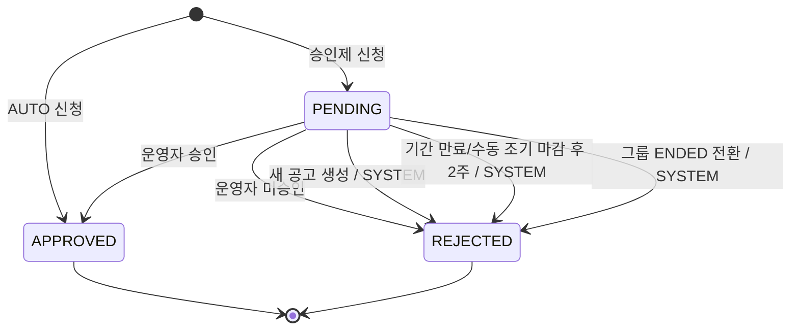

# 비즈니스 정책

> 상태: 저장소 최신 설계 기준
>
> 구현·테스트와 충돌하면 임의로 해석하지 않고 차이를 보고한다.

이 문서는 요청이나 이벤트가 발생했을 때 시스템이 수행해야 하는 업무 처리 흐름을 정리한다. 모델의 필드/값 유효성은 `model/` 아래 상세 문서에서, 모델 간 항상 유지되어야 하는 관계는 `invariants.md`에서 다룬다.

## 회원 가입과 탈퇴

- GitHub 인증만 완료한 단계에는 `Member`를 만들지 않고, 크루명/과정과 일반 회원의 경우 기수를 입력한 뒤 생성한다. 따라서 프로필이 비어 있는 `Member`는 존재하지 않는다.
- 탈퇴 시 닉네임 익명화와 재가입 정책은 추후 결정한다.

## 피드백

- 피드백은 가입을 완료한 로그인 회원만 작성할 수 있다.
- 요청 본문은 피드백 내용만 받고, 서버는 인증 정보에서 작성 회원을 확인해 필수 `member_id`로 저장한다.
- 피드백 내용은 최대 1,000자이며, 유형·처리 상태·답변은 저장하지 않는다.

## 모집 방식별 정책

| 구분 | 신청 단계 | 확정 단계 |
| --- | --- | --- |
| `AUTO` | 남은 자리가 있으면 신청 가능. | 신청 즉시 `APPROVED` 및 `GroupMember` 생성 |
| `APPROVAL` | `capacity`보다 많은 `PENDING` 신청 허용 | 운영자 승인 시 `capacity` 검증 후 `GroupMember` 생성 |

모집 정원에는 `status = APPROVED`이고 `approvalOrigin = RECRUITMENT`인 신청만 포함한다.
승인제의 대기 신청과 초대 출처 승인은 `capacity`에 포함하지 않는다.
이 기준은 자동 가입·수동 승인·정원 수정·자동 마감과 모임/모집 조회·모집 중 필터에 동일하게 적용한다.
실제 그룹 인원은 `GroupMember`로 계산하며 모임장과 초대 합류자도 포함한다.

## 신청 상태 전이



- 모집 중인 공고의 `PENDING` 신청만 본인이 철회할 수 있다. 철회는 상태 전이가 아니라 `Registration`을 Hard Delete하는 행위다.
- 기간 만료, 조기 마감, 정원 도달로 공고가 마감되면 남아 있는 `PENDING` 신청도 철회할 수 없다.
- `APPROVED` 또는 `REJECTED` 신청은 철회할 수 없다.
- 수동 승인/미승인의 `decidedBy`는 실제 결정을 수행한 `MEMBER(memberId)`로 기록한다.
- 자동 미승인의 `decidedBy`는 `SYSTEM`으로 기록하고 UI에는 `System`으로 표시한다.
- 마감 후 2주 자동 미승인의 사전 알림 기능은 MVP에 포함하지 않고 추후 검토한다.

## 모임장 신청 확인 정책

- 신청 확인 여부는 승인 상태와 분리해 `Registration.leaderViewedAt`으로 기록한다.
- `AUTO`와 `APPROVAL` 신청은 모두 생성 시 미확인(`leaderViewedAt = null`)이다.
- 모임 관리의 `신청 관리` 배지는 그룹의 모든 모집 공고에서 `leaderViewedAt = null`인 신청 수를 표시한다.
- 신청 관리 화면에서 특정 모집의 신청자 목록 조회가 성공하면, 요약 응답으로 받은 마지막 미확인 신청 ID까지 그 모집의 신청만 확인 처리한다.
- 목록을 여는 동안 새 신청이 생성되면 그 신청은 다음 확인 대상으로 남겨야 하므로, 클라이언트가 확인한 마지막 신청 ID보다 큰 신청은 갱신하지 않는다.
- 승인·미승인은 확인 처리로 간주하지 않으며 기존 확인 시각을 그대로 유지한다.

## 그룹 생성과 소속

- 그룹 생성과 동시에 모임장의 `GroupMember(role = LEADER)`를 생성한다.
- 그룹 생성 성공 시 생성자를 제외한 활성 푸시 구독 회원에게 새 모임 등록 알림을 보낸다. 알림함에도 회원당 한 건을 남긴다. 세부 수신·저장 규칙은 [알림 모델](model/notification.md)을 따른다.

## 활동 기록 알림

- 다른 회원이 내 활동 기록에 댓글을 남기면 댓글마다 기록 작성자에게 알린다.
- 다른 회원이 내 활동 기록에 하트를 남기면 작성자가 읽기 전까지 한 알림에 모아 `가온 외 2명이 좋아요를 눌렀어요.`처럼 알린다.
  누른 사람이 20명을 넘으면 `회원님의 댓글이 무수한 관심을 받고 있어요.`로 바꾼다.
- 작성자 본인의 댓글과 하트, 댓글에 남긴 하트는 알리지 않는다. 세부 규칙은 [알림 모델](model/notification.md)을 따른다.

## 모집 공고의 계산 상태

```plain text
endsAt IS NULL              상시 모집
now < startsAt              모집 예정
startsAt <= now < endsAt    모집 중
endsAt <= now               마감
```

- 조기 마감은 `startsAt = min(startsAt, now)`, `endsAt = now`로 처리한다.
- 한 번 마감된 공고는 다시 활성화하지 않는다. 재모집은 새 공고를 생성한다.
- 모임장은 현재 모집 공고의 승인 방식, 정원, 모집 기간을 수정할 수 있다. 모집 공고는 삭제할 수 없고, 마감된 공고를 다시 활성화할 수 없다.
- 새 공고를 생성하면 같은 그룹의 기존 활성 공고를 마감하고, 해당 공고의 `PENDING` 신청을 `SYSTEM` 주체로 즉시 `REJECTED` 처리한다.
- 승인 인원이 `capacity`에 도달하면 `endsAt`을 현재 시각으로 변경하여 공고를 자동 마감하고 신규 신청을 막는다. 기존 `PENDING` 신청은 유지하며 모임장이 직접 처리한다. 승인은 정원이 남아 있을 때만 허용하고, 정원 초과 승인은 허용하지 않는다.
- 모집 정원 수정으로 `capacity`가 현재 승인 인원과 같아져도 공고를 현재 시각에 마감하고, 기존 `PENDING` 신청은 유지한다. 모임장이 직접 처리하며 승인 인원보다 작은 정원으로는 수정할 수 없다.
- 정원 미달 상태에서 공고 기간이 만료된 경우 기존 `PENDING` 신청은 즉시 미승인하지 않고 마감 후 2주 정책을 적용한다.

## 그룹 삭제 정책
그룹 삭제는 그룹과 연관 데이터를 물리적으로 제거하는 독립된 도메인 명령이다.

| 구분 | 정책 |
| --- | --- |
| 가능 조건 | `ACTIVE`이며 그룹 생성 후 24시간 이내 |
| 처리 | 그룹 데이터를 Hard Delete한다. `Group.status`는 변경하지 않는다 |
| 연관 데이터 | 초대·수락 이력, 모집 공고, 신청, 구성원, 일정을 함께 삭제한다 |
| 종료 기능 | 삭제가 가능한 동안에는 종료할 수 없다 |
| 사용자 화면 | 삭제 기능만 활성화하고 종료 기능은 제공하지 않는다 |

- Hard Delete 전에 “신청자 N명의 이력도 함께 삭제됩니다”라는 경고와 신청자 수를 보여 준다.
- 생성 후 24시간이 지나면 삭제 기능은 비활성화한다.
- 초대 알림은 수신자의 알림함에 유지하고 아직 완료되지 않은 초대 푸시 전송을 취소한다. 이미 전송한 OS 알림의 회수는 보장하지 않는다. 남은 알림을 열면 유효하지 않은 초대로 안내한다.
- 삭제 요청을 종료 요청으로 자동 전환하지 않는다.

## 그룹 종료 정책
그룹 종료는 활동의 생명주기를 끝내고 이력을 보존하는 독립된 도메인 명령이다.

| 구분 | 정책 |
| --- | --- |
| 가능 조건 | `ACTIVE`이며 그룹 생성 후 24시간 초과 |
| 처리 | `Group.status`를 `ACTIVE`에서 `ENDED`로 변경한다 |
| 연관 데이터 | 그룹, 모집 공고, 신청, 구성원, 일정 이력을 보존한다 |
| 모집 공고와 대기 신청 | 모집 예정 공고를 포함해 마감되지 않은 모든 공고를 마감하고, 해당 공고의 `PENDING` 신청을 `SYSTEM` 주체로 즉시 미승인한다 |
| 삭제 기능 | 종료가 가능한 시점에는 삭제할 수 없다 |
| 사용자 화면 | 종료 기능만 활성화하고 삭제 기능은 제공하지 않는다(삭제 기능은 비활성화된 UI로) |

- `ACTIVE` 그룹에서만 모집 생성, 그룹 수정, 신청, 신청자 승인/미승인 등의 변경 행위를 수행할 수 있다.
- `ENDED` 그룹은 다시 `ACTIVE`로 전환할 수 없다.
- `ENDED` 그룹은 기본 탐색 목록에서 제외하고 별도 종료 목록에서만 조회한다.
- `ENDED` 그룹에서는 과거 그룹/모집/신청/구성원/일정 조회만 허용한다.
- 모집 생성, 그룹 수정, 신청, 신청자 승인/미승인을 포함한 모든 변경 행위를 금지한다.
- 삭제와 종료를 하나의 메뉴 항목이나 조건에 따라 처리만 달라지는 단일 버튼으로 표현하지 않는다.

## 모임장 이탈 정책
모임장이 그룹 또는 서비스를 이탈하려면 다른 구성원에게 모임장 역할을 반드시 위임해야 한다.
- 그룹에서 이탈할 때는 해당 `GroupMember`를 Hard Delete한다.
- 위임은 기존 모임장과 새 모임장의 `role`을 맞바꾸는 하나의 원자적 행위이며, 도중에 `LEADER`가 0명 또는 2명이 되는 상태를 허용하지 않는다.

## 초대 발급과 합류

> 상태: 초대 발급·회원 후보·목록·상세·공개 미리보기·취소·알림 저장 구현. 수락·소속과 신청 승인의 연결도 구현했다.
> 필드와 모델 규칙은 [초대 모델](model/invitation.md), 모델 간 관계는 [불변식](invariants.md#invitation--groupmember--registration)을 따른다.
> 대안을 비교해 채택한 기술 결정은 [백엔드 ADR 목록](../../adr/README.md)의 초대 ADR에서 관리한다.

기존 모임을 등록할 때 구성원이 모집 공고를 찾아 재신청하는 부담을 줄인다.
초대는 모집 신청의 변형이 아니라 실제 구성원이 합류하는 별도 경로다.
채팅·일정 자체와 가입 대상 확대는 다른 작업이며 초대에 포함하지 않는다.

### 유형별 발급·수락·취소

| 구분 | 지정 회원 초대 | 공유 링크 |
| --- | --- | --- |
| 발급 | ACTIVE 모임의 현재 모임장·일반 모임원 | ACTIVE 모임의 현재 모임장·일반 모임원 |
| 대상 | 가입 완료한 특정 회원 | 링크 소지자, 비회원도 가입 후 사용 |
| 수락 | 지정된 회원만 직접 수락 | 가입·로그인한 링크 소지자가 직접 수락 |
| 합류 | 수락 즉시 MEMBER, 별도 승인 없음 | 수락 즉시 MEMBER, 별도 승인 없음 |
| 시간 만료 | 없음 | 초기 약 3일; 정확한 계산 계약은 초대 모델 참조 |
| 취소 | 발급자만 | 발급자 또는 현재 모임장 |

- 모임당 유효한 공유 링크는 하나다. 현재 모임장과 모든 모임원은 같은 링크를 복사·공유한다. 유효 링크가 있을 때 발급을 요청해도 같은 링크를 반환하며 발급자와 만료일을 바꾸지 않는다.
- 만료·취소·발급자 이탈로 기존 공유 링크가 무효가 되면 새 링크를 발급할 수 있다. 과거 초대와 수락 이력은 보존한다.

- 비회원은 인증·회원가입 후 원래 초대로 복귀한다. 가입·로그인만으로 자동 합류시키지 않는다.
- A를 지정한 링크가 B에게 전달되어도 B는 수락할 수 없다.
- 공유 링크는 유효 기간 안에 여러 사람이 사용할 수 있으며 첫 수락으로 소비하지 않는다.
- 공유 링크의 목록·상세·재복사는 모든 현재 모임장과 모임원이 이용할 수 있다. 누가 발급했는지와 관계없이 같은 링크를 복사하여 다른 사람에게 전달할 수 있으며, 재복사는 만료를 연장하지 않는다. 취소 권한은 발급자 또는 현재 모임장으로 제한한다.
- 발급자 소속이 사라지면 그 사람의 남은 초대는 두 유형 모두 만료 안내한다. 이탈·추방 API는 이번에 추가하지 않는다.
- 종료된 모임에는 신규 소속을 만들지 않는다. 삭제된 모임의 초대는 유효하지 않은 초대로 안내한다.
- 취소는 이후의 신규 합류를 막고 기존 소속은 유지한다.
- 취소 권한은 현재 소속을 전제로 하며, 모임장 위임 후에는 현재 역할로 판단한다. 종료된 모임의 취소는 거부한다. 재취소는 최초 취소 시각을 유지한다.
- 시간 만료나 수락 이력이 있어도 활동 중인 모임의 권한 있는 구성원은 취소할 수 있다. 이미 취소한 초대의 상세에서는 추가 취소 가능 여부를 false로 안내한다.
- 이미 구성원인 사람이 재수락하면 이미 참여 중 안내 후 모임으로 이동하며 소속·수락 성과를 추가하지 않는다.
  대상/링크 자격은 여전히 확인하고, 기존 소속 안내는 만료·취소 후에도 신규 합류와 구분한다.
- 합류 이후 이탈·재가입 정책은 후속 검토다.

### 기존 신청 이력과 모집 정원

- 열린 모집 없음·모집 마감·모집 정원 도달 여부와 관계없이 ACTIVE 모임의 초대 합류를 허용한다.
- 같은 모임의 PENDING 신청이 있으면 기존 신청을 초대 경로 APPROVED로 변경한다.
  현재 모집에만 한정하지 않으며, 마감된 공고에 남은 PENDING도 포함한다.
- 신청이 없으면 가짜 신청을 만들지 않는다. 기존 APPROVED·REJECTED는 바꾸지 않는다.
- 신청 승인 출처를 구분하고 모집으로 가입한 인원만 모집 정원에 집계한다.
  초대 합류로 남은 자리를 줄이거나 모집을 자동 마감하지 않는다.
- 소속 생성·기존 신청 승인·신규 수락 이력은 부분적으로만 반영되지 않아야 한다.
- 초대에 의한 신청 결정은 일반 모임장 승인처럼 표시하지 않는다. 승인 확인 여부 leaderViewedAt은 유지한다. 수락 완료는 해당 응답으로 안내하며 일반 모집 승인 알림을 추가로 만들지 않는다.
- 모집 신청 승인이 먼저 완료되면 기존 구성원 안내이며 RECRUITMENT 출처를 유지한다.
  초대가 먼저 합류를 완료하면 모집 신청 승인은 이미 결정된 신청이며 추가 자리 소진이 없다.

- 개인 초대 메시지는 제공하지 않는다.
- 지정 초대는 대상 회원만 거절할 수 있다. REJECTED 상태를 저장하고 재거절은 같은 상태를 유지한다. 거절한 초대는 다시 수락할 수 없으며, 이후 별도로 발급한 새 초대는 독립적으로 처리한다.
- 거절은 모임장·발급자에게 알림을 만들지 않고 기존 초대 알림을 보존한다. 알림에서 다시 열면 거절한 초대로 안내한다. 해당 초대의 미완료 푸시 작업은 취소한다.
- 수락 이력이 있는 초대는 거절할 수 없다. 수락과 거절이 겹치면 버전 충돌로 롤백·재조회하여 둘 중 하나만 반영한다. 공유 링크는 특정 수신자를 지정하지 않으므로 이 거절 기능의 대상이 아니다.

### 지정 초대 알림

- 신규 지정 초대는 대상 회원의 알림함에 기록하고, 당시 활성 브라우저 구독으로 웹푸시를 전송한다.
- 푸시 미허용·구독 없음·외부 전송 실패에도 초대와 알림함 기록은 유지한다.
- 같은 발급 사건의 재처리로 알림과 전송 작업을 늘리지 않는다. 공유 링크 생성·복사는 자동 알림 대상이 아니다.
- 알림 조회·클릭·읽음은 합류 동작이 아니다. 인증 복귀 후 초대 화면에서 직접 수락한다.
- 알림 클릭 시 대상 계정과 현재 초대 상태를 확인한다. 이미 전송된 푸시를 회수한다고 보장하지 않는다.
- 지정 초대 취소는 남은 전송 대기·재시도·선점 작업을 취소하고 알림함 이력과 완료된 전송 기록은 유지한다. 초대와 전송 작업의 취소는 원자적으로 처리한다.
- 과거 초대 발급 후 푸시를 켰다고 과거 초대를 자동 재전송하지 않는다.

## 그룹 달력

### 노출과 정보 범위

- `CLUB`, `STUDY`, `SESSION` 상세에 월간 기본 달력을 제공한다. 기존 `SESSION`은 독립된 같이해요 그룹이며 그 그룹의 일회성 일정이 달력에 나타난다.
- 공개 달력에는 일정 제목·날짜·시각을 제공한다. 일정 설명과 장소 상세는 현재 그룹원에게만 제공한다. 모임 상세의 기존 장소 공개 범위는 달력 정책으로 바꾸지 않는다.
- 모임장은 기존 반복 요일과 `SESSION` 일정을 달력에서 켜거나 끌 수 있다. 기본값은 켜짐이며 달력 표시만 바뀐다. 모임장이 등록한 개별 일정과 날짜별 정기 모임은 이 설정의 영향을 받지 않는다.
- 개별 일정의 제목은 최대 50자, 장소는 최대 255자, 설명은 필수이며 최대 10,000자다. 과거 날짜도 등록·수정할 수 있다. 한 일정은 종일 또는 시각 지정 중 하나를 선택하고, 시작일부터 최대 1년까지 이어질 수 있다.
- 종료된 그룹은 종료일까지의 일정을 조회할 수 있다. 종료일 이후 일정은 숨기고 종료 뒤 일정 변경은 허용하지 않는다. 여러 날에 걸친 일정은 종료일까지만 표시한다.

### 정기 일정과 회차

- 반복 정기 일정은 모임 개설일(서울 날짜)부터 달력에 적용한다. 전체 표시 시작일은 모임 개설일보다 빠를 수 없고, 전체 종료일은 비우면 무기한이다. 전체 표시 기간은 별도로 수정하고, 요일·시각 변경 범위는 선택한 회차 날짜로 정한다.
- 요일을 정하지 않은 유동적 운영 기간은 달력 칸에 일정처럼 표시하지 않는다. 해당 날짜를 선택했을 때 일정 목록에 안내한다. 기존 정기 일정 표시를 끄면 이 안내도 숨긴다.
- 유동적으로 운영하던 모임에 처음 정기 규칙을 등록하면 정기 발생은 첫 등록일부터 표시한다. 과거의 유동적 기간은 모임 개설일부터 첫 등록일 전날까지로 안내한다.
- 반복 회차를 열면 해당 날짜에 적용된 규칙을 보여 준다. 모든 회차에서 같은 날짜 기준 범위를 제공하고, 저장된 규칙 구간은 편집 범위 선택지로 노출하지 않는다.
- 정기 회차를 수정할 때 범위는 `모든 일정`, `이 이후의 일정도`, `이 일정만`이다. `모든 일정`은 해당 반복 일정의 전체 규칙 구간을 바꾼다. `이 이후의 일정도`는 선택한 회차 날짜부터 포함해 적용하고, 선택일 이전의 규칙 이력은 보존한다. `이 일정만`은 반복 규칙을 유지하고 선택한 회차만 예외로 저장한다. 규칙 구간 자체를 범위 선택지로 노출하지 않는다.
- 반복 회차 중 한 건만 수정하면 반복 규칙은 유지하고 선택 회차를 `GroupEvent`로 저장한다. 제목은 `정기 모임`으로 고정하고 설명은 필수, 장소는 선택이다. 모임장은 종일 또는 시간 지정을 선택하며 회차 상태는 기본적으로 날짜 기준으로 계산되고 직접 바꿀 수 있다.
- 한 회차만 삭제하면 반복 규칙과 다른 날짜를 유지하고 선택한 원래 날짜만 숨긴다. 숨김 이력을 보존해 새로고침이나 규칙 재계산 뒤에도 해당 회차가 나타나지 않게 한다.
- 날짜별 `정기 모임`은 동아리·스터디에서 반복 규칙 밖 날짜에 등록할 수 있다. 반복 규칙이 같은 날짜에 회차를 만들고 있거나 규칙 변경으로 만들게 되면 저장을 거절한다. 사용자는 겹치는 날짜별 회차를 옮기거나 삭제한 뒤 다시 시도한다.
- 반복 회차 예외와 날짜별 정기 모임은 일정 ID를 가진다. 계산되는 반복 발생은 `seriesId + 발생 날짜`로 식별하며, 규칙 구간 ID는 편집 대상을 찾는 데만 사용한다.

### 원자성 및 확장 경계

- 기존 모임의 기본 정보 수정과 정기·세션 일정 수정은 서로 다른 저장 작업이다. 한 요청의 실패가 다른 저장 작업을 자동 실행하거나 되돌리지 않는다. 각 일정 변경과 그에 대응하는 이력 변경은 같은 트랜잭션에서 처리한다. 새 모임 생성만 그룹 정보와 최초 일정을 함께 생성한다.
- 날짜별 정기 모임에도 장래 참석 인원 제한과 RSVP를 붙일 수 있도록 발생일을 안정적으로 식별한다. RSVP와 참석 정원은 그룹 가입 신청과 분리한다.
- 장래 모임 주최 단기 세션과 개인 달력은 이번 범위에 포함하지 않는다. 세부 경계와 결정은 [백엔드 ADR 0017](../../adr/0017-group-calendar-event-and-history-model.md)을 따른다.
