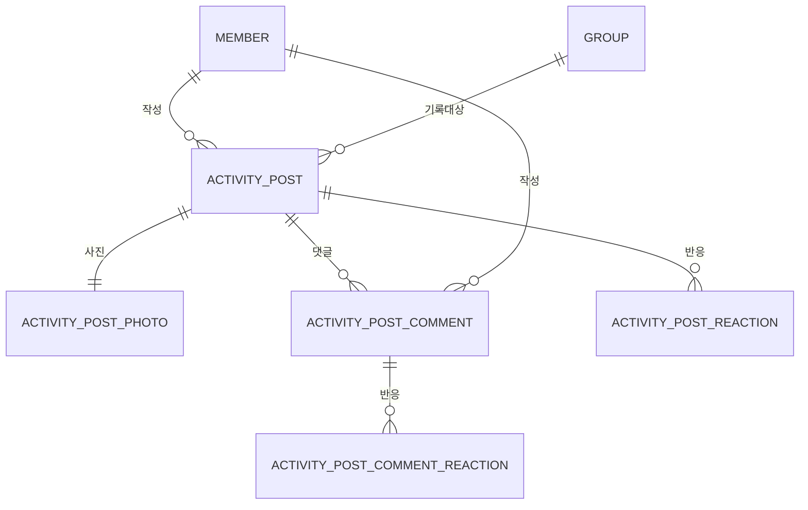

# ActivityPost

그룹 활동을 사진 중심으로 공개하는 게시물이다. 자동 생성되는 도메인 활동 이력이나 분석 이벤트(PostHog)가 아니다.

## 관계와 저장

- `ActivityPost`: 그룹, 작성 회원, 선택 캡션(최대 50자), 활동 날짜, 생성, 수정, 숨김 시각을 가진다.
- `ActivityPostPhoto`: 게시물과 분리된 사진 키 참조다. v1은 유니크한 게시물 ID로 사진 한 장을 제한한다.
- 활동 날짜는 `LocalDate`이며 기본값은 오늘, 과거 날짜 허용, 미래 날짜 불가다.
- 모든 기록은 전체 공개이며 그룹 이름, 유형, 상태와 작성자 `crewName`을 반환한다.
- 그룹 삭제 전 게시물의 `group_id`를 비우고 `deleted_at`을 기록해 공개 조회에서 제외한다. 종료된 그룹 기록은 보존한다.

## 댓글과 하트 반응

- `ActivityPostComment`: 기록, 작성 회원, 내용(앞뒤 공백 제거 후 1자 이상 200자 이하), 숨김 시각을 가진다.
  지우면 `deleted_at`을 기록하고 공개 조회와 댓글 수에서 제외한다.
- `ActivityPostReaction`, `ActivityPostCommentReaction`: 대상(기록 또는 댓글), 회원, 이모지를 가진다.
  `(대상, 회원, 이모지)`가 유니크라 같은 회원은 같은 이모지를 한 번만 남긴다.
- 이모지는 `ReactionEmoji`이며 선언 순서가 응답의 배지 순서다. 피드에서는 단순한 공감만 반응으로 받도록
  우선 `HEART` 하나만 둔다. DB의 `ck_*_reaction_emoji` 검사 제약도 같은 값만 허용한다.
- 반응은 되돌리기 쉬운 토글이고 이력에 의미가 없으므로, 기본 soft delete 정책과 달리 취소하면 물리 삭제한다.
  유니크 제약과 soft delete 충돌을 피하려는 결정이기도 하다.
- 화면은 하트 이미지와 개수를 한 버튼으로 보여 주고, 눌러서 남기거나 취소한다.
- 다른 회원이 내 기록에 댓글이나 하트를 남기면 기록 작성자에게 알린다. 하트는 작성자가 읽기 전까지 한 알림에 모은다.
  세부 규칙은 [알림 모델](notification.md)을 따른다.

## 권한

- 생성: 로그인한 해당 그룹의 구성원. 그룹은 `ACTIVE` 상태여야 한다.
- 수정, 숨김: 작성자 또는 현재 그룹의 `LEADER`.
- 작성자 권한은 그룹 탈퇴 후에도 유지한다.
- `canModify`는 현재 요청자에 대한 표시용 값이며, 서버 권한 검사를 대체하지 않는다.
- 댓글과 반응 작성: 로그인 회원 누구나. 그룹 구성원일 필요가 없고 종료된 그룹 기록에도 남길 수 있다.
- 댓글 숨김: 댓글 작성자 또는 기록 그룹의 현재 `LEADER`. `canDelete`는 표시용 값이다.
- 반응 취소: 반응을 남긴 본인.

## 조회, 페이지네이션

전체, 그룹별 목록은 `activityDate DESC, id DESC`로 조회한다. 커서는 URL-safe Base64로
`activityDate|id`를 인코딩하며 날짜가 같아도 안정적으로 다음 페이지를 이어 간다. `mine=true`는
로그인 회원 본인의 기록만 반환한다.

## 인덱스, 제약

- 전체 최신순: `(activity_date DESC, id DESC)`
- 그룹 최신순: `(group_id, activity_date DESC, id DESC)`
- 작성자 기록: `(author_member_id, activity_date DESC, id DESC)`
- 사진 테이블은 `activity_post_id`, `image_key` 각각 유니크다.
- 댓글 작성 순서: `(activity_post_id, created_at, id)`
- 반응 중복 방지: `(activity_post_id, member_id, emoji)`, `(activity_post_comment_id, member_id, emoji)` 유니크

기본 스키마는 `backend/src/main/resources/db/migration/V1__baseline.sql`, 댓글과 반응은
`backend/src/main/resources/db/migration/V2__activity_post_comment_reaction.sql`로 생성하고,
하트만 허용하는 반응 검사 제약은 `backend/src/main/resources/db/migration/V3__activity_post_reaction_heart_only.sql`이 더한다.
댓글과 좋아요 알림 사건 종류는 `backend/src/main/resources/db/migration/V5__activity_post_interaction_notification.sql`이 알림 검사 제약에 더한다.
