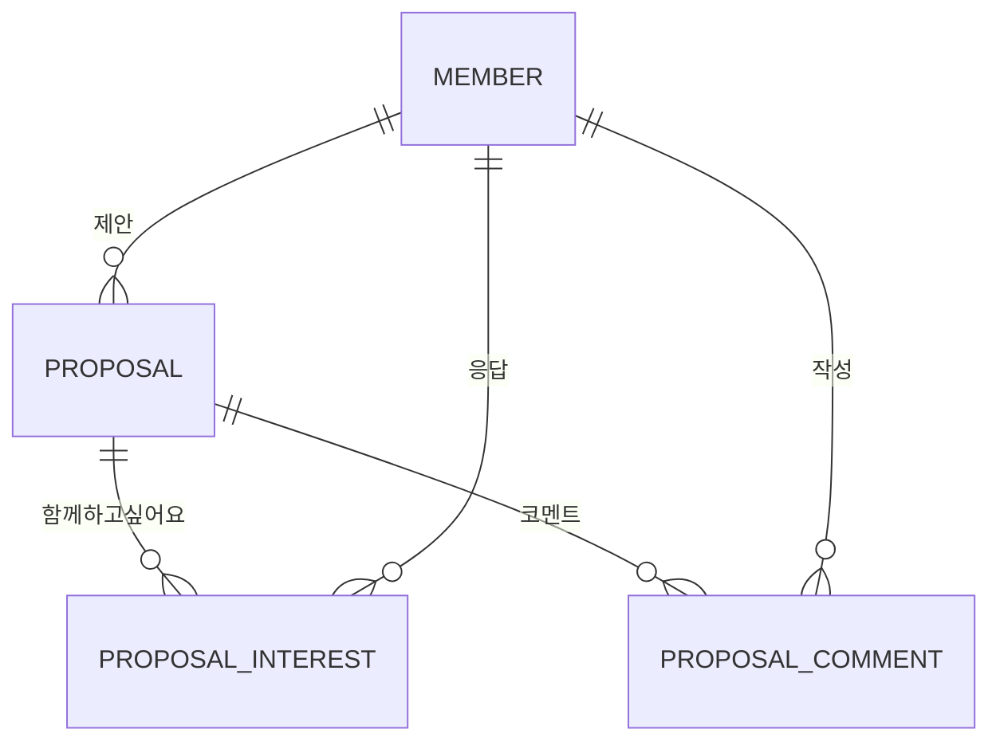

# Proposal

자유게시판에 올리는 모임 제안이다. 아직 그룹이 없는 상태에서 "이런 모임 같이할 사람?"을 묻고,
함께할 마음과 조건을 모아 실제 모임을 열지 판단하게 돕는다. 응답은 모임 신청(`Registration`)이 아니며
그룹 소속(`GroupMember`)을 만들지 않는다.

## 관계와 저장

- `Proposal`: 제안 회원, 분야(`ProposalCategory`), 제목(1~50자), 내용(1~1000자), 분위기 선택지(0~3개, 각 1~20자, 한 줄, 서로 다름), 숨김 시각을 가진다.
  분위기 선택지는 줄바꿈으로 이어 한 컬럼에 저장한다.
- `ProposalInterest`: 제안, 회원, 가능한 시간(`ProposalTimeSlot` 집합), 진행 방식(`ProposalMeetingMode` 집합), 고른 분위기 선택지 순번 집합을 가진다.
  `(proposal_id, member_id)`가 유니크라 회원마다 응답은 하나다. 집합은 쉼표로 이어 저장하며 비어 있으면 빈 문자열이다.
- `ProposalComment`: 제안, 작성 회원, 내용(1~300자), 숨김 시각을 가진다.

## 규칙

- 조건은 모두 비워도 된다. 목록에서 누른 함께하고 싶어요는 조건 없는 응답이고, 상세에서 조건을 보내면 같은 응답의 조건을 바꾼다.
- 시간과 방식 선택지는 모든 제안이 같다. 분위기 선택지만 제안자가 정하며, 응답은 그 순번을 저장하므로 제안 작성 뒤에는 선택지를 바꾸지 않는다.
- 응답 취소는 되돌리기 쉬운 토글이라 물리 삭제한다. 유니크 제약과 soft delete의 충돌도 피한다.
- 제안과 코멘트는 지우면 숨김 시각을 기록하고 조회에서 뺀다. 상태 전이는 숨김 시각을 담은 새 엔티티를 돌려준다.
- 제안자도 자기 제안에 응답할 수 있다. 응답 수에서 제안자를 빼는 규칙은 아직 두지 않는다.

## 권한

| 동작 | 권한 |
| --- | --- |
| 목록, 상세, 코멘트 조회 | 누구나 |
| 제안 작성, 응답 저장과 취소, 코멘트 작성 | 가입한 회원 |
| 제안 숨김 | 제안한 회원 |
| 코멘트 숨김 | 코멘트 작성자 또는 제안한 회원 |

## 조회

- 목록은 응답 수와 코멘트 수를 하위 쿼리로 함께 가져와 N+1 조회를 만들지 않는다.
- 상세의 조건별 인원은 해당 제안의 응답 행만 읽어 애플리케이션에서 센다. 한 제안의 응답이 수천 건 이상으로 늘면 DB 집계로 바꾼다.

API는 [자유게시판 모임 제안 API](../../api/endpoints/proposals.md)를 따른다.
