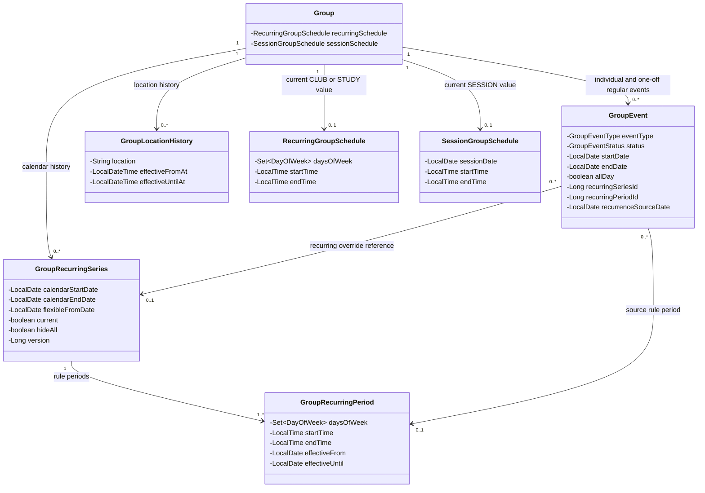

# 일정 모델

## 일정 구조

`Group`의 embedded 반복·세션 일정은 현재 모임 상세와 기존 API 계약에 쓰는 최신 값이다. 달력은 변경 이력이 필요한 정기 규칙과 별도 일정 자원을 새 모델로 보관한다.

### `GroupEvent`

모임장이 등록한 개별 일정, 날짜별 정기 모임, 반복 회차 예외를 표현한다. 일정은 모임에 속하며 달력 외 화면도 같은 일정 ID를 참조할 수 있다.

| 필드 | 타입 | 제약 | 설명 |
| --- | --- | --- | --- |
| `eventType` | `GroupEventType` | NOT NULL | `INDIVIDUAL` 또는 하루짜리 `REGULAR_MEETING` |
| `status` | `GroupEventStatus` | NOT NULL | `AUTO`, `UPCOMING`, `COMPLETED`; 개별 일정은 `AUTO` |
| `title` | String | 1~50자 | 정기 모임은 `정기 모임`으로 고정 |
| `startDate`, `endDate` | LocalDate | 시작일부터 최대 1년, 종료일 포함 | 개별 일정의 표시 기간 |
| `allDay` | boolean | NOT NULL | 종일 여부 |
| `startTime`, `endTime` | LocalTime | 종일이면 둘 다 null, 아니면 둘 다 필수 | 시각 지정 일정의 시작·종료 시각 |
| `description` | String | 필수, 최대 10,000자 | 일정 설명 |
| `location` | String | 선택, 최대 255자 | 일정 장소 |
| `recurringSeriesId`, `recurringPeriodId`, `recurrenceSourceDate` | Long, Long, LocalDate | 반복 회차 예외면 모두 필수, 일반 일정이면 모두 null | 원래 반복 회차를 찾는 참조 |
| `deletedAt` | LocalDateTime | nullable | 삭제된 일정 또는 숨긴 반복 회차 예외를 표시 |
| `version` | Long | 낙관적 잠금 | 여러 탭에서 발생한 오래된 수정을 검출 |

- 시간 지정 일정은 `startDate.atTime(startTime) < endDate.atTime(endTime)`여야 한다. 종일 일정은 두 시각을 모두 비운다.
- 날짜별 `REGULAR_MEETING`은 동아리·스터디에서만 등록하며 하루 일정이다. 제목은 서버에서 고정한다.
- `AUTO` 상태는 일정 날짜가 오늘보다 과거면 `COMPLETED`, 오늘 또는 미래면 `UPCOMING`으로 계산한다. 모임장이 두 상태를 직접 지정하면 날짜가 바뀌어도 유지한다.
- 반복 회차 예외는 한 반복 묶음의 원래 발생일마다 한 건만 둔다. 날짜를 옮겨도 `recurrenceSourceDate`와 `GroupEvent.id`를 유지한다. 삭제 예외는 soft delete tombstone으로 남겨 반복 회차가 다시 나타나지 않게 한다.

### `RecurringGroupSchedule`과 `SessionGroupSchedule`

`RecurringGroupSchedule`은 `CLUB`, `STUDY`의 현재 주간 규칙이고 `SessionGroupSchedule`은 독립 `SESSION` 그룹의 현재 단일 일정이다. 둘은 서로 다른 모델이며 달력의 변경 이력은 이 embedded 값과 별개로 보관한다.

| 모델 | 필드 | 제약 |
| --- | --- | --- |
| `RecurringGroupSchedule` | `daysOfWeek` | 하나 이상의 요일 |
|  | `startTime`, `endTime` | 둘 다 지정하거나 둘 다 비움. 지정하면 시작 시각이 종료 시각보다 빠름 |
| `SessionGroupSchedule` | `sessionDate` | 필수 날짜 |
|  | `startTime`, `endTime` | 둘 다 필수이고 시작 시각이 종료 시각보다 빠름 |

반복 요일은 있지만 시각이 비어 있는 상태는 **시간 유동적 반복 일정**이다. 요일 자체가 없는 **유동적 운영**과 구분한다.

### `GroupRecurringSeries`와 `GroupRecurringPeriod`

`GroupRecurringSeries`는 달력에 표시할 정기 규칙 전체 기간과 안정적인 ID를 보유한다. `GroupRecurringPeriod`는 해당 묶음 안에서 요일·시각이 적용된 변경 이력 구간이다.

- 묶음의 전체 기간은 `calendarStartDate`부터 `calendarEndDate`까지이며 양끝을 포함한다. 종료일이 null이면 끝이 없다.
- `flexibleFromDate`는 정기 규칙을 제거한 뒤 유동적으로 운영하는 구간의 시작일이다. `current` 묶음은 그룹당 최대 한 건이다.
- 기간의 `effectiveFrom`과 `effectiveUntil`은 양끝을 포함하고, 같은 묶음의 구간끼리 겹치지 않는다. 각 구간은 하나 이상의 요일을 가지며 시각은 둘 다 지정하거나 둘 다 비운다.
- 날짜별 반복 발생은 전체 기간과 규칙 구간의 교집합에서 조회 시 계산한다. 발생일마다 별도 DB 행을 미리 만들지 않는다.
- 반복 발생의 안정 식별 키는 `seriesId + 발생 날짜`다. 편집용 `periodId`가 기간 분할이나 규칙 편집으로 바뀌어도 발생일의 키는 유지된다.

### `GroupLocationHistory`

모임의 현재 장소는 기존 그룹 정보에 유지하고, 달력의 당시 장소 조회를 위해 변경 시각별 이력을 추가한다. `effectiveFromAt`은 포함하고 `effectiveUntilAt`은 배타적이다. 해당 날짜·시각의 이력이 없으면 당시 장소를 반환하지 않으며 현재 장소로 과거를 채우지 않는다. 시각이 없는 정기 일정은 그 날짜 마지막으로 설정된 장소를 조회한다.

그룹의 현재 장소와 이력 변경, 정기 규칙과 적용 구간 변경은 각 명령 안에서 원자적으로 저장한다. 모임 정보 수정과 일정 수정은 서로 다른 저장 작업이다.
