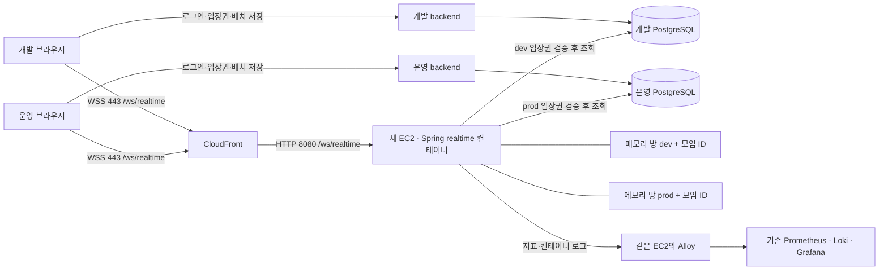

# 아지트 멀티플레이 아키텍처와 결정 이력

기준일: 2026-11-13

이 문서는 아지트 멀티플레이를 논의하며 선택한 구조, 선택을 바꾼 이유와 감수하는 비용을 기록한다. 2026-11-11의 초기 프로젝터 계획 이후 요청과 현재 작업 트리의 코드를 대조했다. 초기 제안과 최종 선택이 다른 항목은 아래 변경 이력에 구분했다. 비용과 재검토 조건은 현재 구조에 대한 평가이며, 모두가 처음부터 선택 이유였다는 뜻은 아니다.

M1·M2는 로컬 구현과 검증 기록이 있다. M3는 LiveKit을 사용하는 방향을 정했고 구현은 보류했다. EC2·러너 설치와 CloudFront 연결은 사용자에게 완료 보고를 받았지만, 이 문서를 작성하며 원격 설정이나 운영 배포 성공을 확인하지는 않았다. 로컬 검증의 범위는 [검증 기록](../infra/realtime/VERIFICATION.md)을 따른다.

## 문서 지도

| 문서 | 기록하는 결정 |
| --- | --- |
| [인프라 ADR 0007](../infra/docs/adr/0007-clubhouse-realtime-service.md) | 독립 Spring 앱, DB 직접 조회, 환경·방 분리, 입장 토큰, 방 메모리 |
| [인프라 ADR 0008](../infra/docs/adr/0008-shared-realtime-deployment.md) | 공용 컨테이너, CloudFront·8080, 기존 Environment 값 재사용, 배포·복구·모니터링 |
| [인프라 ADR 0009](../infra/docs/adr/0009-projector-livekit-direction.md) | P2P·TURN 검토 후 LiveKit SFU 선택, 시그널링·영상 경로, 남은 네트워크 결정 |
| [실시간 v1 계약](../contracts/realtime/v1/README.md) | 메시지·상태·오류·카탈로그의 실행 가능한 계약 |
| [프론트 런타임](../frontend/docs/group-space-realtime.md) | 연결·배치 갱신·원격 캐릭터·상호작용 표시 |
| [배포 실행 가이드](../infra/realtime/README.md) | 실제 변수 이름, 러너·DB·CloudFront 준비와 실행 순서 |

## 현재 HLD

`realtime`은 새 Spring 애플리케이션의 이름이다. DB 이름은 개발 `jarihana_dev`, 운영 `jarihana_prod`다. 개발·운영 API는 각자의 DB를 사용하고, realtime 컨테이너 하나가 두 DB를 구분해 조회한다.



그림의 API 연결은 업무 책임을 나타낸다. 기존 API의 상세 배포 경로는 [인프라 ADR 0005](../infra/docs/adr/0005-nginx-ec2-blue-green-deployment.md)를 따른다. 새 realtime 배포에는 Nginx가 없으며, 기존 API 인프라의 Nginx를 제거하는 결정은 아니다.

### 패키지와 소유권

```text
backend/                            로그인, 방문 정책, 입장권 발급, 영속 데이터 쓰기
realtime/                           독립 Java 21 / Spring Boot / Gradle 앱
  .../auth/                         입장권 검증
  .../room/domain/                  참여자·좌석·물건 상태와 규칙
  .../room/runtime/                 방 식별, 실행 큐, 접속·갱신 수명
  .../room/persistence/             환경별 PostgreSQL 조회
  .../layout/, interaction/         저장 배치 해석, 상호작용
  .../transport/                    WebSocket 수신·송신·메시지
frontend/src/features/group-space/realtime/
                                    입장권 요청, 연결, 상태 저장, 보간
frontend/src/pages/space/            장면·입력·가구·아바타 표시
contracts/realtime/                 버전 있는 메시지 계약과 판정용 JSON 생성
infra/realtime/                     Docker Compose, Alloy, 검증 도구
.github/workflows/realtime-deploy.yml
                                    검증, GHCR 발행, 설정 전달, 공용 배포
```

저장소를 나누지 않고 빌드·프로세스·배포 단위를 나눈다. backend의 JPA 엔티티를 realtime에 공유하지 않는다. 프론트의 가구 카탈로그에서 판정용 JSON을 생성해 Java와 JavaScript가 같은 좌석·표면 정보를 사용한다. 이 JSON의 생성 결과와 배치 문서 버전은 함께 검증한다.

| 데이터 | 기준을 정하는 곳 | 저장 수명 |
| --- | --- | --- |
| 회원, 모임, 방문 권한, 가구 배치, 개인 아바타 외형 | 기존 backend와 환경별 PostgreSQL | DB에 저장 |
| 현재 위치·방향·동작, 좌석 점유, 손에 든 쿠키·컵, 선반 물건, 던지기·제조 상태 | realtime의 해당 방 | 방 메모리. 빈 방 정리·재시작 때 초기화 |
| 미저장 가구 편집 초안, 카메라, 관절 애니메이션·보간 | 브라우저 | 브라우저 상태 |
| 미래 프로젝터 점유·공유 권한 | realtime에 둘 방향 | M3 세부 계약 미구현 |
| 미래 화면 영상·오디오 트랙과 미디어 시그널링 | LiveKit에 둘 방향 | M3 미구현 |

여기서 손 물건과 착석 상태를 “저장한다”는 말은 늦게 입장한 사용자에게도 방 스냅샷으로 전달한다는 뜻이다. 이 일시 상태를 DB에 영구 보관하지는 않는다. 가구 편집과 아바타 저장은 기존 API의 DB 쓰기가 계속 필요하다.

## 기능 범위와 사용자에게 보이는 규칙

### M1과 M2를 함께 개발한 이유

초기 M1의 입퇴장·이동·방향·점프·인사·원격 표시만으로는 이미 앉아 있거나 쿠키를 든 사람을 늦은 입장자에게 제대로 보여 줄 수 없었다. 착석과 보유 물건도 입장 스냅샷에 필요하다는 요청에 따라 M1·M2를 함께 개발했다. 대신 첫 구현에서 좌석 경쟁, 물건 소유권, 배치 변경, 재접속을 함께 다뤄야 했다.

입장 스냅샷에는 참여자와 소품·가구 상태가 들어간다. 같은 방에서 한 좌석이나 물건을 둘이 동시에 차지할 수 없게 서버가 명령을 순서대로 판정한다. 이동은 클라이언트가 제안하고 서버가 속도·범위·배치 조건을 검사한다. 원격 위치는 보간하고, 공유 상호작용은 서버 결과를 적용한다. 경쟁 게임 수준의 연속 물리 시뮬레이션은 현재 범위에 없다.

### 가구를 옮겼을 때 누가 갱신하는가

1. 편집한 브라우저가 기존 backend에 배치를 저장한다. backend가 DB에 기록한다.
2. realtime이 활성 방의 배치를 주기적으로 조회한다. 현재 배치 조회 간격은 10초다. DB 저장 성공이 모든 접속자에게 즉시 반영됐다는 뜻은 아니다.
3. realtime이 새 `layoutRevision`을 적용하면서 좌석·소품·진행 작업을 함께 정리하고 방 상태를 전송한다.
4. 브라우저가 revision 차이를 감지해 기존 API에서 저장 배치를 다시 읽는다. 새 배치가 준비될 때까지 공유 조작을 대기시킨다. 편집 중인 초안은 보존한다.

갱신은 앉기 거절을 받아야만 시작되는 동작이 아니다. 정상적인 배치 갱신으로도 시작한다. 명령의 배치 버전이 서버와 다르면 `LAYOUT_MISMATCH`로 거절하고 최신 상태로 재동기화한다. 단, **DB 저장 직후부터 realtime이 새 배치를 읽기 전까지는 이전 배치가 서버의 현재 기준**이다. 이 구간까지 거절을 보장하려면 저장 이벤트 전달 등 별도 설계가 필요하다.

| 상황 | 현재 처리 | 선택에 따른 비용 |
| --- | --- | --- |
| 이전 화면에서 누른 앉기가 이미 갱신된 서버에 도착 | 오래된 revision 명령 거절, 새 배치 적용 후 다시 조작 | 사용자가 한 번 더 눌러야 할 수 있음 |
| 앉아 있는 가구의 위치·회전·크기 변경 또는 삭제 | 서 있는 상태로 바꾸고 안전 위치로 보정 | 가구에 앉은 채 함께 이동하는 경험은 제공하지 않음 |
| 같은 종류의 가구와 표면 슬롯이 유지된 채 이동·회전·크기 변경 | 놓인 소품을 새 표면 좌표로 이동 | 카탈로그의 표면 정의가 정확해야 함 |
| 소품을 올린 가구·슬롯이 사라짐 | 소품을 안전한 바닥 위치로 이동 | 원래 부착 관계는 해제됨 |
| 물건을 꺼낸 원본 가구가 삭제됨 | 이미 손에 든 물건은 유지 | 가구 수명과 꺼낸 물건 수명을 구분함 |
| 제조 중인 기계 이동·삭제 | 작업을 취소하고 컵은 보존 | 진행 시간은 이어받지 않음 |

“예전 위치에서 누른 앉기도 허용하자”는 중간 논의 뒤에 “거절하도록 하자”는 요청이 있어 최종 정책은 거절로 정했다. 앉아 있는 사람을 가구와 함께 이동시키는 정책은 채택하지 않았다. 구현 근거는 [배치 조정](../realtime/src/main/java/com/project/jarihana/realtime/room/domain/LayoutReconciliation.java)과 [실시간 v1 계약](../contracts/realtime/v1/README.md)에 있다.

### 개인 아바타와 동작

각자의 DB에 저장된 아바타 외형을 입장 상태에 포함하고 내 캐릭터·원격 캐릭터에 같은 관절 구조와 부품을 사용한다. 외형과 걷기·달리기·점프·인사·착석 동작을 분리했으므로 현재 아바타 부품은 같은 동작을 재사용한다. 관절 구조가 다른 외부 모델까지 자동 호환한다는 뜻은 아니다. 저장 외형이 없으면 기본 캐릭터를 쓴다.

가구 크기를 바꿔도 앉은 캐릭터가 파묻히지 않도록 좌석의 높이·폭·깊이에 맞춰 표시 자세를 보정한다. 필요한 경우 착석 중 아바타 표시 크기도 줄인다. 서버의 좌석 판정과 화면의 자세 보정은 각각 관리하며, 임의의 모든 에셋이 검증됐다는 의미는 아니다. 컵은 고정된 월드 좌표 대신 손 위치를 따라가게 하고, 내 화면과 상대 화면이 같은 컵 들기 동작을 사용한다.

실내 조명은 개인 아바타 재질에도 적용한다. 밤의 실내 보조광과 조명 스위치를 함께 반영하되 관절 애니메이션용 셰이더 처리를 유지한다. 외형·재질·가구를 추가할 때는 단위 검증 외에 내 화면과 상대 화면의 착석·손 물건·야간 표시 확인이 필요하다. 관련 구현은 [아바타 구성](../frontend/src/pages/space/clubhouseAvatar.js), [착석 보정](../frontend/src/pages/space/seatedAvatar.js), [컵 동작](../frontend/src/pages/space/cupLift.js), [방 조명](../frontend/src/pages/space/roomLighting.js)이다.

### 재접속과 이동 거절

끊어진 연결은 새 입장권으로 재접속하고 서버 스냅샷을 적용한다. 결과를 받지 못한 명령은 자동 재생하지 않는다. 예를 들어 컵 소비가 처리됐는지 모르는 상태에서 같은 명령을 재생하면 이중 소비가 될 수 있기 때문이다. 그 대신 사용자가 최신 상태를 보고 다시 조작한다.

명시적 퇴장은 좌석·손 물건을 즉시 정리하고 비정상 끊김에는 재접속 유예를 둔다. 같은 사용자가 새로 접속하면 이전 연결을 교체한다. 따라서 같은 로그인 세션의 탭 두 개를 두 사람으로 취급하지 않는다.

`INVALID_MOVEMENT`는 서버의 이동 검증 거절이다. 연결된 상태에서 이 오류나 `LAYOUT_MISMATCH`를 받으면 연결을 유지하고 뒤따르는 스냅샷으로 위치·배치를 보정한다. 오류를 받자마자 소켓을 닫아 복구 스냅샷을 놓치던 동작을 수정했다. 이 처리는 잘못된 이동을 허용하는 변경이 아니며, 사용자가 겪은 모든 간헐적 거절의 원인을 규명했다는 뜻도 아니다. [연결 복구 구현](../frontend/src/features/group-space/realtime/connection.js)

로컬의 서로 다른 프론트 포트는 두 사용자 화면을 확인하기 위한 테스트 구성이다. 실제 서비스가 사용자마다 별도 프론트 서버를 요구하지 않는다. HTTP 계정 응답을 대체한 로컬 fixture 검증과 실제 두 계정의 로그인·운영 WSS 검증은 구분한다.

## 논의 중 바뀐 선택

| 처음 검토한 안·질문 | 최종 선택과 이유 | 자세한 기록 |
| --- | --- | --- |
| 모노레포에서 어디에 서버를 둘 것인가 | 루트 `realtime/` 독립 앱. 저장소는 유지하고 API와 실행 수명을 분리 | 인프라 ADR 0007 |
| M1 이동 기능을 먼저 끝내고 M2를 할 것인가 | 착석·보유 물건을 처음부터 공유하도록 M1·M2 동시 개발 | 이 문서의 기능 범위 |
| 내부 API를 호출해야 하는가, DB를 직접 읽을 수 있는가 | 사용자 요청에 따라 DB 직접 조회. 쓰기·마이그레이션은 backend에 유지 | 인프라 ADR 0007 |
| 개발·운영 서버와 URL을 따로 둘 것인가 | 한 컨테이너·URL을 사용하고 검증된 `iss`로 DB와 방을 분리 | 인프라 ADR 0007 |
| 별도 공개키·개인키를 등록해야 하는가 | 기존 JWT 시크릿에서 입장 전용 키 유도. 별도 키 쌍 등록 제거 | 인프라 ADR 0007 |
| `realtime-dev`, Repository secrets 복사, `dev.KEY` 접근 | 기존 dev/prod Environment 준비 잡 두 개가 값을 읽고 마지막 잡에서 공용 배포 | 인프라 ADR 0008 |
| 배포 스크립트 파일이 GHCR 때문에 필수인가 | `deploy.sh` 없이 workflow에 배포·헬스체크·롤백 포함 | 인프라 ADR 0008 |
| Nginx와 EC2 80을 둘 것인가 | CloudFront를 사용하므로 새 프록시 없이 원본·Spring 모두 8080 | 인프라 ADR 0008 |
| `multi-server`, `space`, `realtime` 중 무엇을 쓸 것인가 | 서버·패키지·러너는 realtime, WebSocket은 `/ws/realtime`으로 통일 | 인프라 ADR 0008 |
| develop 반영에도 공용 서버를 재시작할 것인가 | 빠른 배포·검증을 위해 관련 경로 변경 시 재배포. 운영 방도 영향받음 | 인프라 ADR 0008 |
| 별도 실시간 모니터링 서버를 둘 것인가 | 새 EC2의 Alloy에서 기존 Prometheus·Loki·Grafana로 전송 | 인프라 ADR 0008 |
| 화면 공유를 P2P·coturn으로 구현할 것인가 | LiveKit SFU 방향 채택. M1·M2 배포를 먼저 진행하고 M3는 보류 | 인프라 ADR 0009 |
| 영상도 CloudFront URL prefix로 보낼 것인가 | HTTP 시그널링과 WebRTC 미디어 경로를 분리. 실제 미디어 포트는 미정 | 인프라 ADR 0009 |

이 표의 인프라 ADR 번호는 위 문서 지도의 링크를 따른다. 기존 `/api/groups/{groupId}/space/...`는 아지트 업무 API 이름이므로 그대로 둔다. `space`라는 도메인 용어까지 저장소 전체에서 치환한 것은 아니다.

## 아직 확인하거나 다시 결정할 항목

- 공용 배포의 운영 검증: 실제 두 환경의 토큰·DB·동일 모임 ID 격리, CloudFront WebSocket, 재접속, Alloy 수집은 원격 실행 결과가 필요하다. EC2와 CloudFront가 준비됐다는 보고만으로 완료로 표시하지 않는다.
- 배포 조건: 현재 workflow는 경로 필터가 있다. 모든 develop 머지가 배포되는 것은 아니며 `frontend/src/features/group-space/realtime/**`만 바뀐 경우도 현재 필터에 없다. 필터 범위의 의도와 보완 여부를 별도로 확인한다.
- 첫 배포 순서: 두 DB에 아바타·아지트 마이그레이션이 먼저 적용돼야 한다. API와 realtime workflow는 서로의 완료를 기다리지 않는다. 실패 시 두 DB 상태를 확인하고 전체 잡을 다시 실행한다.
- 확장·가용성: 한 EC2·프로세스의 한계와 재시작 초기화를 수용했다. 설정의 인원·CPU·메모리 상한은 검증된 수용량이 아니다. 실제 동시 방·사용자 수를 정해 측정하고 필요하면 환경별 서버와 방 소유권 분산을 결정한다.
- M3: 미디어 포트·TURN fallback·TLS 종료·도메인, LiveKit 배치와 공유 권한의 수명을 정해야 한다. 현재 TCP 8080은 Spring에 배정됐으므로 초기의 “영상에 8080” 예시는 현재 배포안이 아니다.

운영·부하 검증의 결과가 나오면 결정 자체와 실행 결과를 구분해 이 문서와 [검증 기록](../infra/realtime/VERIFICATION.md)을 갱신한다.
