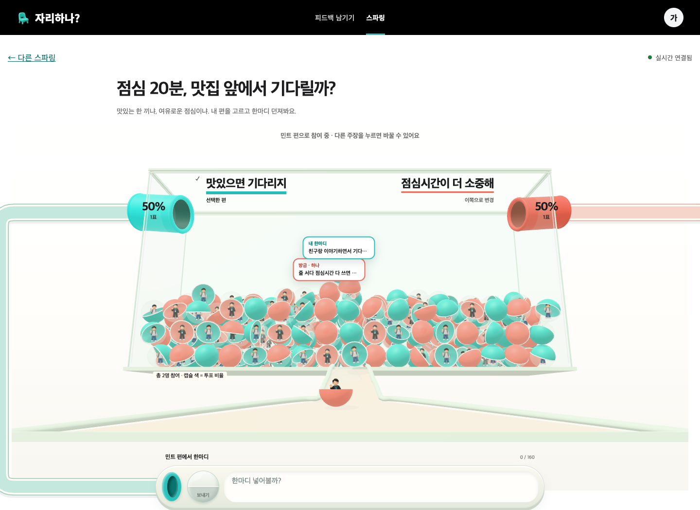
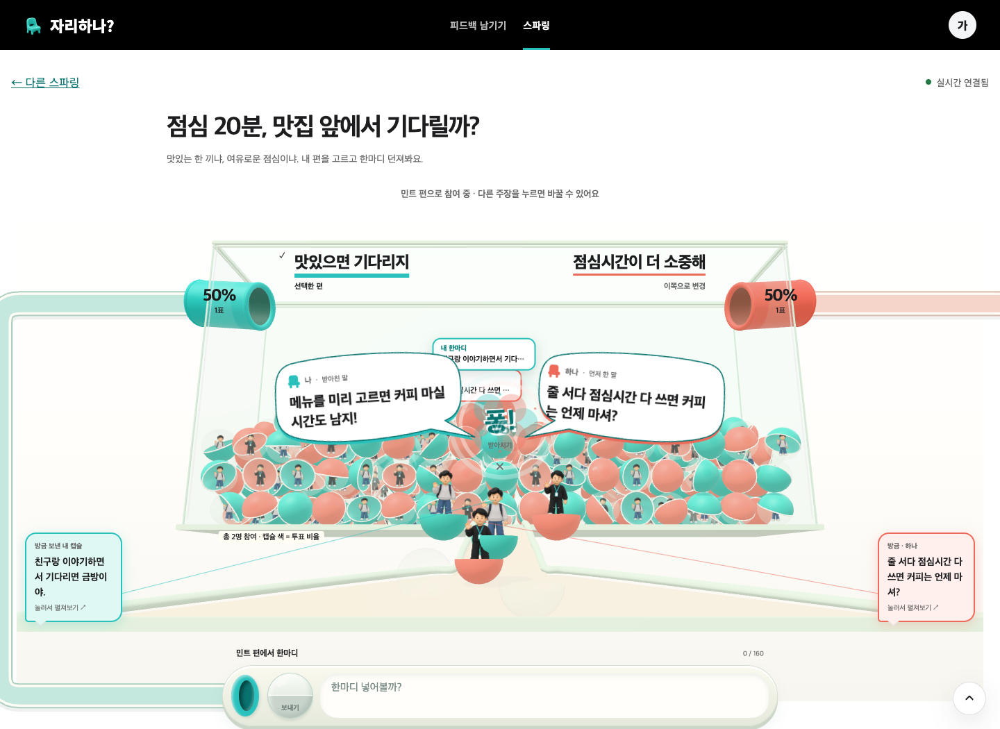
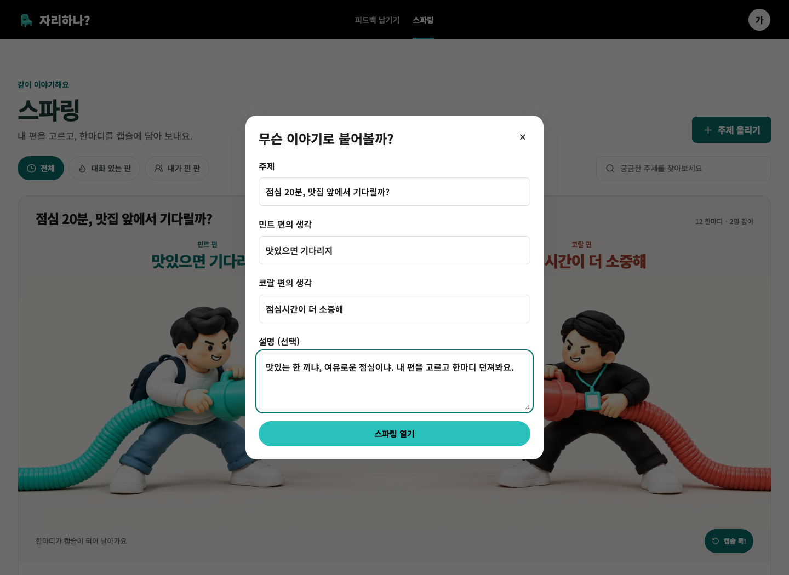
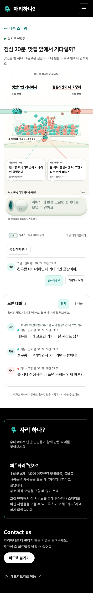

# 스파링 서비스 통합 검증

검증일: 2026-10-29 (KST). 작성자가 직접 로컬 검증했다. 별도 에이전트의 독립 승인을 뜻하지 않는다.

## 자동 검증

| 범위 | 실행/결과 |
| --- | --- |
| 백엔드 전체 | Java 21, `./gradlew test`: 60 suites / 438 tests, 실패·오류·skip 0 |
| 신규 수용 테스트 | 9개: 등록/조회, 한 표 변경, 중복 UUID, 원문 소속/편 보존, 페이지·catch-up, 인증·CSRF, 입력 검증, SSE 재연결, 동시 쓰기 |
| 프론트엔드 전체 | Node 24, `npm test`: 45 suites / 477 tests 통과 |
| 정적 검사 | `npm run typecheck` (ESLint, max-warnings 0) 통과 |
| 배포 빌드 | `npm run build` 성공. 자산/entrypoint 크기 경고 2개는 남음; 성능 최적화를 별도 완료한 것으로 보지 않는다 |
| OpenAPI | YAML 파싱, 7 operations / 47 local refs 해석 확인 |
| SQL | 전용 PostgreSQL 17의 새 스키마에 마이그레이션 적용 성공 |
| diff | `git diff --check` 통과 |

## 실제 브라우저 검증

Chromium의 격리된 두 컨텍스트와 전용 DB 회원을 사용했다. 사용자 Chrome 세션이나
다른 작업의 백엔드/DB를 사용하지 않았다. production build를 별도 로컬 서버에서 제공해
최소화된 native ESM/Three.js/Cannon/이미지 경로까지 확인했다.

- 목록 → 모달 등록 → 빈 상세 → 편 선택 → 한마디 → 받아치기
- 두 회원 간 POST 저장/SSE 새 글, 상대 편 변경, 새로고침 후 DB 복원
- 오프라인 중 다른 회원의 글을 재접속 후 한 번만 보충
- UUID 재시도 시 한 번 저장, HTTP 503 시 초안 유지
- 받아치기 원문/답장 동시 표시, 일반 캡슐 대기열 중복 없음
- 내 대화 필터, 35개 기록의 20 → 30 → 35 더 보기와 종료
- 390px/320px 가로 넘침 없음, 입력창이 긴 iframe의 맨 아래로 뛰지 않음
- 움직임 줄이기, 게스트 조회/전송 제한, WebGL 없는 환경의 기록/투표 UI
- 없는 주제의 오류/다시 불러오기
- WCAG A/AA axe 검사: 목록·상세에서 검출 위반 0. 낮은 VS/답장 인용 색 대비 두 곳을 수정했다

원본 결과: [실시간](evidence/live-interactions.json), [production 시나리오](evidence/production-checks.json),
[접근성](evidence/accessibility.json). 렌더러 수치는 해당 짧은 시나리오의 진단값이며 부하/성능 보장이 아니다.

## 화면

## 남은 확인

실기기 Safari, 실제 가상 키보드, 장시간 GPU/배터리 사용, 운영 프록시/SSE 재접속과 다중
인스턴스 부하, 실제 GitHub OAuth, 운영 마이그레이션·배포·PostHog 수신은 확인하지 않았다.
모바일의 말풍선 공간은 연출을 위해 확보되어 있어 정지 상태에서는 여백이 보일 수 있다.
외형/재미와 2.5D 캐릭터 유사도의 최종 판단은 사용자의 실제 체험이 필요하다.

## 2026-10-29 캐릭터 대치 UI

작업 위치: `sparring-latest-integration/2026-jarihana`,
`feat/sparring-latest-integration-preview` (develop `a063514d` 기반 작업본).
로컬 미리보기: `http://localhost:5199/sparring/2`. 기존 격리 백엔드 8098의
예시 주제를 읽었으며 이번 화면 검증에서 투표·글을 추가하지 않았다.

- 캡슐 받침과 미끄럼틀을 제거하고 크루/코치 두 명의 항의·팔짱 자세를 연결했다.
  `character-duel.js`, `character-duel.css`, 새 투명 아틀라스가 대화를 표시한다.
  `scene.js`는 실제 원문/답장을 전달하고 투표 통/파이프는 계속 렌더링한다.
- Node 24에서 lint (`--max-warnings=0`) 통과. 새 캐릭터 동작, 스파링 페이지,
  브리지 Jest 3개 모음 / 16개 테스트 통과. Production build 통과.
  큰 이미지·번들에 관한 Webpack 경고 2종은 남아 있으며 새 아틀라스는 960 KiB다.
- 격리 Chromium에서 1440px, 768px, 390px 확인. 문서/iframe 가로 넘침과
  페이지 JavaScript 오류 없음. 태블릿 주장 겹침과 입력창의 인물 가림을 수정했다.
- 실제 화면에서 말하는 쪽 교대, 7.2초 동안 말풍선 포커스 유지, 재생 일시정지,
  말풍선 읽기를 끝내도 명시적 일시정지 유지, 모바일 모션 감소의 이동/회전 생략을 확인했다. 같은 편 원문 색 보존,
  빈 판의 첫 새 글, 중복 수신은 Jest로 검증했다.
- 로컬 근거: `.omx/state/character-duel/`의 `browser-result.json`,
  `motion-result.json`, `service-preview.png`, `character-duel-preview.png`.

캐릭터는 생성한 두 자세를 전환하는 2.5D 이미지이며 관절을 가진 3D 모델이 아니다.
실기기 Safari와 새 에셋을 포함한 운영 성능은 이번 로컬 검증 범위 밖이다.
