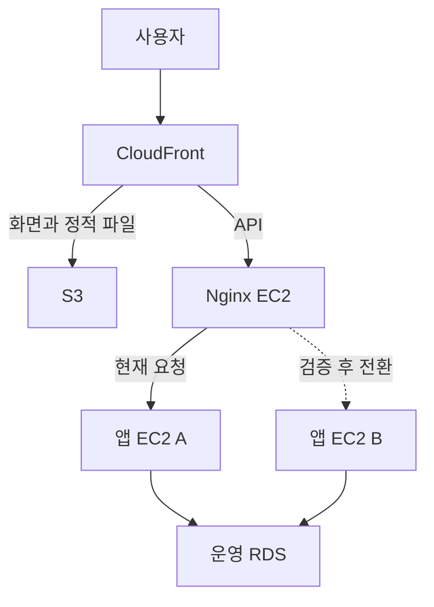

# 자리하나 Blue-Green 배포

새 버전을 대기 EC2에서 준비하고, 검증 후 Nginx가 요청을 보내는 대상을 바꾼다.
평소에는 앱 한 대가 서비스하고 다른 한 대는 중지한다. 배포가 끝나면 이전 서버를 중지해
다음 배포의 후보로 재사용한다.

## 구조

그림은 A에서 B로 교대하는 예시다. A/B는 고정된 논리 슬롯이며 실제 호스트는 보호된
`topology` 설정으로 확인한다. CloudFront의 API origin은 Nginx로 유지한다.
GitHub Actions가 순서를 연결하고, 각 서버의 전용 runner가 자기 호스트에서 배포 작업을 실행한다.
프론트엔드 파일의 S3 게시와 복구는 Nginx 서버의 coordinator가 수행한다.

## 배포 실행

적용 버전과 정상 실행 순서는 [배포 실행](controller/deployment.md)을 따른다.

## 문서

- [동작 구조](controller/architecture.md): 구성요소, worker 인계, 프론트 릴리스와 실행 보호 규칙.
- [배포 환경 구성](controller/environment.md): 필수 호스트, 권한과 관측 설정, 환경 재구성과 최초 worker 등록.
- [배포 실행](controller/deployment.md): 적용 버전, workflow 입력과 정상 배포 순서.
- [상태 확인](controller/status.md): 실행과 저널, 관찰 기준과 지표 최신성.
- [장애 복구](controller/recovery.md): 실패 시 처리, 복구 기한과 수동 조사.
- [검증](controller/verification.md): 배포 스크립트, 계측과 관제 변경의 검증 명령.
- [중앙 배포 수집기](../docs/observability/CENTRAL-DEPLOYMENT-COLLECTOR.md): Nginx 서버의 수집 경로, timer와 전용 Alloy 점검.
- [인프라 ADR 0005](../docs/adr/0005-nginx-ec2-blue-green-deployment.md): Nginx와 앱 EC2 두 대를 선택한 이유.
- [인프라 ADR 0006](../docs/adr/0006-s3-paired-frontend-rollback.md): 프론트엔드 보관과 동반 복구를 선택한 이유.
