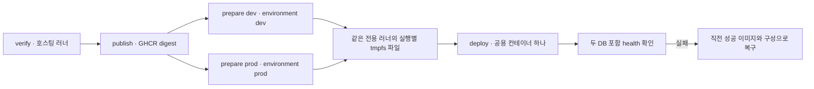

# 0008. 기존 환경 설정으로 공용 realtime 컨테이너를 배포한다

상태: 채택 · workflow·Compose·대시보드 구현 있음 · 운영 적용 미확인

날짜: 2026-11-13

관련 결정: [인프라 ADR 0007](0007-clubhouse-realtime-service.md), [공통 아키텍처 문서](../../../docs/clubhouse-realtime-architecture.md)

## 배경

사용자는 새 EC2에 GitHub 러너를 설치했고 Docker로 멀티플레이 서버를 배포하기로 했다. 당장은 개발·운영을 같은 서버로 빠르게 검증하며, develop 반영 때도 공용 서버를 갱신하기로 했다. 기존 CloudFront를 사용하고 EC2 인바운드는 80·8080을 허용한다는 제약이 있었다. 이후 원본 포트와 Spring 포트를 모두 8080으로 지정했다.

새 `realtime-dev` Environment나 별도 공개키·개인키를 만들고 값을 복사하기보다 기존 dev/prod Environment의 DB·JWT 설정을 재사용하기로 했다. 배포 절차는 별도 `deploy.sh` 없이 workflow 안에 두되 헬스체크와 롤백을 유지한다.

## 결정 1. CloudFront에서 Spring 8080으로 직접 전달한다

```text
개발·운영 브라우저
  → wss://jarihana.com/ws/realtime (CloudFront, 443)
  → http://<새 EC2>:8080/ws/realtime
  → Docker 포트 8080:8080
  → Spring realtime
```

현재 새 EC2의 애플리케이션은 realtime 하나이므로 별도 Nginx를 두지 않는다. 기존 CloudFront가 TLS와 경로별 원본 선택을 담당한다. WebSocket은 HTTP Upgrade 요청으로 시작하므로 `/ws/realtime` 경로로 전달할 수 있다. [AWS WebSocket 문서](https://docs.aws.amazon.com/AmazonCloudFront/latest/DeveloperGuide/distribution-working-with.websockets.html)

서버 디렉터리는 `realtime/`, Java 패키지는 `com.project.jarihana.realtime`, 이미지·Compose 프로젝트·러너 라벨은 `jarihana-realtime`으로 통일한다. 공개 WebSocket은 `/ws/realtime`을 사용한다. 아지트 REST 업무 경로인 `/api/groups/{groupId}/space/...`는 유지한다. 포괄적인 `/ws/*` 원본 변경으로 기존 경로까지 옮기지 않는다.

CloudFront의 `/ws/realtime/*` 패턴만으로는 끝에 `/`가 없는 실제 연결 주소를 선택할 수 없다. 정확한 `/ws/realtime` Behavior를 사용한다. 기존 프론트 배포의 CDN 사전 검사는 exact·wildcard 경로를 모두 허용하도록 보완했으며, 실제 배포된 Behavior와 WSS 연결은 운영에서 별도로 확인한다.

| 검토안 | 결정 이유와 비용 |
| --- | --- |
| Nginx를 추가해 prefix별로 전달 | 여러 HTTP 원본을 한 EC2에서 나눌 때 사용할 수 있다. 현재는 CloudFront가 목적지 하나를 선택하므로 설정·장애 지점을 추가하지 않음 |
| CloudFront → Spring 8080 — 채택 | 사용자가 정한 원본·앱 포트를 일치시킴. CloudFront→EC2 구간은 평문 HTTP이며 원본 접근 제한은 별도로 설정해야 함 |
| EC2 80 → 컨테이너 8080 | 가능한 매핑이지만 최종 포트 요청이 양쪽 8080이므로 채택하지 않음 |

기존 API의 Nginx·Blue-Green 구조는 유지한다. 향후 LiveKit을 추가한다고 Nginx가 반드시 필요해지는 것은 아니다. HTTP 시그널링 경로와 미디어 전송 경로를 정한 뒤 판단한다. [인프라 ADR 0009](0009-projector-livekit-direction.md)

## 결정 2. Environment별 준비 잡과 공용 배포 잡을 둔다

GitHub Environment의 secret은 해당 Environment를 지정한 잡에서 사용할 수 있다. `${{ secrets.dev.KEY }}`처럼 다른 Environment를 이름 공간으로 조회하는 방식을 제공하지 않는다. Environment 승인·브랜치 제한도 이를 참조하는 잡에 적용된다. [GitHub Environment 문서](https://docs.github.com/en/actions/reference/workflows-and-actions/deployments-and-environments)

처음에는 EC2 `.env` 파일, 새 realtime Environment, 개발·운영 값을 Repository secrets에 각각 복사하는 방법을 검토했다. 최종 요청은 기존 값을 다시 등록하지 않는 것이므로 아래 흐름을 사용한다. **마지막 배포 잡은 Environment를 지정하지 않지만, 앞의 준비 잡 두 개는 기존 Environment를 지정한다.**



| 입력 | 기존 저장 위치 | 쓰임 |
| --- | --- | --- |
| `RDS_URL`, `DB_USERNAME`, `FRONTEND_ORIGIN` | dev/prod Environment variables | 환경별 JDBC 주소·DB 계정·Origin 허용 목록 |
| `DB_PASSWORD`, `ACCESS_TOKEN_SECRET` | dev/prod Environment secrets | DB 비밀번호·입장 전용 키 유도 |
| `REALTIME_WEBSOCKET_URL` | dev/prod Environment variables | 각 backend가 입장권과 함께 반환하는 공용 WSS 주소 |
| `MONITORING_BIND_ADDRESS` | Repository variable | 기존 모니터링 EC2 주소 |
| `GITHUB_TOKEN` | Actions 제공 토큰 | GHCR 발행·pull 권한 |

설정 의도는 두 Environment의 `REALTIME_WEBSOCKET_URL`을 모두 `wss://jarihana.com/ws/realtime`으로 사용하는 것이다. 이 문서 작성 시 GitHub에 저장된 실제 값은 재조회하지 않았다. 변수·secret 구분은 [workflow](../../../.github/workflows/realtime-deploy.yml)를 기준으로 한다.

준비 잡은 `RDS_URL`로 `jdbc:postgresql://<host>:5432/jarihana_dev|prod?sslmode=require`를 만들고, 기존 JWT 시크릿에서 환경별 입장 키를 유도한다. 원본 JWT 시크릿 대신 유도한 키를 realtime에 전달한다. 두 Origin은 공용 허용 목록으로 합친다.

준비 잡과 배포 잡은 모두 `[self-hosted, Linux, ARM64, jarihana-realtime]` 러너를 사용한다. `/dev/shm`의 실행 ID·시도 번호별 디렉터리에 값을 NUL 구분 파일로 전달하고 배포 종료 후 삭제한다. 다음 준비 때 1시간 넘게 남은 실행 디렉터리도 정리한다. 운영자가 EC2에 상시 `.env`를 작성하지 않아도 된다.

이 선택에는 **같은 라벨의 전용 러너 호스트와 실행 계정 하나**라는 전제가 있다. GitHub 라벨 자체가 동일 호스트 실행을 보장하는 것은 아니다. 같은 라벨을 여러 호스트에 붙이면 파일이 없는 호스트에 배포 잡이 배정될 수 있다. 재부팅으로 tmpfs가 사라지거나 잡을 재실행할 때는 `Re-run all jobs`로 설정부터 다시 준비한다. 러너를 늘리거나 환경별 승인·접근 경계를 분리할 때는 값 전달 방식을 다시 결정한다.

### `REALTIME_ENABLED`와 입장권 발급

기존 API의 입장권 발급을 켜고 끄는 별도 플래그는 제거했다. 입장 조건을 만족하면 기존 API가 발급한다. realtime 앱의 `REALTIME_ENABLED` 설정은 코드에 남아 있으며 로컬 기본값은 `false`, 배포 Compose는 `true`로 고정한다. 이 값을 false로 한다고 다른 서버가 대신 발급하거나 동기화하는 것은 아니다. 입장권 발급과 실시간 서버의 가동 상태를 구분한다.

## 결정 3. develop의 관련 변경을 공용 서버에 배포한다

현재 [Realtime Deploy](../../../.github/workflows/realtime-deploy.yml)는 develop 대상 PR에서 카탈로그·Gradle·두 DB 격리·Alloy 설정을 검증한다. develop push에서는 검증 후 ARM64 이미지를 GHCR에 발행하고 digest로 배포한다. 수동 실행도 publish 조건이 develop으로 제한된다.

push·PR에는 경로 필터가 있다. `realtime/**`, `contracts/realtime/**`, `infra/realtime/**`, `frontend/src/pages/space/**`, 지정 마이그레이션 세 개와 workflow 파일이 대상이다. 따라서 “develop에 무엇이든 머지하면 항상 재시작”하는 구성은 아니다. 현재 `frontend/src/features/group-space/realtime/**`만의 변경은 직접 포함되지 않는다. 이는 현재 설정의 한계로 남기며, 이 문서 작성에서 배포 동작을 바꾸지는 않는다.

사용자가 빠른 배포·검증을 위해 공용 재시작을 선택했으므로 개발 변경도 운영의 실시간 연결과 방 메모리에 영향을 준다. 기존 backend의 Blue-Green·검증된 릴리스 승격 절차를 realtime에 그대로 복제하지 않았다. 운영 방의 독립적인 배포 시점이 필요해지면 환경별 배포 대상으로 나눈다.

## 결정 4. workflow 안에서 헬스체크와 복구를 수행한다

GHCR는 이미지를 저장·전달하는 역할이며 `deploy.sh` 파일을 요구하지 않는다. 사용자가 요청한 대로 배포 Bash는 workflow에 넣었다. Compose·Alloy 설정은 내용 해시별 디렉터리에 복사하고 성공한 이미지 digest와 함께 기록한다.

배포는 Compose 구성 확인, 이미지 pull, `up -d`, `/healthz` 확인 순서다. 헬스는 최대 18회 확인하며 개발·운영 DB의 연결과 필수 조회 권한도 검사한다. 실패하면 직전 성공 이미지와 Compose·Alloy 설정으로 돌아가 헬스를 다시 확인한다.

| 복구되는 것 | 복구되지 않는 것 |
| --- | --- |
| 직전 성공 이미지 digest, Compose와 Alloy 설정 | 이전 DB 비밀번호·JWT 키. 현재 Actions에서 읽은 값을 사용함 |
| 이전 앱을 다시 실행하려는 시도 | 이미 초기화된 방 메모리·끊긴 연결 |
| 이전 성공 기록이 있는 경우의 컨테이너 구성 | DB 마이그레이션·기존 API 발급 버전 |

첫 배포에는 돌아갈 성공 기록이 없다. 복구 실행도 실패할 수 있으므로 재확인 결과가 필요하다. 두 DB 중 하나가 준비되지 않아도 공용 헬스가 실패한다. API 마이그레이션과 realtime 배포가 병렬로 시작할 수 있으므로 아바타·아지트 스키마가 두 DB에 적용된 뒤 배포해야 한다. 기존 토큰 형식을 변경할 때는 API 발급 버전과 realtime 검증 버전을 함께 맞춘다.

workflow 안에 절차를 모아 배포 흐름을 한 파일에서 볼 수 있지만 Bash가 길어지고 로컬 단독 실행은 불편해진다. 배포 경로가 늘거나 재사용이 필요해지면 별도 스크립트 추출을 다시 검토한다.

## 결정 5. 기존 Alloy·Grafana 수집 경로를 확장한다

기존 backend처럼 관측할 수 있도록 새 EC2의 Compose에 Alloy를 함께 둔다. 별도 Grafana를 새 EC2에 설치하지 않고 기존 Prometheus·Loki·Grafana를 사용한다.

- Actuator 지표는 5초, HTTP 헬스·호스트·Alloy 지표는 10초 간격으로 수집한다.
- Docker discovery는 realtime 서비스의 stdout·stderr를 골라 Loki로 보낸다. Actuator 8081과 Alloy 관리 12345는 호스트 loopback에서 접근한다.
- 환경별 방·참여자·입장 결과, WebSocket 거절·종료 사유, 큐·송신 버퍼, DB 풀과 공용 호스트 자원을 대시보드에 둔다. 방 ID·회원 ID를 무제한 지표 라벨로 늘리지 않는다. `INVALID_MOVEMENT` 같은 개별 이동·명령 판정의 전용 지표까지 구현한 것은 아니다.
- 앱 메트릭의 개발·운영 구분과 공용 컨테이너 로그·호스트 지표의 범위를 구분한다. 지표·로그 수집 구성만으로 분산 추적까지 제공한다고 표시하지 않는다.

앱과 Alloy는 같은 EC2의 자원·장애 범위를 공유한다. 앱 배포에서 Alloy readiness 실패는 경고로 남기며 앱을 자동 롤백하지 않는다. 따라서 앱 헬스 통과와 관측 경로 정상은 각각 확인해야 한다. 대시보드는 별도의 Monitoring Deploy로 배포된다.

구현: [Compose](../../realtime/compose.yaml), [Alloy](../../realtime/config.alloy), [Grafana 대시보드](../../monitoring/grafana/provisioning/dashboards/json/jarihana-realtime.json). 설치·명령어·운영 확인은 [실행 가이드](../../realtime/README.md), 결과는 [검증 기록](../../realtime/VERIFICATION.md)에 둔다.
