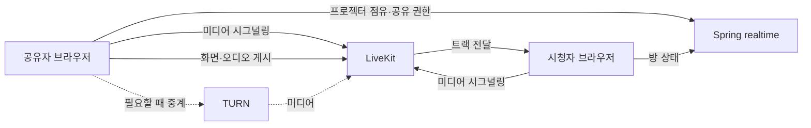

# 0009. 프로젝터 화면 공유는 LiveKit SFU를 사용하고 구현은 보류한다

상태: 방향 채택 · M3 구현·배포 및 네트워크 구성 보류

날짜: 2026-11-13

관련 결정: [인프라 ADR 0007](0007-clubhouse-realtime-service.md), [인프라 ADR 0008](0008-shared-realtime-deployment.md)

## 배경과 선택 변화

초기에는 Spring이 멀티플레이와 화면 공유 시그널링을 처리하고, 브라우저끼리 P2P로 화면을 전송하며 직접 연결에 실패하면 coturn으로 중계하는 안을 검토했다. 사용자는 TURN을 쓰면 서버도 영상 트래픽을 부담하므로 처음부터 SFU를 사용하는 편이 낫지 않은지 질문했다. 여러 시청자에게 보내는 구조와 연결 관리 부담을 검토한 뒤 LiveKit SFU를 사용하는 방향으로 바꿨다.

현재는 M1·M2 멀티플레이를 먼저 배포한다. Compose와 workflow에 LiveKit·coturn은 포함되어 있지 않다. 화면 공유 토큰, 프로젝터 점유, 트랙 게시·구독, 미디어 포트가 이미 구현됐다는 의미로 이 결정을 읽으면 안 된다.

## 결정. 방 상호작용과 미디어를 나눈다

Spring realtime은 누가 프로젝터를 사용 중인지와 공유 권한 같은 방 상태를 맡는다. LiveKit은 미디어 연결의 시그널링과 화면·오디오 트랙 전송을 맡긴다. 브라우저는 LiveKit SDK로 게시·구독하는 방향이다. SFU를 직접 만드는 대신 Go 기반의 기존 LiveKit 서버를 컨테이너로 운영하는 것을 검토한다. [LiveKit 서버](https://github.com/livekit/livekit), [방·참여자·트랙 모델](https://docs.livekit.io/intro/basics/rooms-participants-tracks/)

위 그림은 역할 분담이며 포트·도메인·배치 확정도가 아니다. 초기 목표였던 새 EC2 공동 배치도 실제 미디어 자원 사용량을 확인한 뒤 확정한다. 공동 배치하면 미디어의 CPU·네트워크 부하와 장애가 멀티플레이에도 영향을 준다.

| 방식 | 장점 | 비용·채택 여부 |
| --- | --- | --- |
| P2P 직접 연결 | 직접 연결에 성공한 미디어는 서버 중계 비용을 줄일 수 있음 | 공유자가 여러 시청자 연결을 관리하며 업로드 부담이 커질 수 있음. 이번 M3 방향에서 제외 |
| P2P + TURN fallback | 직접 연결의 장점을 유지하며 중계 경로를 추가 | TURN을 타는 구간은 서버 트래픽을 사용하고, 앱의 연결·시그널링 구현도 필요. 초기안에서 변경 |
| LiveKit SFU — 방향 채택 | 공유자는 SFU에 게시하고 시청자별 전달을 서버에 맡김. 트랙·연결 관리를 기존 구현으로 처리 | 서버 트래픽·운영 비용이 기본적으로 발생. 네트워크 경로와 수용량 검증 필요 |

SFU가 TURN보다 항상 트래픽이 적거나 무조건 더 안정적이라는 검증 결과는 없다. 동일 영상을 여러 시청자에게 보내면 SFU도 시청자별 송신 트래픽을 부담한다. P2P의 직접 연결 비율, TURN 경유 비율, 화질·구독 정책에 따라 실제 비용이 달라진다. 선택 이유는 화면 공유의 다자 전달과 연결 관리를 SFU에 맡기는 데 있다.

## 논의에서 구분해야 했던 개념

대화의 `tun`은 이 문서에서 **TURN**을 뜻한다. OS의 TUN 가상 네트워크 장치와 구분한다.

| 구성 | 하는 일 | 이 구성만으로 해결되지 않는 일 |
| --- | --- | --- |
| 시그널링 | 세션 설명·미디어 조건·ICE 후보 등 연결 준비 정보를 상대와 교환 | 실제 영상 중계·방화벽 통과를 보장하지 않음 |
| STUN | NAT 밖에서 관찰되는 자신의 IP·포트를 알아내고 연결 확인·바인딩 유지에 활용 | 상대에게 후보를 전달하는 앱 시그널링이나 모든 NAT 통과를 대신하지 않음 |
| ICE | 후보 경로로 실제 통신을 시도하고 연결 가능한 경로를 선택 | 서버나 네트워크 정책이 차단한 경로를 무조건 열지 못함 |
| TURN | 직접 통신이 어려울 때 사용할 패킷 중계 경로 제공 | 프로젝터 사용 권한, 다자 미디어 구독 정책을 정하지 않음 |
| SFU | 게시된 미디어를 필요한 시청자에게 전달 | 브라우저에서 SFU까지의 네트워크 연결 가능성을 보장하지 않음 |

STUN은 NAT 통과의 구성 요소이며 단독 해결책이 아니다. ICE는 후보 교환과 연결 검사를 사용하고 TURN을 중계 후보로 사용할 수 있다. [STUN RFC 8489](https://www.rfc-editor.org/rfc/rfc8489.html), [ICE RFC 8445](https://www.rfc-editor.org/rfc/rfc8445.html), [TURN RFC 8656](https://www.rfc-editor.org/rfc/rfc8656.html)

포트포워딩을 수동 설정하지 않아도 외부로 보내는 패킷으로 NAT 매핑이 만들어지고 일정 시간 유지될 수 있다. 하지만 STUN 서버를 향한 매핑이 다른 목적지에서도 같다는 보장은 없고 필터링 정책도 다르다. 예를 들어 목적지에 따라 외부 포트가 달라지는 NAT에서는 STUN이 알려 준 주소만으로 상대 연결이 성립하지 않을 수 있다. 기업망의 UDP 차단도 별도 문제다. STUN의 바인딩 유지와 ICE 연결 검사가 필요한 이유다. [STUN RFC 8489](https://www.rfc-editor.org/rfc/rfc8489.html), [ICE RFC 8445](https://www.rfc-editor.org/rfc/rfc8445.html)

coturn은 STUN·TURN 서버의 기존 오픈소스 구현이다. 선택하면 제공되는 서버·컨테이너를 설정하는 작업이며 Spring으로 TURN 프로토콜을 직접 만드는 작업이 아니다. coturn은 자리하나의 프로젝터 권한이나 미디어 세션 시그널링 서버를 대신하지 않는다. LiveKit은 인증이 통합된 TURN 서버를 포함하므로 별도 coturn의 필요 여부는 M3에서 판단한다. [coturn 프로젝트](https://github.com/coturn/coturn), [LiveKit 내장 TURN](https://docs.livekit.io/transport/self-hosting/deployment/)

## CloudFront와 Nginx prefix로 영상도 보낼 수 있는가

HTTP·WebSocket 시그널링에는 요청 경로가 있으므로 경로별 프록시가 가능하다. 반면 일반적인 WebRTC 미디어의 ICE/UDP·ICE/TCP와 TURN/TLS는 HTTP의 `/path`를 전달하지 않는다. Nginx의 HTTP `location`으로 구분할 경로가 없다. TURN/TLS가 443을 사용해도 HTTPS 요청이 되는 것은 아니다. CloudFront의 WebSocket 지원 역시 HTTP Upgrade 경로에 대한 지원이다. [AWS WebSocket 동작](https://docs.aws.amazon.com/AmazonCloudFront/latest/DeveloperGuide/distribution-working-with.websockets.html), [LiveKit 포트 구분](https://docs.livekit.io/transport/self-hosting/ports-firewall/)

따라서 현재의 CloudFront behavior에 `/livekit` 같은 prefix만 추가해서 영상 경로까지 완성할 수 없다. 시그널링을 CloudFront에 둘지 별도 도메인·프록시에 둘지도 아직 정하지 않았다. 미디어는 브라우저가 도달 가능한 LiveKit 또는 TURN 등의 종단점을 별도로 마련해야 한다. EC2에 직접 연결하는 방식 외에 적절한 L4 로드밸런서나 관리형 서비스도 검토할 수 있지만, 현재 선택한 배포 구성은 없다.

“SFU가 방화벽에 막힌다”는 말은 SFU라는 제품을 특별히 차단한다는 뜻이 아니다. 사용하는 프로토콜·목적지 포트·출발지 정책에 따라 허용 여부가 달라진다는 뜻이다. TURN과 HTTPS도 차단될 수 있다. TURN/TLS는 일부 제한된 망에서 연결 선택지를 늘릴 수 있지만 방화벽 통과를 보장하지 않는다. 지금 확보한 80·8080 허용만으로 M3 연결 성공을 단정하지 않는다.

## 포트 논의의 현재 결론

브라우저 사용자에게 인바운드 포트포워딩을 설정하게 하는 설계는 아니다. 브라우저가 접속할 서버 종단점과 서버의 인바운드 허용 정책을 결정해야 한다. 브라우저가 쓰는 임시 로컬 포트 수와 서버에서 공개할 포트 수는 다른 질문이다.

LiveKit 기본값을 검토할 때 나온 번호는 다음과 같다. 전부 반드시 공개해야 한다는 목록은 아니며 활성화한 전송 방식에 따라 달라진다. [LiveKit 포트·방화벽 문서](https://docs.livekit.io/transport/self-hosting/ports-firewall/)

| 용도 | 기본 설정에서 검토한 값 | 현재 상태 |
| --- | --- | --- |
| API·WebSocket 시그널링 | TCP 7880, 보통 TLS 종료 프록시 뒤 | 미설정 |
| ICE/UDP | 50000–60000 범위 또는 UDP mux 7882 | 둘 중 사용할 방식·허용 정책 미정 |
| ICE/TCP | TCP 7881 | 사용 여부·실제 포트 미정 |
| 선택적 TURN | UDP 3478, TURN/TLS 설정 5349 또는 외부 443 구성 | 사용 여부·인증서·배치 미정 |

대화 중 “시그널링은 CloudFront 443, 영상은 EC2 8080”이라는 TCP 전용 예시를 검토했다. 이후 최종 요청은 **Spring과 CloudFront 원본을 모두 8080**으로 사용하는 것이었다. 그러므로 영상용 TCP 8080을 예약한 상태가 아니며 동일 IP의 같은 TCP 포트를 두 서버가 독립적으로 사용할 수 없다. 미디어를 TCP만으로 전달하면 패킷 손실 시 재전송 대기가 지연에 영향을 줄 수 있으므로 실제 품질도 확인해야 한다.

## M3 착수 때 확정할 항목

1. 동시 시청자·공유자 수, 화질·프레임률·오디오 범위와 허용 지연.
2. 새 EC2 공동 배치 여부, 허용 가능한 TCP·UDP 포트, TLS 종료·도메인·TURN fallback.
3. 환경과 모임 ID를 함께 사용하는 미디어 방 식별, 게시·구독 권한과 토큰 발급 책임.
4. 프로젝터 점유와 미디어 트랙의 일치: 공유자 퇴장·연결 끊김·가구 삭제·권한 회수 때 정리 규칙.
5. 새 입장자의 진행 중 공유 구독, 브라우저의 공유 중단, 재접속과 실패 안내.
6. 다른 실제 네트워크에서 연결 성공률·지연·대역폭·CPU 측정. TCP 전용이나 TURN 경유가 필요한 경우도 별도 확인.

이 항목을 확정하고 검증하기 전에는 현재 멀티플레이 배포 완료를 화면 공유 배포 완료로 확대하지 않는다.
