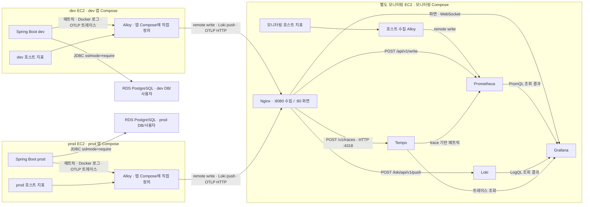
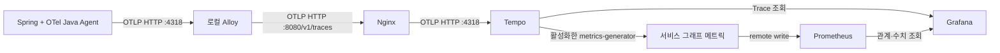

# 자리하나 모니터링·로그 아키텍처

이 문서는 [인프라 ADR 0001](../adr/0001-local-alloy-observability.md)의 실행 설계를
설명한다. 목표는 로컬 Alloy에서 별도 서버의 Prometheus·Loki로 보내고 Grafana에서 조회하는
구조다. 트레이스는 같은 앱 Alloy를 거쳐 Tempo에 저장한다. Nginx·Alloy·Prometheus·Loki·Tempo·Grafana는 Docker Compose로 실행한다.
**저장소는 Alloy·Prometheus·Loki·Tempo·Grafana와 dev·prod RDS 연결을 반영했다.
실제 AWS 배포·RDS 접속 검증·기존 Agent 제거와 외부 자원 정리는 아직 수행하지 않았다.**

선택 배경은 ADR, 용어와 계산 방법은 [학습 노트](../learning/observability.md)에 있다.
실행 명령은 [모니터링 실행 가이드](OPERATIONS.md), 로그 필드와 검색은
[애플리케이션 로깅 가이드](../../../backend/docs/operations/application-logging.md)를 따른다.

## 저장소 구현과 미검증 범위

| 영역 | 저장소의 실행 구성 | 별도로 확인할 항목 |
| --- | --- | --- |
| 로그 | ECS JSON stdout → Docker `local` → Alloy → Loki | 실제 EC2에서 알려진 요청의 로그 수신 |
| 앱 메트릭 | Micrometer endpoint → 로컬 Alloy scrape → remote write → Prometheus | 지표·라벨·수집 누락 |
| 호스트 메트릭 | Alloy unix exporter로 앱·모니터링 EC2 관측 | 호스트 마운트, 용량·권한과 실제 지표 |
| 배포 DB | dev·prod 모두 외부 RDS PostgreSQL | RDS 접속, 스키마·권한, 백업·복원 |
| 화면 | Grafana의 Prometheus·Loki·Tempo 데이터 소스, 운영 대시보드와 Canvas JSON | 운영 데이터 조회, 자동 서비스 그래프·인프라 지도 |
| 알림 | health·HTTP 500·호스트 자원 알림 정의 12개와 Slack 정책 제공, 외부 감시 미구현 | 장애 발생·복구·데이터 없음과 전달 실패 |
| 트레이스 | OTel Java Agent → 앱 Alloy → Tempo, trace 기반 지표 → Prometheus | 실제 EC2 전송·보관·자원 비용 |

[prod Compose](../../docker-compose.yml), [dev Compose](../../docker-compose.dev.yml),
[Alloy 설정](../../monitoring/alloy/config.alloy)과 [DB 결정](../adr/0002-rds-deployment-database.md)을
기준으로 작성했다. 이 파일들이 실제 AWS 상태를 증명하지는 않는다.

## 배포 구성



dev·prod·모니터링은 각각 다른 EC2다. 각 앱 EC2에는 해당 앱과 Alloy 한 개를 둔다.
Alloy는 자기 환경의 앱 대상 한 곳과 호스트·자체 메트릭을 수집한다.
새 앱 EC2를 추가할 때도 해당 호스트의 Alloy를 함께 준비한다. 모니터링 EC2에는
[monitoring.alloy](../../monitoring/alloy/monitoring.alloy)를 사용하는 Alloy를 두어 호스트·자체
메트릭만 수집한다. 이 수집기는 앱 scrape나 Docker 로그 수집을 하지 않는다.

## Docker Compose 배포 단위

| 실행 위치 | Compose 프로젝트 | 서비스와 배포 범위 |
| --- | --- | --- |
| dev EC2 | dev 앱 프로젝트 | `infra/docker-compose.dev.yml`의 Spring Boot·Alloy 직접 정의 |
| prod EC2 | prod 앱 프로젝트 | `infra/docker-compose.yml`의 Spring Boot·Alloy 직접 정의 |
| 모니터링 EC2 | 모니터링 프로젝트 | Nginx·Prometheus·Loki·Tempo·Grafana·호스트 수집 Alloy와 각 저장 볼륨 |

각 EC2에서 해당 Compose를 실행한다. Compose가 서비스들을 다른 EC2에 자동으로 배치하지는 않는다.
Alloy 서비스와 `alloy-data` 볼륨은 두 앱 Compose 파일에 각각 직접 정의한다.
include·extends로 별도 파일을 연결하지 않고 한 앱 Compose 파일에서 배포 구성을 읽도록 했다.
이 단순함을 위해 서비스 선언의 중복을 받아들인다. 수집 규칙은 공통
`./monitoring/alloy/config.alloy`를 마운트하므로 두 환경이 같은 설정을 사용한다.
독립 collector Compose는 없으며 Alloy와 볼륨은 각 앱 프로젝트에 속한다.

dev·prod backend의 `depends_on`은 Alloy의 `service_started`만 사용한다. 외부 RDS에는 Compose의
시작 순서·health 의존성이 적용되지 않으므로 DB 연결과 앱 health를 별도로 확인한다.
`up -d --no-build backend`로 앱과 필요한 의존 서비스를 함께 시작한다. Alloy의 시작 조건은
수집 성공이나 저장소 준비 완료를 보장하지 않는다. `restart: true`는 의존성에 지정하지 않는다.
backend만 갱신할 때 설정이 바뀌지 않은 정상 Alloy는 유지할 수 있지만, 프로젝트 전체 `down`은
Alloy도 내린다. 일반 배포에 `down -v`를 넣지 않는다.

현재 백엔드 배포 workflow는 `up -d --no-build --force-recreate backend alloy`를 사용한다.
bind mount 원본인 `config.alloy`의 체크아웃 내용을 다시 읽게 하려는 선택이다.
`infra/docs/**`만 바뀌면 백엔드는 자동 배포하지 않는다. 다만 dev/prod workflow 모두
`backend/**`를 path로 보므로 backend 하위 문서 변경은 앱 배포 조건에 포함된다.
허용된 앱 런타임·Compose·workflow·Alloy 설정 변경이나 수동 실행으로 배포가 시작되면
해당 체크아웃의 설정을 사용하므로 앱과 함께 바뀐 인프라 설정도 적용된다.
이는 실행 조건의 제한이며 설정 버전 고정은 아니다. 재생성 동안 Alloy 수집이 잠시 멈추지만
named volume은 유지한다.
기동 후 Alloy `/-/ready`를 확인하고 저장소의 실제 수신은 별도로 확인한다.
EC2 runner 라벨은 dev `jarihana-dev`, prod `jarihana-prod`다.
workflow의 라벨 조건은 작성했지만 실제 runner 등록·라벨 설정은 이 문서가 증명하지 않는다.

모니터링 EC2는 별도 [monitoring-deploy.yml](../../../.github/workflows/monitoring-deploy.yml)로
자동 배포한다. `main`에 `infra/monitoring/**` 또는 해당 workflow 변경이 반영되면
`jarihana-monitoring` runner가 대시보드 생성, 설정 검증, Compose 재생성, 준비 상태 확인을 실행한다.
repository-wide Actions variables `MONITORING_HOST_ID`·`MONITORING_BIND_ADDRESS`와 repository secret
`SLACK_WEBHOOK_URL`을 주입한다. workflow는 `MONITORING_HOST_ID`를 컨테이너 `HOST_ID`로 매핑해
backend dev/prod workflow의 `vars.HOST_ID`와 충돌하지 않게 한다. 이 값은 지표 라벨에 사용할
안정적인 모니터링 호스트 이름이며 실제 AWS instance ID일 필요는 없다. `MONITORING_BIND_ADDRESS`는 Nginx `80`·`8080`을 bind할 모니터링 EC2의 실제 사설 IPv4다.
Prometheus `9090`, Loki `3100`, Tempo 조회 `3200`, Grafana `3000`은 호스트 loopback 관리 포트로 유지하며
Tempo OTLP `4317`은 호스트에 publish하지 않는다.
Grafana의 `GF_SERVER_ROOT_URL`은 Compose에서 `http://grafana.jarihana.com/`으로 고정한다.
도메인·HTTPS 변경 시 Compose의 이 값과 Nginx Host 설정을 함께 맞춘다.
Nginx `80`은 `grafana.jarihana.com` Host만 받고 다른 Host는 `404`로 응답한다.
이 서브도메인의 DNS를 모니터링 EC2 공인 IP에 연결하며 루트 `jarihana.com`의 기존 서비스는 변경하지 않는다.
DNS 실제 변경은 아직 수행하지 않았다. 수집 주소는 사설 IP의 `8080`을 유지한다.
프로젝트 이름은 `jarihana-monitoring`으로 고정하고
named volume을 유지한다. 등록 방법은 [실행 가이드](OPERATIONS.md)를 따른다.

프로젝트 이름은 기존 앱과 같게 유지한다. `alloy-data`는 각 앱 프로젝트의 볼륨이며,
과거 독립 `jarihana-collector` 프로젝트의 볼륨과는 이름·소유 프로젝트가 다르다.
이전 구성이 실제 EC2에 배포되었다는 확인은 없다. 만약 기존 수집기를 운영 중이라면 먼저
실제 프로젝트·볼륨과 WAL·읽기 위치를 확인하고 중지·백업·이관 절차를 정한다.
새 프로젝트가 이전 볼륨을 자동으로 이어 쓴다고 가정하지 않는다.
[Compose 프로젝트 이름](https://docs.docker.com/compose/how-tos/project-name/)

### 컨테이너 사이와 EC2 사이의 주소

Linux EC2의 Alloy에는 **`network_mode: host`**를 사용한다. 호스트 네트워크를 공유하므로
각 호스트에 공개된 관리 포트에 접근한다. `APP_METRICS_TARGET`은 dev·prod 각 Compose에서
`127.0.0.1:8081`로 고정해 Alloy 컨테이너에 전달한다. 셸이나 `.env`에서 치환하지 않는다.
두 호스트의 `8081` 포트는 각 backend 컨테이너의 관리 포트 `8081`로 연결한다.
일반 bridge 컨테이너의 `127.0.0.1`은 그 컨테이너 자신을 가리킨다. `host.docker.internal`
이름만 추가해도 호스트 loopback에 접근할 수 있다고 가정하지 않는다.

host 모드 Alloy에는 `ports`를 지정하지 않는다. Alloy의 관리 HTTP 주소는 호스트
loopback으로 제한한다. 반면 Prometheus·Loki·Grafana는 모니터링 Compose의 bridge 네트워크를
공유한다. 서비스 이름을 각각 `prometheus`, `loki`로 정하면 Grafana의 데이터 소스 주소는
`http://prometheus:9090`, `http://loki:3100`, `http://tempo:3200`이다. Grafana 데이터 소스는
Nginx를 거치지 않으며 저장소를 `localhost`로 지정하지 않는다.

앱 EC2의 Alloy는 모니터링 EC2의 **사설 주소와 Nginx `8080`**으로 전송한다.
Nginx는 정확히 일치하는 `POST /api/v1/write`, `POST /loki/api/v1/push`, `POST /v1/traces`만
각각 Prometheus `9090`, Loki `3100`, Tempo OTLP HTTP `4318`로 전달한다. 경로 접두사는 추가하지 않는다.
`8080`은 RFC1918 사설 IPv4와 loopback만 허용하며 다른 출발지는 거부하고 알 수 없는 경로는 `404`로 응답한다.
Grafana 화면은 Nginx `80`의 루트 경로로 제공하며 WebSocket도 전달한다.
사설 IP bind만으로 인터넷 차단이 보장되지는 않는다. AWS 보안 그룹·라우팅에서 `80`은 허용한 운영자,
`8080`은 앱 EC2의 사설 접근만 허용하는지 별도로 확인한다.
모니터링 Alloy는 host 네트워크에서 `http://127.0.0.1:9090/api/v1/write`로 직접 전송한다.
Compose 서비스 DNS는 서로 다른 EC2를 연결하지 않으며 host 모드 Alloy에도 제공되지 않는다.
[Compose 네트워크](https://docs.docker.com/compose/how-tos/networking/)

### 설정과 데이터의 보관

이미지 버전을 고정하고 설정 파일은 읽기 전용으로 마운트한다. 쓰기가 필요한 데이터 경로는
서비스별 named volume 또는 전용 호스트 경로로 분리한다.

| 서비스 | 영속화할 경로 |
| --- | --- |
| Alloy | 실행 인자 `--storage.path`로 지정한 경로. WAL·읽기 위치 등 구성 요소의 상태 |
| Prometheus | 기본 `/prometheus`. `--storage.tsdb.path`를 바꾸면 볼륨도 맞춘다 |
| Loki | 선택한 설정에서 사용하는 index·chunk·WAL·compactor 등의 데이터 경로 |
| Tempo | `/var/tempo` 아래 trace WAL·블록·metrics-generator WAL. `tempo-data` 볼륨으로 보관 |
| Grafana | 기본 `/var/lib/grafana`. 데이터 소스·알림 provisioning 파일을 읽기 전용 마운트 |

볼륨 경로와 컨테이너 실행 사용자의 쓰기 권한을 대조한다. 데이터가 컨테이너 내부에만
쌓이지 않는지 재생성 후 확인한다. 데이터 볼륨을 지우는 `docker compose down -v`는 일반
배포 절차에 넣지 않는다. restart 정책·healthcheck는 서비스마다 설정한다. 현재 모니터링
Compose는 Grafana·Loki·Tempo·Prometheus와 모니터링 Alloy에 컨테이너별 메모리 상한을 걸지 않으며,
실제 메모리는 같은 호스트에서 공유된다. 앱 Compose의 Alloy는 기존 메모리 상한을 유지한다.
자동 재시작만으로 수집 연속성과 무중단 운영을 보장하지 않는다.
[Alloy Docker 설치](https://grafana.com/docs/alloy/latest/set-up/install/docker/),
[Prometheus Docker 실행](https://prometheus.io/docs/prometheus/latest/installation/),
[Loki 저장소](https://grafana.com/docs/loki/latest/configure/storage/),
[Grafana Docker 실행](https://grafana.com/docs/grafana/latest/setup-grafana/installation/docker/)

## 책임과 수명주기

| 구성 요소 | 맡는 일 |
| --- | --- |
| Spring Boot | 업무 처리, 허용된 로그 필드 생성, Micrometer 메트릭 노출 |
| Docker | 컨테이너 stdout 로그의 로컬 보관·회전 |
| Alloy | 대상 발견, 수집, 라벨 정리, 가공, 제한된 버퍼·재시도와 전송 |
| Nginx | Grafana 화면·WebSocket과 세 수집 API의 HTTP 진입점 |
| Prometheus·Loki | 신호별 저장·조회, 보관 정책 적용 |
| Grafana | 화면·탐색·설정한 알림 평가와 전달 |
| 운영 구성 | 영속 볼륨, 접근 제어, 백업·복구, 버전·자원 한도 관리 |

수동으로 backend만 갱신하면 Alloy를 유지할 수 있다. 자동 배포는 설정 반영을 위해
backend와 Alloy를 함께 재생성한다. 프로젝트 전체 종료도 Alloy를 중단하므로 배포·종료의
수집 중단 시간을 운영 절차에 반영한다. 로그 수집 대상은 배포마다 바뀌는 컨테이너 ID를 설정에 박아 넣기보다 서비스·환경 식별 정보를 기준으로
찾는다. 수집 대상 허용 목록을 두어 같은 호스트의 모든 컨테이너 로그를 무조건 가져오지 않는다.

## 신호별 데이터 경로

### 애플리케이션 메트릭

현재 호스트의 관리 주소는 dev·prod 모두 `127.0.0.1:8081/actuator/prometheus`다. 업무 API의 `/api` 경로를 이 관리 주소 앞에
붙이지 않는다. Alloy가 로컬에서 읽으므로 외부 서버에 Actuator 포트를 공개할 필요가 없다.
이 주소는 위에서 선택한 host 네트워크 Alloy를 기준으로 한다. `APP_METRICS_TARGET`으로
해당 EC2의 대상 한 곳만 수집하며 dev·prod를 동시에 scrape하지 않는다.

목표 경로는 다음과 같다.

```text
Micrometer → /actuator/prometheus
                 ↑ 로컬 scrape
          Alloy prometheus.scrape
                 ↓
          Alloy prometheus.remote_write
                 ↓ HTTP
          Nginx :8080/api/v1/write → Prometheus :9090
```

Prometheus 수신 서버에서는 `--web.enable-remote-write-receiver`를 명시적으로 활성화해야
한다. 이 경로는 초기 저용량 수집을 전제로 하며 일반적인 대규모 push 수집 대안으로 보지
않는다. 부하가 커지면 직접 scrape 또는 전용 remote write 저장소와 비교한다.
[Prometheus 수신 API](https://prometheus.io/docs/prometheus/latest/querying/api/#remote-write-receiver)

Compose에서 Prometheus의 `command`를 지정하면 이미지의 기본 실행 인자가 대체된다.
수신 옵션을 추가할 때 설정 파일 경로와 TSDB 저장 경로 등 필요한 인자도 명시적으로 유지한다.
[Prometheus 실행 인자](https://prometheus.io/docs/prometheus/latest/installation/#setting-command-line-parameters)

Alloy 앱 scrape는 30초 주기다. 실제 endpoint에 노출된 지표와 Prometheus의 시계열을 대조한다.
부하 테스트용 간격은 필요한 시간 해상도와 수집 비용을 보고 조정한다.

RED 지표의 기준은 HTTP 메트릭이다. 요청량은 카운터 증가율, 오류율은 전체 요청 대비 5xx,
p95는 HTTP timer의 histogram으로 계산한다. 4xx는 별도 지표로 보며 모든 실패를 서버 오류로
묶지 않는다. p95를 추가하려면 앱의 histogram 노출과 Alloy의 bucket 전달을 모두 확인해야 한다.
계산식과 무트래픽·결측 처리는 [학습 노트](../learning/observability.md)에 있다.

### 호스트 메트릭

Alloy의 `prometheus.exporter.unix` 등으로 CPU·메모리·디스크·인터페이스 지표를 노출하고
scrape한 뒤 같은 Prometheus로 전송한다. 앱의 JVM 메모리와 호스트 메모리는 다른 지표다.
컨테이너 단위 사용량도 호스트 지표만으로 자동 확보되는 것은 아니므로 필요하면 별도 수집을
설계한다. EC2 unix exporter는 RDS 내부 상태를 관측하지 않는다. Hikari는 앱 연결 풀 지표이며
DB CPU·디스크·락·쿼리 상태는 별도 관측 경로가 필요하다.

Alloy 컨테이너에는 호스트의 procfs·sysfs·rootfs를 읽기 전용으로 bind mount한다. 예를 들어
`/proc`을 `/host/proc`, `/sys`를 `/host/sys`, `/`를 `/host/root`에 연결했다면 exporter의
`procfs_path`·`sysfs_path`·`rootfs_path`도 각각 그 경로로 지정한다. 추가 mount가 생기는 환경은
mount propagation을 검토하고, 선택한 collector에 필요한 PID namespace·capability만 허용한다.
host 네트워크만 설정해도 파일시스템 접근이 해결되는 것은 아니다. 자기 컨테이너만 보고
EC2 전체를 측정했다고 해석하면 안 된다.
[unix exporter의 컨테이너 배치](https://grafana.com/docs/alloy/latest/reference/components/prometheus/prometheus.exporter.unix/#run-on-dockerkubernetes)

### 로그

기존 ECS JSON 형식과 필드 정책을 유지한다. 이번 실행 설계의 기본안은 **Docker `local`
driver로 stdout을 로컬에 보관하고 Alloy의 `loki.source.docker`가 Docker API로 읽는 방식**이다.
새 애플리케이션 파일 appender를 반드시 추가해야 하는 구조는 아니다.

```text
Spring ECS JSON stdout
  → Docker local driver의 보관·회전
  → discovery.docker / loki.source.docker
  → loki.process의 필요한 파싱·라벨 정리
  → loki.write
  → Nginx :8080/loki/api/v1/push → Loki :3100
```

로그는 Compose 서비스 이름이 `backend`이고 `com.jarihana.monitoring.logs=true`인 컨테이너만
수집한다. `environment`는 Docker 라벨 대신 Alloy 자신의 `SPRING_PROFILES_ACTIVE`에서
가져온다. 앱과 Alloy는 앱 Compose 실행 셸 또는 `--env-file`의 같은 필수 변수를 사용한다.
YAML 앵커와 `com.jarihana.monitoring.environment` 라벨은 사용하지 않는다.

두 앱 Compose의 backend는 기본으로 `local` driver와 수집 허용 라벨을 사용한다.
`max-size=10m`, `max-file=5`이며 별도 로그 override를 적용하지 않는다.
logging driver 변경에는 컨테이너 재생성이 필요하다. Docker 내부 로그 파일을 일반 JSON
파일로 가정해서 직접 tail하지 않는다.
[Docker local driver](https://docs.docker.com/engine/logging/drivers/local/),
[Alloy Docker 로그 수집](https://grafana.com/docs/alloy/latest/reference/components/loki/loki.source.docker/)

`max-size`·`max-file`로 보관 상한을 정하고 장애 중 쌓이는 로그가 언제 회전되어 사라지는지
시험한다. 이 설계는 로컬 Docker socket을 Alloy 컨테이너에 연결해 로그 API를 읽는다.
socket 마운트와 실행 사용자의 접근 권한은 host 네트워크와 별도로 설정한다.
Docker API 접근 권한은 호스트 제어 권한으로 이어질 수 있으므로 최소 허용 범위를
검토한다. Docker socket을 읽기 전용으로 마운트했다는 이유만으로 API 호출까지 읽기 전용이
되었다고 판단하지 않는다.

별도 애플리케이션 파일을 택한다면 호스트 볼륨·회전·`loki.source.file`의 positions를 준비한다.
두 로그 원본을 동시에 수집해 같은 이벤트를 중복 적재하지 않는다.

## 식별자와 라벨

| 대상 | 초기 기준 |
| --- | --- |
| 앱 메트릭 | 기존 `application=jarihana`, `environment=dev\|prod` 유지. `instance`는 호스트·대상을 구분할 수 있게 만든다 |
| 호스트 메트릭 | 각 EC2의 고유한 `HOST_ID`로 한 번만 기록 |
| Loki 인덱스 라벨 | `service_name`, `environment` 등 값의 종류가 제한된 식별자부터 사용 |
| 요청·회원·경로 ID | 검색할 JSON 본문에 남긴다. Prometheus나 Loki 인덱스 라벨로 올리지 않는다 |
| 배포 버전 | 기존 `BACKEND_TAG → APP_VERSION → service.version`을 유지. 메트릭 버전 라벨은 시계열 증가량을 보고 선택 |
| 로그 연결 | 응답 `X-Request-Id`와 로그의 `http.request.id`를 대조. `trace.id`와 동일시하지 않는다 |

HTTP 경로는 실제 ID가 들어간 URL보다 매핑 템플릿을 사용한다. Loki의 서비스 라벨 이름과
JSON 안의 `service.name`은 별도다. ECS JSON은 중첩 객체를 포함하므로 실제 로그 샘플로 파싱
경로를 확인한다. 토큰·쿠키·전체 본문·원시 query·개인정보 수집 제한은
[기존 로그 정책](../../../backend/docs/operations/application-logging.md#개인정보와-변경-규칙)을 따른다.

## 저장·장애·유실의 경계

| 장애 | 기대하는 동작 | 보장하지 않는 것 |
| --- | --- | --- |
| backend만 재시작·교체 | 변경이 없는 정상 Alloy는 유지하고 새 컨테이너를 발견한다 | 앱 메모리에만 있던 미기록 이벤트의 복원 |
| App EC2 중단 | 별도 서버에 도착한 데이터는 조회 가능하다 | 호스트에 남아 있던 데이터의 즉시 전송 |
| 네트워크 또는 저장소 중단 | 경로별 버퍼·재시도 한도 안에서 다시 보낸다 | 무제한으로 지연을 허용하거나 한도 초과 데이터를 보존하는 것 |
| Alloy 강제 종료 | 영속 상태를 이용해 재시작한다 | 메모리 batch와 모든 신호의 무손실 복구 |
| 모니터링 EC2 중단 | 별도 외부 감지 경로로 중단을 알아야 한다 | 그 서버의 Grafana가 자기 장애를 계속 통지하는 것 |
| 로컬 디스크 소실 | 전송된 데이터·외부 백업 범위만 복구한다 | 로컬 WAL만으로 호스트 소실까지 복구하는 것 |

**positions는 읽기 위치이고 WAL은 데이터를 디스크에 기록하는 장치다.** 둘은 같은 보장이 아니다.
Prometheus remote write의 WAL은 영속 상태 경로와 보존 한도가 필요하다. Loki 경로는 읽기
위치, 전송 큐, 재시도 실패 후 폐기를 따로 확인한다. 확인한 Alloy 문서에서 `loki.write`의
WAL·queue 옵션은 실험 기능이며 기본 활성화된 내구성으로 가정하지 않는다.
[메트릭 전송](https://grafana.com/docs/alloy/latest/reference/components/prometheus/prometheus.remote_write/),
[파일 읽기 위치](https://grafana.com/docs/alloy/latest/reference/components/loki/loki.source.file/),
[로그 전송](https://grafana.com/docs/alloy/latest/reference/components/loki/loki.write/)

Alloy에는 프로세스 자원 상한과 경로별 큐·배치·재시도 상한을 둔다. 한도 초과 때 데이터가
거절·폐기되거나 OOM 종료될 수 있다. 트레이스 경로에 쓰는 `memory_limiter`가
`prometheus.*`·`loki.*` 구성의 메모리까지 모두 제한해 주는 것은 아니다.
[OTel memory limiter](https://grafana.com/docs/alloy/latest/reference/components/otelcol/otelcol.processor.memory_limiter/)

Prometheus·Loki의 저장 볼륨, Grafana의 설정·대시보드·사용자 데이터도 컨테이너 수명과 분리한다.
로그 회전 용량, Alloy 상태 보관, 저장소 retention은 각각 따로 정한다. 볼륨이 있다는 사실은
백업이 있다는 뜻이 아니며 복구 시점과 허용 유실 범위는 배포 전에 정하고 실제 복원으로 확인한다.

## 접근과 알림

Actuator는 기존 loopback 범위를 유지한다. Nginx `8080` 수신 포트는 지정한 앱 EC2에서만
접근하게 하고 Grafana 화면은 인증된 운영자에게만 제공한다. 네트워크와 전송 구간에 맞는
인증·암호화를 구성한다. 인터넷에 저장소 쓰기 API를 그대로 공개하는 설계는 아니다.

Grafana Alerting의 [Slack 장애 알림](SLACK.md)은 dev·prod health·HTTP 500 규칙 4개와
호스트 CPU·메모리·디스크·inode 규칙 8개, 연락처와 전달 정책을 시작 시 파일 provisioning으로 등록한다.
Alloy는 앱 health를 60초마다 확인하며 Grafana는 30초마다 평가한다. 호스트 자원 알림은
`host_id`별로 평가하고 디스크·inode는 `mountpoint`도 구분한다. environment 라벨은 별도로 추가하지 않는다. 이후 변경도 파일에서
관리하며 시작 시 다시 적용한다. GC·RDS 내부 상태와 모니터링 서버 밖의 장애 감시는
현재 규칙 범위에 없다. 모니터링 EC2도 호스트 알림 대상이지만 서버나 Grafana 완전 중단은
자체 통지할 수 없다. 실제 발생·복구·전달과 운영 임계치는 배포 전에 검증해야 한다.
[Grafana Alerting](https://grafana.com/docs/grafana/latest/alerting/)

로그의 단일 오류 감지와 Prometheus 오류율은 의미가 다르다. 카운터가 처음 생기기 전이나
두 번 수집되기 전의 오류를 놓칠 수 있으므로 감지할 조건부터 정한다. `up == 0`은 scrape
실패이며 호스트 사망을 확정하지 않는다. Alloy가 꺼지면 `up=0` 자체가 전송되지 않을 수
있으므로 데이터 없음·오래된 데이터도 별도 장애 상태로 처리한다.

## micro 인스턴스 검증

`t3.micro`는 2 vCPU·1 GiB이고 CPU burst 특성이 있다.
[EC2 T3 사양](https://aws.amazon.com/ec2/instance-types/t3/)
네 서비스가 기동되는 것과 부하 테스트의 수집·조회까지 감당하는 것은 다른 조건이다.
swap도 메모리 수용량과 처리량의 검증을 대신하지 않는다.

측정할 축을 신호별로 나눈다.

| 대상 | 측정할 값 |
| --- | --- |
| Prometheus | 활성 시계열, 초당 samples, WAL·디스크 증가, 메모리, 쿼리 시간 |
| Loki | 초당 로그 줄·바이트, 수집 거절·지연·폐기, 동시 조회 부하 |
| Alloy | CPU·RSS, 전송 backlog·재시도·실패, scrape 실패 |
| 모니터링 EC2 | 가용 메모리, OOM·재시작, 디스크 여유·I/O, CPU credit·swap |
| 사용자 시나리오 | 앱 요청 지연과 모니터링 수집 지연을 각각 측정 |

평상시 수집, 부하 테스트, 부하 중 Grafana 로그 조회, 저장소 일시 중단 후 복구를 차례로
시험한다. 승인할 최대 수집 지연과 허용 유실 범위를 먼저 정하고 누락이 지속되거나 OOM·
심한 swap·디스크 압박이 생기면 수집 정책 또는 인스턴스 크기를 조정한다.
측정 전 메모리 예상치와 유지 가능한 RPS를 성능 결과로 적지 않는다.

## 전환 순서와 확인 기준

1. **기준 기록**: 현행 로그·메트릭·알림과 수집량을 기록한다. 배포 버전, 로그 보관 기간,
   수집 주기와 새 저장소 용량·보관 정책을 확정한다.
2. **Compose 준비**: Alloy를 포함한 앱 프로젝트와 모니터링 프로젝트의 이미지·설정·볼륨·접근 제어를 구성한다.
   각 파일을 `docker compose config`로 검사한 뒤 dev에서 host 네트워크의 Actuator 접근,
   호스트 지표, Docker 로그 API와 EC2 간 전송을 검증한다. 컨테이너 재생성 후 데이터도 확인한다.
3. **메트릭 대조**: 기존 endpoint의 카운터·라벨이 Prometheus에 들어오는지 확인한다.
   histogram을 추가했다면 bucket과 p95 계산까지 확인한다. 같은 대상을 중복 scrape하지 않는다.
4. **로그 대조**: 알려진 요청의 응답 ID로 Loki 로그를 찾는다. JSON 숫자·시간·환경·버전을
   확인하고 중복, 누락, 민감한 필드와 회전 후 읽기를 점검한다.
5. **장애와 알림 검증**: dev에서 수집기 재시작, 저장소 중단·복구, 데이터 없음과 알림
   발생·복구를 확인한다. 모니터링 서버 밖의 장애 감지도 준비한다.
6. **용량 검증**: 예상 로그량·시계열·동시 조회를 포함한 부하 테스트로 micro 유지 여부를 판단한다.
7. **운영 배포**: 검증한 구성을 반영하고 수신을 다시 확인한다. 알림·외부 감시 공백과
   dev·prod RDS 연결·스키마 검증을 함께 확인한다. 기존 데이터 보관·외부 자원 정리는 별도 작업이다.

저장소에서 이전 관측 설정을 제거했지만 실제 설치된 Agent와 AWS 자원은 변경하지 않았다.
dev·prod RDS 접속과 DB 백업·복원 확인도 수행하지 않았다. 이전 데이터를 지우는
명령은 일반 배포에 넣지 않는다.

## 트레이스 수집 구성

[인프라 ADR 0003](../adr/0003-tempo-tracing.md)에 따라 다음 경로를 추가했다.
실행·네트워크·샘플링·유실 범위는 [Tempo 가이드](TRACING.md)를 따른다.
[Grafana Canvas](CANVAS.md)는 앱·DB health와 최근 2분 평균 흐름을 보여주는 저장소 화면으로
추가했다. 자동 서비스 그래프나 인스턴스 증감을 모두 나타내는 인프라 지도는 후속 범위다.



Tempo에 trace를 저장하는 설정과 서비스 그래프용 메트릭 생성 설정은 별도다.
DB 노드는 client span 속성으로 추론할 수 있지만 DB 내부 CPU·락·쿼리 상태까지 측정한 것은
아니다. 간선별 bytes/s는 호스트 전체 송수신량으로 대신하지 않고 별도 네트워크 계측을 검토한다.
[Tempo 서비스 그래프 구성](https://grafana.com/docs/tempo/latest/metrics-from-traces/service_graphs/enable-service-graphs/)

중앙 Alloy를 나중에 추가할 때도 프로토콜을 구분한다. 현재 메트릭은 remote write, 로그는
Loki push이며 모두 OTLP가 아니다. 중앙의 해당 receiver를 준비하거나 변환 경로를 검증해야 한다.
서비스 그래프는 서비스 관계이고 인스턴스 증감을 모두 나타내는 인프라 지도와도 다르다.

## 배포 전에 남은 결정

[초기 실행 구성](OPERATIONS.md)에 모니터링 서버와 Alloy의 Compose·설정 파일을
추가했다. 이미지 버전을 고정하고 Prometheus 7일·2GB, Loki 30일, Tempo 7일 보관과 앱 로그 회전 상한을
초기값으로 지정했다. 이 값은 실제 수집량과 조회 부하를 측정한 운영 용량 산정 결과가 아니다.

EC2 디스크 크기, 허용 수집 지연·유실 범위, 외부 감시 방식과 알림 임계치는 배포 전에 결정한다.
프로필은 dev·prod 앱 Compose의 backend·Alloy에 각각 `dev`·`prod`로 고정한다. 배포 workflow는
메트릭 대상과 모니터링 접속 변수를 넘기지만 실제 AWS 배포는 하지 않았다. 실제 EC2의 네트워크·호스트 지표·로그 수신,
dev·prod RDS 연결과 부하 검증이 남아 있다.
