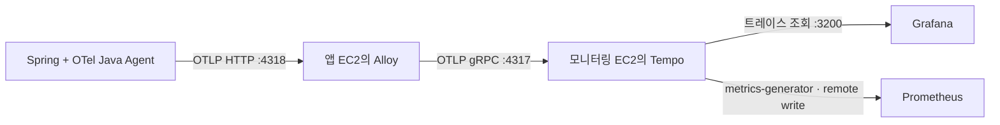

# Tempo 트레이스 수집

요청 하나에서 HTTP 처리와 JDBC 호출에 걸린 시간을 확인하기 위한 구성이다.
이 문서는 데이터 생성·전송·저장과 Grafana 데이터 소스를 설명한다. Canvas 화면의 의미와
한계는 [Grafana Canvas](CANVAS.md)에 둔다.
선택 배경은 [인프라 ADR 0003](../adr/0003-tempo-tracing.md)에 있다.

## 데이터 흐름



Java Agent `2.32.0`은 [백엔드 Dockerfile](../../../backend/Dockerfile)에 버전과 SHA-256을 고정해
포함한다. 실행 시 다운로드하지 않는다. Dockerfile의 `JAVA_TOOL_OPTIONS`가 컨테이너 이미지에서
Agent를 활성화하며, 필요하면 실행 환경에서 `OTEL_SDK_DISABLED=true`로 전송을 끈다.
IDE나 기존 `bootRun` 실행에는 자동으로 붙지 않는다. 애플리케이션 코드나 Gradle 의존성은 바꾸지 않는다.

Agent의 메트릭·로그 exporter는 `none`이다. 기존 Micrometer → Prometheus와 Docker 로그 → Loki
경로를 그대로 사용하고 OTLP로는 트레이스만 보낸다. 지원하는 라이브러리를 자동 계측하는 방식이며,
모든 업무 메서드가 각각 span으로 기록되는 것은 아니다.

Alloy에서 `url.query`·`url.fragment`를 제거하고 `url.full`·기존 HTTP URL 속성의 query와 fragment도
잘라낸다. OAuth callback의 `code`·`state`가 Tempo에 남지 않게 하기 위해서다. 정제 오류가 나면 해당
payload를 전송하지 않는다. 헤더·본문 수집은 활성화하지 않고 SQL은 Agent의 기본 정제 기능을 유지한다.

## 주소와 환경 구분

| 설정 | 값과 의미 |
| --- | --- |
| 앱 → Alloy | `http://host.docker.internal:4318`, OTLP `http/protobuf` |
| Alloy → Tempo | 필수 `TEMPO_OTLP_ENDPOINT=<monitoring-private-ip>:4317`, scheme 없는 gRPC 주소 |
| Grafana → Tempo | Compose 내부 주소 `http://tempo:3200`, 데이터 소스 UID `tempo` |
| `service.name` | `jarihana` |
| `deployment.environment.name` | 앱 Compose에 고정한 `dev` 또는 `prod` |
| `service.instance.id` | 해당 앱 EC2의 `HOST_ID` |
| `service.version` | `BACKEND_TAG` |

앱 컨테이너는 bridge 네트워크이고 Alloy는 host 네트워크다. `extra_hosts`의
`host.docker.internal:host-gateway`로 호스트에 도달한다. 이 이름은 호스트 loopback을 의미하지
않으므로 Alloy의 OTLP HTTP receiver는 `0.0.0.0:4318`에서 듣는다. **앱 EC2의 4318은 인터넷이나
다른 EC2에 개방하지 않는다.** 호스트 방화벽을 사용한다면 앱 Docker 네트워크에서 오는 연결만 허용한다.
Alloy 관리 포트 `12345`와 앱 관리 포트 `8081`의 loopback 제한은 유지한다.

모니터링 EC2의 `4317`은 `MONITORING_BIND_ADDRESS`에 지정한 사설 IP에만 공개하고 앱 EC2의
보안 그룹에서만 접근하도록 설정한다. 초기 OTLP 구간에는 TLS·인증이 없으므로 신뢰하는 사설망에서만
사용한다. Tempo 조회 API `3200`은 호스트 loopback에만 공개한다.

## 실행 순서

1. 모니터링 EC2에서 먼저 Tempo를 시작한다.

   ```bash
   cd infra/monitoring
   docker compose config --quiet
   docker compose run --rm --no-deps tempo -config.file=/etc/tempo/config.yaml -config.verify=true
   docker compose up -d tempo prometheus grafana
   curl --fail http://127.0.0.1:3200/ready
   ```

   Tempo 초기 준비에는 시간이 걸릴 수 있다. Tempo 2.10.8 이미지는 `/var/tempo`를 UID/GID
   `10001:10001` 소유로 준비하므로 새 `tempo-data` 볼륨은 별도 초기화 컨테이너 없이 사용한다.
   기존 볼륨을 옮겨 사용하는 경우에는 소유권이 일치하는지 확인한다.
   Tempo 본체는 해당 non-root 사용자로 실행한다. 설정 파일은 읽기 전용 마운트다.

2. 각 앱 EC2의 `infra/.env`에 `TEMPO_OTLP_ENDPOINT`를 추가하고 **Agent가 포함된 새 이미지**를 준비한다.
   기존 이미지에는 Agent 파일이 없으므로 Compose만 갱신하면 JVM이 시작하지 못한다.

   ```bash
   export BACKEND_TAG="$(git rev-parse HEAD)"
   docker build -t "jarihana-backend-dev:${BACKEND_TAG}" ./backend
   docker compose --env-file infra/.env -f infra/docker-compose.dev.yml config --quiet
   docker compose --env-file infra/.env -f infra/docker-compose.dev.yml run --rm --no-deps alloy validate /etc/alloy/config.alloy
   docker compose --env-file infra/.env -f infra/docker-compose.dev.yml up -d --no-build --force-recreate backend alloy
   ```

   prod는 이미지 이름 `jarihana-backend`와 `infra/docker-compose.yml`을 사용한다.
   현재 GitHub 배포 workflow의 dev·prod Variables에도 `TEMPO_OTLP_ENDPOINT`를 넣는다.
   향후 CodeBuild/CodeDeploy로 옮겨도 이미지 빌드와 이 입력 전달은 필요하다.
   백엔드 배포는 인프라 파일 변경만으로 시작하지 않는다. 모니터링 스택은 별도
   [자동 배포 workflow](../../../.github/workflows/monitoring-deploy.yml)가 `main`의
   `infra/monitoring/**` 변경에 반응해 배포한다.

## 실제 요청으로 확인

개발 API에 읽기 요청을 보내고, Grafana Explore에서 Tempo를 선택해 최근 15분 범위로 조회한다.

```traceql
{ resource.service.name = "jarihana" && resource.deployment.environment.name = "dev" }
```

트레이스가 열리면 HTTP server span과 그 아래 JDBC client span이 같은 trace ID에 연결되는지 확인한다.
`/ready` 성공은 이 수신 확인을 대신하지 않는다. 운영 환경은 조건의 `dev`를 `prod`로 바꾼다.
`http.request.id`는 기존 로그 검색용 식별자이며 trace ID와 별개다. 로그에서 trace ID로 이동하는 UI 연결은
이번 구성에 포함하지 않는다.

Prometheus에서는 다음 쿼리로 span 지표의 전달을 확인한다.

```promql
traces_spanmetrics_calls_total{service="jarihana"}
```

service-graphs와 span-metrics processor를 켰고 환경 속성도 dimension으로 지정했다.
이 지표는 **Tempo가 받은 span의 집계**다. 전체 HTTP 요청률의 기준은 기존 Micrometer 지표이며,
호출 오류가 DB 서버 자체의 장애를 증명하지는 않는다. Canvas는 최근 흐름을 요약하지만
자동 서비스맵과 별도 DB 내부 상태 점검은 후속 범위다.

## 보관과 유실 범위

- Tempo `2.10.8`은 Kafka 없이 실행하는 단일 프로세스 구성이다. WAL·블록·metrics-generator WAL을
  모두 `tempo-data:/var/tempo`에 보관한다. 컨테이너 교체 시 같은 프로젝트·볼륨을 유지한다.
- 보관 기간은 `168h`(7일)이며 compactor 처리와 삭제 지연이 더해진다. 전체 디스크의 용량 상한은 아니다.
  로컬 디스크 소실에 대비한 백업·복원과 실제 AWS 수용량 검증은 별도로 필요하다.
- 초기 샘플링은 `parentbased_always_on`이다. 부모가 없는 요청은 모두 기록하고 부모의 샘플링 결정을
  이어받는다. Actuator 요청도 span이 생길 수 있어 수집량·CPU·메모리를 측정한 뒤 정책을 조정한다.
- 앱 Alloy의 `256m` 제한은 유지한다. 트레이스 memory limiter는 `192MiB`, spike는 `48MiB`로 두었다.
  프로세스 메모리를 보고 OTLP 수신을 제한하지만 기존 `prometheus.*`·`loki.*` 경로까지 제한하지는 않는다.
- OTLP batch는 최대 512 span, 전송 큐는 128개 batch, 실패 재시도는 최대 5분이다. 큐는 메모리에 있으므로
  Alloy 종료·장애 장기화·한도 초과 시 유실될 수 있다. `alloy-data`가 트레이스 전송 큐까지 영속화하지는 않는다.
- 모니터링 서비스에는 컨테이너별 메모리 제한을 추가하지 않았다. 트레이스 보관·색인·지표 생성에 드는
  자원은 기존 Prometheus·Loki·Grafana와 같은 EC2에서 나눠 쓴다.

## 로컬 검증 기록 — 2026-10-09

실제 백엔드 Dockerfile로 이미지를 빌드하고 별도 Compose 프로젝트에서 다음을 확인했다.

| 확인 항목 | 결과 |
| --- | --- |
| 설정 검증 | dev·prod Compose 렌더링, Alloy validate, Tempo config.verify, Prometheus promtool 통과 |
| 실제 API 요청 | `GET /api/groups?size=1`이 200을 반환하고 HTTP → Repository → Hibernate·JDBC의 5개 span을 같은 trace ID로 조회 |
| 저장소 유지 | Tempo 컨테이너를 재생성한 뒤에도 기존 trace와 span 조회 성공 |
| 조회·지표 연결 | Grafana Tempo 데이터 소스 health 정상, Prometheus에 dev 환경의 span·DB 호출 지표 도착 |
| URL 개인정보 제거 | OAuth callback에 넣은 테스트용 code·state가 저장된 span에서 제거되고 HTTP span은 유지됨 |
| 기존 수집 경로 | 백엔드 Prometheus `up=1`, Loki에서 앱 요청 완료 로그 조회 성공 |

로컬 환경은 Docker Desktop의 bridge 네트워크와 별도 PostgreSQL 컨테이너를 사용했다.
Slack 알림은 이 검증 프로젝트에서 비활성화했다. EC2의 host 네트워크·보안 그룹·RDS 연결과
운영 부하에서의 수용량은 검증하지 않았으며, AWS에는 배포하지 않았다.

## 참고

- [OpenTelemetry Java Agent 설정](https://opentelemetry.io/docs/zero-code/java/agent/configuration/)
- [Tempo 2.10.8 릴리스](https://github.com/grafana/tempo/releases/tag/v2.10.8)
- [Tempo 서비스 그래프 설정](https://grafana.com/docs/tempo/latest/metrics-from-traces/service_graphs/enable-service-graphs/)
