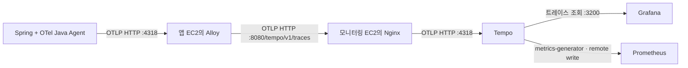

# Tempo 트레이스 선택 구성

요청 하나에서 HTTP 처리와 JDBC 호출에 걸린 시간을 trace로 확인해야 할 때 켜는 선택 구성이다.
기본 모니터링과 서비스 토폴로지는 Tempo 없이 동작한다. DB 호출량과 DB p95는 백엔드 Actuator의
`jdbc_query_seconds_*` Prometheus 지표로 계산한다.
이 문서는 데이터 생성·전송·저장과 Grafana 데이터 소스를 설명한다. Canvas 화면의 의미와
한계는 [Grafana Canvas](CANVAS.md)에 둔다.
선택 배경은 [인프라 ADR 0003](../adr/0003-tempo-tracing.md), 기본 비활성 결정은
[인프라 ADR 0004](../adr/0004-disable-tempo-by-default.md)에 있다.

## 데이터 흐름



Java Agent `2.32.0`은 선택 구성에서만 사용한다. 백엔드 이미지에 Agent 파일이 포함되어 있더라도
기본 실행에서는 `OTEL_SDK_DISABLED=true`로 Agent를 끄고 trace exporter와 Tempo 전송을 켜지 않는다.
trace가 필요할 때만 실행 환경에서 `OTEL_SDK_DISABLED=false`와 OTLP trace 설정을 함께 지정한다.
IDE나 기존 `bootRun` 실행에는 자동으로 붙지 않는다. trace를 켜기 위해 업무 코드에 별도 span을 먼저 추가하지는 않는다.

Agent의 메트릭·로그 exporter는 `none`이다. 기존 Micrometer → Prometheus와 Docker 로그 → Loki
경로를 그대로 사용하고 OTLP로는 트레이스만 보낸다. 지원하는 라이브러리를 자동 계측하는 방식이며,
모든 업무 메서드가 각각 span으로 기록되는 것은 아니다.

Alloy에서 `url.query`·`url.fragment`를 제거하고 `url.full`·기존 HTTP URL 속성의 query와 fragment도
잘라낸다. OAuth callback의 `code`·`state`가 Tempo에 남지 않게 하기 위해서다. 정제 오류가 나면 해당
payload를 전송하지 않는다. 헤더·본문 수집은 활성화하지 않고 SQL은 Agent의 기본 정제 기능을 유지한다.

## 주소와 환경 구분

| 설정 | 값과 의미 |
| --- | --- |
| 앱 → Alloy | `http://host.docker.internal:4318`, OTLP `http/protobuf` |
| Alloy → Nginx → Tempo | 선택 구성에서 `TEMPO_OTLP_ENDPOINT=http://<monitoring-private-ip>:8080/tempo`, OTLP HTTP 기본 주소 |
| Grafana → Tempo | 선택 구성에서 Compose 내부 주소 `http://tempo:3200`, 데이터 소스 UID `tempo` |
| `service.name` | `jarihana` |
| `deployment.environment.name` | 앱 Compose에 고정한 `dev` 또는 `prod` |
| `service.instance.id` | 해당 앱 EC2의 `HOST_ID` |
| `service.version` | `BACKEND_TAG` |

앱 컨테이너는 bridge 네트워크이고 Alloy는 host 네트워크다. `extra_hosts`의
`host.docker.internal:host-gateway`로 호스트에 도달한다. 이 이름은 호스트 loopback을 의미하지
않으므로 Alloy의 OTLP HTTP receiver는 `0.0.0.0:4318`에서 듣는다. **앱 EC2의 4318은 인터넷이나
다른 EC2에 개방하지 않는다.** 호스트 방화벽을 사용한다면 앱 Docker 네트워크에서 오는 연결만 허용한다.
Alloy 관리 포트 `12345`와 앱 관리 포트 `8081`의 loopback 제한은 유지한다.

Alloy는 `otelcol.exporter.otlphttp`를 사용하며 `TEMPO_OTLP_ENDPOINT`에 `/v1/traces`를 자동으로
추가한다. endpoint에는 `/tempo`까지 넣고 `/v1/traces`를 중복해서 넣지 않는다.
모니터링 EC2의 Nginx `8080`을 `MONITORING_BIND_ADDRESS`의 사설 IP에 bind하고, 정확히 일치하는
`POST /tempo/v1/traces`에서 `/tempo`를 제거해 Compose 내부 Tempo HTTP receiver `4318`의
`/v1/traces`로 전달하는 설정을 선택 구성에서만 적용한다. 기본 Nginx 설정은 이 경로를 `404`로 막는다.
Nginx는 RFC1918 사설 IPv4와 loopback만 허용하고 나머지 출발지를 거부한다.
알 수 없는 경로는 `404`, 허용 경로의 POST 외 메서드는 `403`으로 응답한다.
보안 그룹·라우팅도 앱 EC2의 사설 접근만 허용하는지 확인한다. 사설 IP bind만으로 인터넷 차단을 보장하지 않는다.
초기 OTLP 구간에는 TLS·인증이 없으므로 신뢰하는 사설망에서만 사용한다. Tempo `4317`은 호스트에
publish하지 않으며 조회 API `3200`은 호스트 loopback에만 공개한다. Grafana는 `http://tempo:3200`으로 직접 조회한다.

## 실행 순서

1. 기본 모니터링 스택이 정상 동작하는지 먼저 확인한다. Tempo를 켜려면 Compose `tracing` profile로
   Tempo 서비스를 올리는 것만으로는 부족하다. 기본 구성에서 빠져 있는 다음 항목을 같이 복원한다.

   - Grafana provisioning의 `deleteDatasources`에서 Tempo를 제거하고 Tempo 데이터 소스를 다시 등록한다.
   - Nginx의 `/tempo/v1/traces` 경로를 `404` 대신 `proxy_pass http://tempo:4318/v1/traces`로 되돌린다.
   - Prometheus의 Tempo scrape job 주석을 해제한다.
   - 앱 Alloy의 주석 처리된 OTLP receiver, privacy transform, batch, Tempo exporter pipeline을 되살린다.
   - 앱 배포 환경에 `TEMPO_OTLP_ENDPOINT=http://<monitoring-private-ip>:8080/tempo`와 백엔드 OTel 설정을 넣는다.

   ```bash
   cd infra/monitoring
   docker compose config --quiet
   docker compose run --rm --no-deps tempo -config.file=/etc/tempo/config.yaml -config.verify=true
   docker compose --profile tracing up -d
   curl --fail http://127.0.0.1:3200/ready
   ```

   Tempo 초기 준비에는 시간이 걸릴 수 있다. Tempo 2.10.8 이미지는 `/var/tempo`를 UID/GID
   `10001:10001` 소유로 준비하므로 새 `tempo-data` 볼륨은 별도 초기화 컨테이너 없이 사용한다.
   기존 볼륨을 옮겨 사용하는 경우에는 소유권이 일치하는지 확인한다.
   Tempo 본체는 해당 non-root 사용자로 실행한다. 설정 파일은 읽기 전용 마운트다.

2. 수동 실행 시 각 앱 EC2의 `infra/.env`에 trace 관련 값을 추가하고 백엔드 이미지를 준비한다.
   기본 모니터링 배포에는 이 변수들이 필요하지 않다.

   ```env
   TEMPO_OTLP_ENDPOINT=http://<monitoring-private-ip>:8080/tempo
   OTEL_SDK_DISABLED=false
   OTEL_TRACES_EXPORTER=otlp
   OTEL_EXPORTER_OTLP_ENDPOINT=http://host.docker.internal:4318
   OTEL_EXPORTER_OTLP_PROTOCOL=http/protobuf
   OTEL_SERVICE_NAME=jarihana
   OTEL_RESOURCE_ATTRIBUTES=deployment.environment.name=<dev|prod>,service.instance.id=<HOST_ID>,service.version=<BACKEND_TAG>
   ```

   메트릭·로그는 기존 경로를 유지하므로 `OTEL_METRICS_EXPORTER=none`, `OTEL_LOGS_EXPORTER=none`을 함께
   유지한다. 샘플링 정책을 바꾸려면 `OTEL_TRACES_SAMPLER`와 관련 인자를 별도로 조정한다.

   ```bash
   export BACKEND_TAG="$(git rev-parse HEAD)"
   docker build -t "jarihana-backend-dev:${BACKEND_TAG}" ./backend
   docker compose --env-file infra/.env -f infra/docker-compose.dev.yml config --quiet
   docker compose --env-file infra/.env -f infra/docker-compose.dev.yml run --rm --no-deps alloy validate /etc/alloy/config.alloy
   docker compose --env-file infra/.env -f infra/docker-compose.dev.yml up -d --no-build --force-recreate backend alloy
   ```

   prod는 이미지 이름 `jarihana-backend`와 `infra/docker-compose.yml`을 사용한다.
   기본 GitHub dev·prod 배포 workflow는 Tempo 전송을 켜지 않는다. trace 선택 구성을 배포할 때만
   기존 repository variable `MONITORING_BIND_ADDRESS`와 `8080/tempo`로 `TEMPO_OTLP_ENDPOINT`를 만들고,
   위 OTel 변수들을 함께 주입한다. 수집용 도메인·DNS·`extra_hosts`는 필요 없다.
   앱 Compose·앱 Alloy 설정 변경은 백엔드 배포를 실행하며 `infra/docs/**`만 바뀌면 실행하지 않는다. 모니터링 스택은 별도
   [자동 배포 workflow](../../../.github/workflows/monitoring-deploy.yml)가 `develop`의
   `infra/monitoring/**` 변경에 반응해 배포한다.

## 실제 요청으로 확인

개발 API에 읽기 요청을 보내고, Grafana Explore에서 Tempo를 선택해 최근 15분 범위로 조회한다.

```traceql
{ resource.service.name = "jarihana" && resource.deployment.environment.name = "dev" }
```

트레이스가 열리면 HTTP server span과 그 아래 JDBC client span이 같은 trace ID에 연결되는지 확인한다.
`/ready` 성공은 이 수신 확인을 대신하지 않는다. 운영 환경은 조건의 `dev`를 `prod`로 바꾼다.
`http.request.id`는 기존 로그 검색용 식별자이며 trace ID와 별개다. 로그에서 trace ID로 이동하는 UI 연결은
이번 구성에 포함하지 않는다.

Prometheus에서는 다음 쿼리로 span 지표의 전달을 확인한다.

```promql
traces_spanmetrics_calls_total{service="jarihana"}
```

선택 구성에서는 service-graphs와 span-metrics processor를 켜고 환경 속성도 dimension으로 지정한다.
이 지표는 **Tempo가 받은 span의 집계**다. 전체 HTTP 요청률의 기준은 기존 Micrometer 지표이며,
호출 오류가 DB 서버 자체의 장애를 증명하지는 않는다. 기본 Canvas는 `jdbc_query_seconds_*`와
HikariCP 지표로 최근 흐름을 요약하지만
자동 서비스맵과 별도 DB 내부 상태 점검은 후속 범위다.

## 보관과 유실 범위

- 선택 구성의 Tempo `2.10.8`은 Kafka 없이 실행하는 단일 프로세스 구성이다. WAL·블록·metrics-generator WAL을
  모두 `tempo-data:/var/tempo`에 보관한다. 컨테이너 교체 시 같은 프로젝트·볼륨을 유지한다.
- 보관 기간은 `168h`(7일)이며 compactor 처리와 삭제 지연이 더해진다. 전체 디스크의 용량 상한은 아니다.
  로컬 디스크 소실에 대비한 백업·복원과 실제 AWS 수용량 검증은 별도로 필요하다.
- 초기 샘플링은 `parentbased_always_on`이다. 부모가 없는 요청은 모두 기록하고 부모의 샘플링 결정을
  이어받는다. Actuator 요청도 span이 생길 수 있어 수집량·CPU·메모리를 측정한 뒤 정책을 조정한다.
- 앱 Alloy의 `256m` 제한은 유지한다. 트레이스 memory limiter는 `192MiB`, spike는 `48MiB`로 두었다.
  프로세스 메모리를 보고 OTLP 수신을 제한하지만 기존 `prometheus.*`·`loki.*` 경로까지 제한하지는 않는다.
- Nginx가 중단되면 앱 Alloy의 전송 재시도가 발생한다. 모니터링 스택 배포·수신 확인 후 앱 Alloy를 갱신한다.
- OTLP batch는 최대 512 span, 전송 큐는 128개 batch, 실패 재시도는 최대 5분이다. 큐는 메모리에 있으므로
  Alloy 종료·장애 장기화·한도 초과 시 유실될 수 있다. `alloy-data`가 트레이스 전송 큐까지 영속화하지는 않는다.
- 모니터링 서비스에는 컨테이너별 메모리 제한을 추가하지 않았다. Tempo 선택 구성은
  `GOMEMLIMIT: 250MiB`를 사용하지만 컨테이너 전체 메모리 강제 상한은 아니다. 트레이스 보관·색인·지표 생성에 드는
  자원은 기존 Prometheus·Loki·Grafana와 같은 EC2에서 나눠 쓴다.

## 로컬 검증 기록 — 2026-10-09

아래는 Nginx 도입 전 gRPC 전송 구성의 과거 기록이며 현재 OTLP HTTP 경로의 검증 결과는 아니다.
당시 실제 백엔드 Dockerfile로 이미지를 빌드하고 별도 Compose 프로젝트에서 다음을 확인했다.

| 확인 항목 | 결과 |
| --- | --- |
| 설정 검증 | dev·prod Compose 렌더링, Alloy validate, Tempo config.verify, Prometheus promtool 통과 |
| 실제 API 요청 | `GET /api/groups?size=1`이 200을 반환하고 HTTP → Repository → Hibernate·JDBC의 5개 span을 같은 trace ID로 조회 |
| 저장소 유지 | Tempo 컨테이너를 재생성한 뒤에도 기존 trace와 span 조회 성공 |
| 조회·지표 연결 | Grafana Tempo 데이터 소스 health 정상, Prometheus에 dev 환경의 span·DB 호출 지표 도착 |
| URL 개인정보 제거 | OAuth callback에 넣은 테스트용 code·state가 저장된 span에서 제거되고 HTTP span은 유지됨 |
| 기존 수집 경로 | 백엔드 Prometheus `up=1`, Loki에서 앱 요청 완료 로그 조회 성공 |

로컬 환경은 Docker Desktop의 bridge 네트워크와 별도 PostgreSQL 컨테이너를 사용했다.
Slack 알림은 이 검증 프로젝트에서 비활성화했다. EC2의 host 네트워크·보안 그룹·RDS 연결과
운영 부하에서의 수용량은 검증하지 않았으며, AWS에는 배포하지 않았다.

## 참고

- [OpenTelemetry Java Agent 설정](https://opentelemetry.io/docs/zero-code/java/agent/configuration/)
- [Tempo 2.10.8 릴리스](https://github.com/grafana/tempo/releases/tag/v2.10.8)
- [Tempo 서비스 그래프 설정](https://grafana.com/docs/tempo/latest/metrics-from-traces/service_graphs/enable-service-graphs/)
