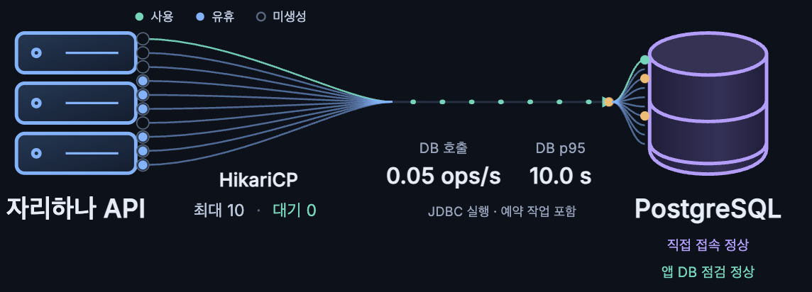

# dev 푸시 워커 지연 분석: 문제 → 해결 → 결과

- 조사일: 2026-10-16, 시각은 별도 표기가 없으면 KST
- 대상: dev 백엔드와 temporal RDS의 `jarihana_dev`
- 조사 당시 앱 이미지: `345257f266fee5ea3bd68b7429861f280d69af0d`
- 문서 상태: **Before 분석과 워커 중지 결과까지 확인. 쿼리 개선·테스트 데이터 정리는 미실행.**

## 1. 문제: 한 건을 선점하는 쿼리가 대량 데이터를 읽는다

푸시 전송 대기가 약 288만 행 쌓인 상태에서, 워커가 한 건을 선택하려고 전송 대기와 알림을 전체 스캔하고 조인·정렬하는 실행계획을 사용했다. 실제 실행 중인 쿼리는 19.5초 동안 진행 중이었고, DB 데이터 파일 읽기를 기다리며 앱 커넥션을 점유했다.

이는 해당 시점의 **푸시 워커 연결 점유 원인**이다. 앞서 별도로 발생한 신규 DB 연결 타임아웃의 근본 원인까지 확인한 것은 아니다.

### 1.1 Before 사진



- 사용자 제공 파일: `스크린샷 2026-10-16 17.05.32.png`
- 파일명 기준 시각: 2026-10-16 17:05:32. 화면 자체에는 환경·측정 구간이 표시돼 있지 않다.
- 표시값: DB 호출 `0.05 ops/s`, DB p95 `10.0 s`, 풀 최대 `10`, 풀 대기 `0`, 직접 접속·앱 DB 점검 정상.
- DB 호출과 p95는 최근 2분 JDBC 실행 지표의 집계다. `0.05 ops/s`가 특정 SQL의 실행 빈도라는 뜻은 아니다.
- `p95 10초`는 개별 쿼리의 정확한 실행시간이 아니다. 별도로 관측한 실행 중 SQL의 19.5초와 구분한다.
- 이 사진은 현상 설명용 Before 증거다. 쿼리 성능 개선의 정량 비교에는 같은 데이터·트래픽·측정 구간의 실행시간과 실행계획이 추가로 필요하다.

### 1.2 커넥션 누수와 반복 점유의 구분

| 확인 항목 | 조사 중 관측값 | 해석과 한계 |
| --- | --- | --- |
| 풀 상태 | 사용 1, 유휴 9, 대기 0, 최대 10 | 해당 관측 시점에 풀 전체가 소진된 상태는 아님 |
| 최근 3분 사용량 최소 / 최대 | 0 / 1 | 연결이 모두 반환된 시점이 있음 |
| 최근 3분 연결 반환 횟수 | 약 201.6회 | `increase` 추정값이며, 같은 연결이 영구적으로 미반환됐다는 설명과 맞지 않음 |
| 최근 3분 반환된 연결의 사용시간 합계 | 156.456초 | 완료된 대여의 누적 사용시간. 구간 전체의 정확한 점유율이나 특정 SQL의 사용시간은 아님 |
| 연결 사용시간 max | 30.106초 | 조회 당시 Hikari 타이머의 최대값. 현재 진행 중인 점유 시간이나 특정 쿼리 시간은 아님 |
| JDBC 실행시간 max | 14.586초 | 조회 당시 JDBC 타이머 최대값. 실행 중 SQL을 별도 확인한 19.5초와 측정 대상·시점이 다름 |
| `idle in transaction` | 0 | DB 수집 시점에 열린 트랜잭션을 둔 채 쉬는 세션은 관측되지 않음 |

풀 시각화의 슬롯은 물리 커넥션 ID가 아니다. 화면에서 같은 슬롯이 사용 중으로 보여도 같은 연결이 계속 미반환 상태라는 뜻은 아니다.

### 1.3 점유 주체: JVM 스레드와 실행 중 SQL이 일치

dev EC2에서 `jcmd 1 Thread.print`로 확인한 호출 경로:

```text
scheduling-1
  PushWorkerSchedulingConfig.dispatchDuePushes
  PushDeliveryWorker.processDue
  PushDeliveryLeaseService.claimNext
  PushDeliveryWorkRepository.claimNext
  claimNextRow
  PgPreparedStatement.executeQuery
  PostgreSQL 응답을 기다리는 소켓 읽기
```

같은 조사에서 RDS의 `pg_stat_activity`를 조회했다.

| 항목 | 실제 관측값 |
| --- | --- |
| PID | 1644 |
| 앱 이름 | `PostgreSQL JDBC Driver` |
| 상태 | `active` |
| 쿼리 경과시간 | `00:00:19.500809` |
| 트랜잭션 경과시간 | `00:00:19.502211` |
| 대기 유형 / 이벤트 | `IO / DataFileRead` |
| 차단 세션 | `pg_blocking_pids(pid) = {}` |
| 실행 SQL | `WITH candidate ... UPDATE notification_deliveries ... RETURNING ...` |

`DataFileRead`는 관계 데이터 파일의 읽기를 기다리는 상태다. 이 관측은 DB 읽기 대기를 뒷받침하며, RDS 스토리지 성능 저하나 메모리 부족을 단독으로 입증하지는 않는다. [PostgreSQL 공식 문서](https://www.postgresql.org/docs/16/monitoring-stats.html)

PID와 경과시간은 당시 스냅샷이다. 다른 시점에도 같은 PID·시간이 유지된다는 뜻은 아니다.

### 1.4 데이터 규모와 테스트 구독 적체

`pg_stat_user_tables`에서 확인한 값이다. `n_live_tup`, `n_dead_tup`은 정확한 `COUNT(*)` 결과가 아닌 통계 추정값이다.

| 테이블 | 추정 행 수 | 추정 dead tuple | 테이블 본체 크기 |
| --- | ---: | ---: | ---: |
| `notification_deliveries` | 2,883,146 | 86 | 322 MB |
| `notifications` | 2,894,113 | 0 | 391 MB |
| `push_subscriptions` | 1,006 | 26 | 504 kB |

`pg_stats`의 전송 대기 상태 분포:

| 상태 | 통계 비율 |
| --- | ---: |
| `PENDING` | 99.56% |
| `FAILED` | 약 0.4133% |
| `CANCELLED` | 약 0.0267% |

구독 URL 전체나 토큰을 출력하지 않고 호스트만 집계했다.

| 구독 호스트 | 건수 |
| --- | ---: |
| `reserved.invalid` | 999 |
| `web.push.apple.com` | 5 |
| `fcm.googleapis.com` | 2 |

발송 예정 시각·ID 순서로 대기열 앞부분 5건을 조회한 결과:

- 모두 `PENDING`이며 `reserved.invalid` 구독에 연결돼 있었다.
- 생성·발송 예정 시각은 모두 `2026-10-15 20:41:40.787504`였다.
- 만료 시각은 `2026-10-16 20:41:40.787504`, 시도 횟수는 0이었다.
- 해당 구독은 활성 상태이고 구독 세대도 일치했으며 알림은 삭제되지 않았다.
- ID가 가장 큰 전송 대기 3건의 생성시각은 `2026-10-16 14:12:09.084251`이었다.

이는 테스트용 구독과 대기 작업이 남아 있음을 뒷받침한다. **288만 행 전체가 테스트 데이터라는 뜻은 아니며, 생성한 요청·테스트 실행까지 추적한 것은 아니다.**

### 1.5 인덱스는 존재하지만 선점 계획은 전체 스캔을 선택

DB에서 다음 인덱스가 존재하는 것을 확인했다.

| 인덱스 | 키와 대상 |
| --- | --- |
| `idx_notification_deliveries_due` | `(next_attempt_at, id)`, 상태가 `PENDING` 또는 `RETRY`인 행 |
| `idx_notification_deliveries_expired_lease` | `(locked_until, id)`, 상태가 `IN_FLIGHT`인 행 |
| `idx_notification_deliveries_subscription_unfinished` | `(push_subscription_id, subscription_generation)`, 미완료 행 |
| `notification_deliveries_pkey` | 전송 대기 ID |
| `notifications_pkey` | 알림 ID |
| `push_subscriptions_pkey` | 구독 ID |

선점 쿼리는 다음 두 대상을 `OR`로 함께 찾고, 알림·구독을 조인한 뒤 정렬한다.

```sql
WHERE (d.status IN ('PENDING', 'RETRY') AND d.next_attempt_at <= :now)
   OR (d.status = 'IN_FLIGHT' AND d.locked_until <= :now)
ORDER BY d.next_attempt_at, d.id
FOR UPDATE OF d SKIP LOCKED
LIMIT 1
```

실행 중 SQL과 같은 구조·타입의 파라미터를 넣어 `PREPARE` 후 `EXPLAIN EXECUTE`로 확인한 계획의 핵심:

```text
Update on notification_deliveries
  CTE candidate
    Limit                         rows=1
      LockRows
        Sort                      estimated rows=2,869,975
          Sort Key: next_attempt_at, id
          Hash Join               push_subscription_id = s.id
            Hash Join             notification_id = n.id
              Seq Scan on notification_deliveries
              Hash
                Seq Scan on notifications
            Hash
              Seq Scan on push_subscriptions
  Nested Loop
    CTE Scan on candidate
    Index Scan using notification_deliveries_pkey
```

- 후보 선정 단계는 전체 스캔·조인·정렬을 선택했다. 최종 UPDATE 대상 ID 조회에는 PK 인덱스를 사용하므로, SQL 전체가 모든 인덱스를 전혀 사용하지 않는다는 뜻은 아니다.
- 앱의 `Asia/Seoul` 시각 조건으로 후보 SELECT를 별도 `EXPLAIN`했을 때도 같은 전체 스캔·조인·정렬 형태였다.
- `LIMIT 1`이 있어도 한 건을 선택하기 전의 처리 비용은 남는다.
- 위 행 수는 계획 추정치다. `EXPLAIN ANALYZE`로 실제 처리 행 수·버퍼·정렬 spill을 측정한 것은 아니다.
- 정확히 어떤 조건이 계획 선택을 바꿨는지는 추가 비교가 필요하다. `OR` 하나만을 단독 원인으로 확정하지 않는다.

### 1.6 실행 환경에서 추가 확인한 사항

| 항목 | 확인값과 해석 |
| --- | --- |
| 워커 주기 | 실행이 끝난 뒤 기본 1,000ms 대기. #422 머지 전에도 같았음 |
| 워커 활성화 | 중지 전 `PUSH_ENABLED=true`, `PUSH_WORKER_ENABLED=true` |
| 외부 푸시 호출 | 워커 전체는 `NOT_SUPPORTED`, 선점·준비·완료는 각각 트랜잭션. 이번에 잡힌 스레드는 외부 발송이 아닌 선점 SQL에서 대기 |
| `work_mem` | 4,096 kB. 이것만으로 정렬 spill 발생을 확정할 수는 없음 |
| `shared_buffers` | 11,295 × 8 kB. 앱 JVM 힙과 다른 DB 설정값 |
| `effective_cache_size` | 46,162 × 8 kB. 실제 할당 메모리 측정값이 아닌 플래너 설정 |
| `plan_cache_mode` | `auto` |
| `pg_stat_statements` | 해당 DB의 설치된 extension 목록에서 발견되지 않음 |
| 테이블별 추가 지표 | 조회한 `pg_stat_user_tables`·`pg_statio_user_tables` 시계열은 Prometheus에서 반환되지 않아 SQL로 통계를 확인 |

전체 스캔·조인·정렬은 RDS가 수행한다. 앱이 약 288만 행을 모두 받아 JVM 메모리에 올리는 구조는 아니다. 앱은 응답을 기다리며 스레드·커넥션을 사용한다. 앱 OOM이나 RDS 메모리 고갈을 관측한 것은 아니다.

### 1.7 최근 변경·별도 장애와의 관계

| 항목 | 확인 결과 |
| --- | --- |
| [#365: PWA 웹푸시와 알림함](https://github.com/woowacourse-teams/2026-jarihana/pull/365) | 2026-10-06 도입. 1초 워커 설정은 이때부터 존재 |
| [#422: 알림 벌크 저장·워커 JPA 전환](https://github.com/woowacourse-teams/2026-jarihana/pull/422) | 10-15 20:22 머지. 워커 저장소를 JDBC에서 JPA native로 전환했지만 주기와 SQL의 주요 조건·트랜잭션 경계는 유지. 변경 전후 같은 데이터로 성능 비교하지 않아 회귀 원인이라고 확정할 수 없음 |
| [#412: Grafana 미사용 플러그인 비활성화](https://github.com/woowacourse-teams/2026-jarihana/pull/412) | Grafana 환경변수 1줄과 Tempo 복원 문서만 변경. 앱 JDBC·Hikari·워커·DB URL 변경 없음. 이번 선점 쿼리 지연의 원인이라는 근거 없음 |
| RDS URL | 10-16 15:08 일반 RDS로 변경 후 15:15 배포, 15:22 temporal로 복원 후 15:28 배포. 이후 16:29·16:39 배포도 temporal 사용 확인 |
| 16:32~16:33 신규 연결 장애 | `SocketTimeoutException: Connect timed out`, `PGStream.createSocket`에서 실패. 풀 실제 연결 1·유휴 0, 연결 획득 약 30초 타임아웃. 이번 SQL I/O 지연과 동일 원인이라고 확정하지 않음 |

초기에는 Grafana·Loki 지표로 원인을 좁혔으나 SQL 주체는 미확정이었다. 이후 사용자가 제공한 SSH 경로로 dev EC2에 접속해 JVM 스레드와 `pg_stat_activity`를 확인하면서 **푸시 워커의 선점 SQL**임을 확정했다. 앞선 AWS API 인증 오류는 SSH를 통한 이번 조사 자체를 막지 않았다.

관련 코드:

- [워커 스케줄](../../../backend/src/main/java/com/project/jarihana/notificationdelivery/config/PushWorkerSchedulingConfig.java)
- [워커 실행](../../../backend/src/main/java/com/project/jarihana/notificationdelivery/command/service/PushDeliveryWorker.java)
- [트랜잭션 경계](../../../backend/src/main/java/com/project/jarihana/notificationdelivery/command/service/PushDeliveryLeaseService.java)
- [선점 SQL](../../../backend/src/main/java/com/project/jarihana/notificationdelivery/command/repository/PushDeliveryWorkRepository.java)
- [JDBC 지표 계산](../../monitoring/grafana/topology/sync-dashboard.mjs)

## 2. 해결: 완료한 임시 조치와 남은 근본 개선

### 2.1 완료: dev 푸시 워커 중지

사용자 요청으로 GitHub `dev` Environment의 `PUSH_WORKER_ENABLED`를 `false`로 변경하고, 실행 중이던 이미지 태그 그대로 수동 재배포했다.

- 설정: `PUSH_ENABLED=true`, `PUSH_WORKER_ENABLED=false`
- 이미지: `ghcr.io/woowacourse-teams/jarihana-backend:345257f266fee5ea3bd68b7429861f280d69af0d`
- 새 컨테이너 시작: 2026-10-16 17:18:50 KST
- [적용 배포 및 점검 결과](https://github.com/woowacourse-teams/2026-jarihana/actions/runs/38872789660): 성공
- GitHub 환경변수로 저장했으므로, 이후 배포에서도 해당 변수를 유지하면 워커 중지가 유지된다.
- 이 조치는 느린 선점의 반복을 멈추는 임시 조치다. dev 푸시 발송도 중단된다.

### 2.2 미실행: 선점 쿼리 개선

목표는 여러 테이블의 대량 데이터를 먼저 조인·정렬하지 않고, 기존 인덱스로 후보를 좁힌 뒤 필요한 알림·구독만 확인하도록 만드는 것이다.

```text
Before: 대량 전송 대기·알림 읽기 → 조인 → 정렬 → 한 건 선택
After 목표: 인덱스로 후보 축소 → 선택한 후보의 알림·구독 확인 → 선점
```

구현 시 확인해야 할 조건:

- `PENDING`·`RETRY`와 만료된 `IN_FLIGHT` 복구를 인덱스에 맞게 조회하는 방법 비교.
- 다른 워커가 잡은 작업을 건너뛰는 `SKIP LOCKED`와 원자적 선점 유지.
- 정렬·선택 정책과 복구 작업의 처리 기회를 보존하고 기아가 생기지 않는지 검증.
- 삭제 알림, 비활성 구독, 구독 세대 불일치, 만료 작업의 취소·실패 정책 유지.
- lease 토큰·기한과 오래된 응답 차단, 재시도 상한 유지.
- 구현 후 실제 실행계획에서 후보 축소가 일어나는지 확인. 쿼리 모양 변경만으로 인덱스 사용이나 성능 개선을 보장하지 않음.

### 2.3 미실행: 테스트 전송 대기 정리

- `reserved.invalid` 구독과 연결된 작업을 정확히 집계하고 대상·상태를 먼저 제시한다.
- 사용자 확인 후 해당 테스트 작업만 작은 묶음으로 취소하는 방안을 적용한다.
- 실제 사용자 구독·발송 대기와 처리 이력을 보존한다. 전체 약 288만 행을 일괄 삭제·취소하지 않는다.
- 부하 테스트 종료 시 테스트 구독·전송 대기를 정리하는 절차도 검토한다.

## 3. 결과: 워커 중지로 연결 점유 해소, 쿼리 개선 결과는 아직 없음

### 3.1 실제 확인한 임시 조치 결과

| 항목 | 중지 전 관측 | 워커 중지 후 직접 확인 |
| --- | --- | --- |
| 워커 설정 | `true` | `false` |
| Hikari 사용 | 자주 1 | **0** |
| Hikari 유휴 | 9 | **10** |
| Hikari 대기 | 0 | **0** |
| 연결 획득 타임아웃 카운터 | 별도 시점의 장애 로그 존재 | 새 프로세스에서 **0**. 재시작으로 초기화되므로 누적 비교 불가 |
| JVM 스레드 | `scheduling-1`에서 `claimNextRow` 대기 | `scheduling-1`·푸시 워커 호출 스택 없음 |
| 앱 health | SQL 지연 조사 시 정상, 앞선 별도 연결 장애 때 실패 | **UP** |
| 배포 점검 | 해당 없음 | health·API 스모크·Alloy readiness 통과 |
| 전송 대기 데이터 | 약 288만 행의 적체 | 정리하지 않고 보존 |

확인한 지표:

```text
PUSH_ENABLED=true
PUSH_WORKER_ENABLED=false

hikaricp_connections_active   0
hikaricp_connections_idle    10
hikaricp_connections_pending  0
hikaricp_connections_max     10
health                       UP
```

이 결과는 워커가 앱의 반복 연결 점유 주체라는 조사 결과와 일치한다. 다만 앱 재시작이 함께 있었으므로, 중지 전후 모든 차이를 변수 하나만의 효과로 정량 해석하지 않는다.

### 3.2 쿼리 개선 Before → After 비교 시 채울 항목

**워커를 끄고 사용량이 0이 된 결과는 쿼리 성능 개선 결과가 아니다.**

| 비교 항목 | Before 근거 | 쿼리 개선 After |
| --- | --- | --- |
| 데이터 규모·상태 분포 | 약 288만 행, `PENDING` 99.56% | 동일한 데이터 또는 격리 복제 데이터에서 기록 필요 |
| 실행계획 | 후보 단계 전체 스캔·Hash Join·Sort | 후보 축소 방식과 인덱스 사용 확인 필요 |
| SQL 실행시간 | 진행 중인 한 건을 19.5초 시점에 관측. 완료시간은 아님 | 반복 측정한 완료시간과 분포 기록 필요 |
| 실제 읽기·버퍼·정렬 spill | 미측정 | 격리 환경에서 측정 필요 |
| JDBC p95·처리량 | 제공 사진에서 10초·0.05 ops/s | 워커를 켜고 동일 구간·트래픽에서 측정 필요 |
| 연결 사용시간·대기 | 장시간 대여 관측, 풀 대기는 해당 시점 0 | 개선 후 사용시간과 대기 확인 필요 |
| 기능·동시성 | 기존 테스트 존재 | 동시 선점·복구·재시도·오래된 응답 차단 검증 필요 |

테스트 데이터를 먼저 정리한 뒤 After를 측정하면 데이터 감소와 쿼리 개선의 효과가 섞인다. 개선 전 데이터를 보존한 격리 환경에서 쿼리 자체의 차이를 비교하고, 실제 dev 정리 효과는 별도로 기록한다.

### 3.3 남은 확인 사항과 작업 경계

- 약 288만 행 전체 중 테스트 작업의 정확한 비율·생성 경로는 미확인.
- #422 변경 전후 같은 데이터에서의 성능·계획 차이는 미확인.
- 정렬 spill, RDS IOPS·지연·캐시 상태가 실행시간에 기여한 정도는 미확인.
- 앞서 발생한 신규 TCP 연결 타임아웃의 인프라 원인은 미확인.
- 이번 조사에서는 DB의 읽기 전용 세션과 `EXPLAIN`을 사용했다. `EXPLAIN ANALYZE`로 UPDATE를 실행하지 않았다.
- 실제 변경은 사용자 요청에 따른 dev 워커 비활성화와 기존 이미지 재배포뿐이다. SQL 수정, 데이터 삭제·취소, RDS 설정 변경은 하지 않았다.
